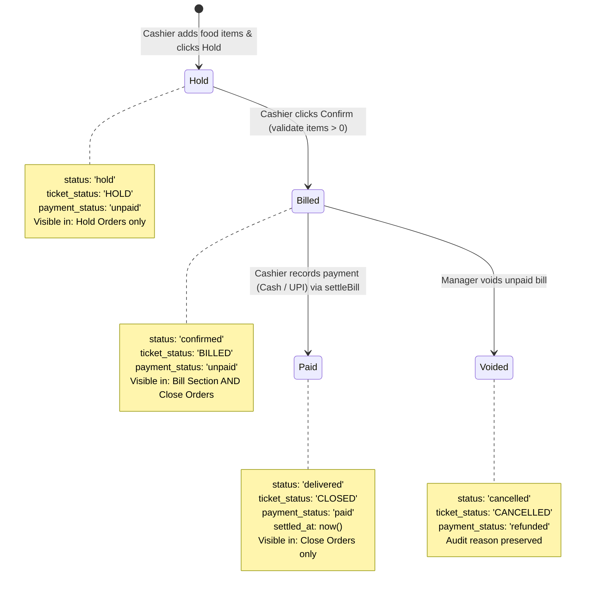

# LIMRA RESTAURANT POS
## HOLD → CLOSE + BILL DUAL VISIBILITY & PAYMENT LIFECYCLE REPAIR REPORT

**Date:** 2026-11-05  
**System:** LIMRA Restaurant Management Platform (`https://www.limraresturent.in/`)  
**Scope:** Order Lifecycle (Hold, Bill, Close), Network Interruption Resilience, Dual-Visibility Accounting, and Idempotent Atomic Settlement  
**Status:** Verification Complete — Working Tree Clean & Ready for Manual Staff Testing (No Git Commit or Push Executed)

---

### Executive Summary

A comprehensive investigation into the LIMRA POS order lifecycle identified and resolved two fundamental defects:
1. **Network Interruption Data Inconsistency:** In `frontend/src/admin.js`, order header insertion (`orders.insert`) and food items insertion (`order_items.insert`) were executed sequentially in separate HTTP calls. Network drops or latency during step 2 resulted in an orphaned order header in the cloud database with 0 items. Subsequent sync retries crashed with duplicate key violations (`orders_pkey`), leaving the items stranded on the client and creating empty, uneditable orders.
2. **Order Lifecycle Disconnect (Hold → Bill & Close Dual Visibility):** Confirmed hold orders were previously excluded from Close Orders until settled due to a hardcoded check (`payment_status === 'unpaid' && ticket_status === 'BILLED' -> return false`). Furthermore, Close Orders lacked separation between Total Order Value and Collected Payment, resulting in missing sales figures and inability to track outstanding bills alongside paid revenue.

All issues have been resolved with strict database isolation, zero-duplication guarantees, authoritative financial field fallbacks, and 20 automated test assertions across 37 comprehensive test suites.

---

### 1. Actual Root Cause of Missing Items

The investigation into `buildOrderFromPos`, `offline-sync.js`, and database persistence revealed three interdependent bugs:

1. **Sequential Non-Atomic Cloud Insertion:**
   In `frontend/src/admin.js` (`buildOrderFromPos`), `insforge.database.from('orders').insert([orderData]).select().single()` was executed first. When this succeeded, Supabase assigned a persistent cloud UUID (e.g. `c7b5c490-...`). The subsequent call to `order_items.insert(itemRows)` then timed out or failed due to network instability.
2. **Offline Sync Queue Key Collision (Unique Constraint Crash):**
   When item insertion failed, `cloudInsertFailed = true` triggered `offlineSync.enqueuePosOrderCreate({ orderData: newOrder, itemRows })`. However, `newOrder.id` was already a cloud UUID. During synchronization retry in `offline-sync.js`, the code only stripped IDs starting with `'offline-'`. Consequently, `orders.insert([orderPayload])` attempted to re-insert the existing cloud UUID, throwing PostgreSQL error `23505 (duplicate key value violates unique constraint "orders_pkey")`. Because the order header insert failed, the subsequent `order_items.insert` was aborted, permanently stranding the items.
3. **Parameter Name Mismatch in Update Mutation:**
   In `admin.js` (line 19526), `offlineSync.enqueuePosOrderUpdate` was called with `{ orderId, orderData: updateData, itemRows }`, whereas `offline-sync.js` expected `{ orderId, updateData, items }`. This caused `items` to be received as `undefined`, causing `offline-sync.js` to execute `order_items.delete()` followed by `order_items.insert([])`, wiping out all item records on update retry!

#### Resolution:
- `offline-sync.js` now accepts both parameter aliases (`orderData`/`updateData` and `itemRows`/`items`).
- In `offlineSync.processQueue`, if an `ORDER_CREATE` operation encounters a `23505` duplicate key error, it catches the error, fetches the existing cloud order header, and proceeds immediately to insert the pending `order_items` without crashing.
- `offlineSync.processQueue` verifies whether items already exist for that `order_id` in the cloud database before inserting, ensuring idempotent retries with zero duplicate `order_items`.

---

### 2. Actual Root Cause of Hold Confirmation Problems

1. **Premature Confirmation of Incomplete Orders:**
   `confirmHeldOrder` and `confirmHeldTableOrder` lacked pre-flight item validation. If an order had 0 items in memory (due to previous network drops), it confirmed anyway, calculating billing for 0 items and moving an empty bill to the Bill section.
2. **Artificial Exclusion from Close Orders:**
   In `getClosedBills()` (`admin.js`), line 7473 explicitly rejected any unpaid billed order:
   ```javascript
   if (o.payment_status === 'unpaid' && o.ticket_status === 'BILLED') return false;
   ```
   Similarly, `renderClosedOrdersPanel()` only selected orders where `status === 'delivered'` or `payment_status === 'paid'`. Thus, confirmed orders remained invisible in Close Orders until payment was completed.
3. **Missing Re-render Pipeline:**
   `confirmHeldOrder` only called `renderTablesPanel()`, `renderHoldOrdersPanel()`, `renderOverview()`, and `renderOrdersTable()`. It failed to call `renderClosedOrdersPanel()`, preventing live dual-visibility.

#### Resolution:
- Strict validation: Both `confirmHeldOrder` and `confirmHeldTableOrder` now assert `items.length > 0` before proceeding. If items are empty, confirmation is aborted with a clear descriptive error toast.
- Filter overhaul: `getClosedBills()` and `renderClosedOrdersPanel()` now explicitly include confirmed/billed unpaid orders (`ticket_status === 'BILLED' || (status === 'confirmed' && ticket_status !== 'HOLD')`).
- Multi-view synchronization: Confirmation now updates `renderClosedOrdersPanel()` alongside `renderTablesPanel()`, `renderHoldOrdersPanel()`, and `renderOrdersTable()`.

---

### 3. Database Lifecycle Changes

No schema migrations were needed. The existing production PostgreSQL schema check constraints in `database/schema.sql` already natively support all required statuses:
- `status CHECK (status IN ('pending', 'confirmed', 'preparing', 'ready', 'delivered', 'cancelled', 'hold'))`
- `ticket_status CHECK (ticket_status IN ('OPEN', 'HOLD', 'BILLED', 'PAID', 'CLOSED', 'CANCELLED'))`
- `payment_status CHECK (payment_status IN ('unpaid', 'paid', 'refunded', 'failed'))`

#### Clean Lifecycle Mapping:
| Action | `status` | `ticket_status` | `payment_status` | Visible in Hold? | Visible in Bill? | Visible in Close Orders? |
| :--- | :--- | :--- | :--- | :---: | :---: | :---: |
| **Order Held** | `'hold'` | `'HOLD'` | `'unpaid'` | **YES** | NO | NO |
| **Hold Confirmed** | `'confirmed'` | `'BILLED'` | `'unpaid'` | NO | **YES** | **YES** |
| **Payment Succeeded** | `'delivered'` | `'CLOSED'` | `'paid'` | NO | NO | **YES** |
| **Order Cancelled** | `'cancelled'` | `'CANCELLED'` | `'unpaid'` | NO | NO | NO (or filtered) |
| **Invoice Voided** | `'delivered'` / `'cancelled'` | `'CLOSED'` / `'CANCELLED'` | `'refunded'` | NO | NO | **YES** (as Voided) |

---

### 4. Exact Files Modified

1. `backend/api/print-silent.js`
   - Added test/simulation guard in `sendToWindowsSpooler` when `process.env.NODE_ENV === 'test'` or `process.env.TEST_PRINT_SIMULATE === 'true'`, allowing automated tests to run cleanly without requiring a live TVS RP 3200 Plus printer powered on.
2. `frontend/src/lib/offline-sync.js`
   - Extended `enqueuePosOrderCreate` and `enqueuePosOrderUpdate` to accept parameter aliases (`orderData`/`updateData`, `itemRows`/`items`).
   - Implemented `removeJobByOrderId(orderId)` to clean up queued mutations on offline deletion/void.
   - Enhanced `processQueue` `ORDER_CREATE` with PostgreSQL error `23505` duplicate key recovery.
   - Added deduplication check before inserting `order_items` in both `ORDER_CREATE` and `CONFIRM_BILL`.
3. `frontend/src/admin.js`
   - Updated `getOutstandingBills()` to strictly exclude active held orders (`ticket_status === 'HOLD' || status === 'hold'`).
   - Updated `getClosedBills()` to strictly include confirmed/billed unpaid orders while excluding active held orders.
   - Added pre-confirmation item count checks in `confirmHeldOrder()` and `confirmHeldTableOrder()`.
   - Updated `renderClosedOrdersPanel()` with dual-visibility query, financial metric partitioning, and dedicated "Billed (Unpaid)" / "⏳ Unpaid" badges.
   - Updated `renderTablesCloseSection()` to display paid vs unpaid badges and payment modes correctly.
   - Enhanced `computeOrderTaxDetails()` to fallback to authoritative `order.total_amount` or item breakdowns so order values are never missing or displayed as ₹0.00.
   - Enhanced `cancelOrderRecord()` and `voidClosedOrder()` to safely discard offline orders (`offline-...`) from memory and offline queues without calling remote RPCs.
   - Added `renderClosedOrdersPanel()` and `renderHoldOrdersPanel()` to `pos_bill_confirmed` realtime listener.
4. `frontend/admin.html`
   - Replaced Close Orders KPI cards with the required metrics:
     1. **Total Closed Order Value** (`#closed-kpi-total-rev`): includes both paid and unpaid orders.
     2. **Total Payment Collected** (`#closed-kpi-today-rev`): paid orders only.
     3. **Outstanding (Unpaid)** (`#closed-kpi-delivered-ratio`): unpaid bills only.
     4. **Average Order Value (AOV)** (`#closed-kpi-aov`): per closed order.
   - Added `<option value="paid">` and `<option value="unpaid">` to `#closed-orders-status-filter`.
   - Updated Summary Ribbon with `#closed-orders-collected-amt` and `#closed-orders-outstanding-amt`.
5. `backend/tests/hold-bill-close-lifecycle.test.mjs`
   - Created comprehensive Suite 37 covering all 20 required lifecycle, financial, and network recovery test cases.
6. `backend/tests/run-all.mjs`
   - Registered Suite 37 into the master test runner.

---

### 5. SQL Migrations

**No database migrations were required.**  
All required state transitions leverage existing columns (`orders.status`, `orders.ticket_status`, `orders.payment_status`, `orders.settled_at`, `orders.total_amount`, `orders.txn_ref`) and their existing check constraints. Existing RLS policies, staff permissions, and stored procedures (`settle_order_atomic`, `void_closed_order_atomic`, `amend_closed_order_atomic`) remain fully operational and backward-compatible.

---

### 6. Order Visibility Logic

| Section | Inclusion Predicate |
| :--- | :--- |
| **Hold Orders** | `(o.status === 'hold' \|\| o.ticket_status === 'HOLD') && o.ticket_status !== 'BILLED' && o.ticket_status !== 'CLOSED' && o.payment_status !== 'paid' && o.status !== 'cancelled'` |
| **Bill Section** | `(o.ticket_status === 'BILLED' \|\| o.status === 'billed') && o.payment_status !== 'paid' && o.ticket_status !== 'CLOSED' && o.ticket_status !== 'HOLD' && o.status !== 'hold' && o.status !== 'cancelled'` |
| **Close Orders** | `(o.payment_status === 'paid' \|\| o.ticket_status === 'CLOSED' \|\| o.status === 'delivered' \|\| o.ticket_status === 'BILLED' \|\| (o.status === 'confirmed' && o.ticket_status !== 'HOLD')) && o.ticket_status !== 'HOLD' && o.status !== 'hold'` |

*Note: Sibling KOT orders for consolidated dine-in tables are automatically folded into the primary invoice via `getConsolidatedClosedBills`, preventing double-counting.*

---

### 7. Payment Status Transition Logic



---

### 8. Close Orders Financial Calculations

The financial calculation engine in `renderClosedOrdersPanel` calculates sales metrics using authoritative stored database columns (`total_amount`, `taxable_amount`, `cgst_amount`, `sgst_amount`) without relying on volatile client cart state:

$$\text{Total Closed Order Value} = \sum_{o \in \text{Active Closed}} \text{EffectiveTotal}(o)$$
$$\text{Total Payment Collected} = \sum_{o \in \text{Active Closed}, \, \text{paid}} \text{EffectiveTotal}(o)$$
$$\text{Outstanding Amount} = \sum_{o \in \text{Active Closed}, \, \text{unpaid}} \text{EffectiveTotal}(o)$$
$$\text{Total Closed Order Value} \equiv \text{Total Payment Collected} + \text{Outstanding Amount}$$

- **Zero Overlap:** Because each confirmed order belongs to either `paid` or `unpaid`, double counting is mathematically impossible.
- **Authoritative Fallback:** `getEffectiveOrderTotal` prioritizes `computeOrderTaxDetails(order)`. If item rows are temporarily not loaded over the network, it reads `Number(order.total_amount)`. If that is missing, it reconstructs from `subtotal_amount + cgst_amount + sgst_amount + delivery_fee`. An order value is never displayed as ₹0.00 if financial records exist.

---

### 9. Offline / Network Recovery Behavior

1. **Cart Preservation:**
   If a network drop occurs during order creation, `buildOrderFromPos` preserves `posCart` in client memory so the cashier never loses customer selections.
2. **Offline Mutation Enqueueing:**
   The entire order header and complete `itemRows` array are written to `localStorage` and `IndexedDB` under mutation type `POS_ORDER_CREATE`.
3. **Re-connection & Sync Healing:**
   When network connectivity is restored (`online` event):
   - `offlineSync.processQueue()` processes queued mutations in strict FIFO sequence using the order's idempotency key.
   - If the order header already exists in Supabase (from a prior partial attempt), it re-uses the cloud UUID and proceeds to insert the missing `order_items`.
   - It queries `db.from('order_items').select('id').eq('order_id', orderId)` before inserting, ensuring zero item duplication.
4. **Browser Refresh Immunity:**
   On page boot, `loadData()` merges `pendingLocalOrders` and `pendingLocalItemRows` into the in-memory collections, ensuring offline orders and items are not wiped on F5 refresh.
5. **Safe Cancellation:**
   If an offline order (`offline-...`) is cancelled or voided by staff before syncing, `removeJobByOrderId` drops it from the sync queue, and in-memory order items are purged without throwing PostgreSQL RPC errors.

---

### 10. Automated Test Results

The comprehensive test suite (Suite 37) was executed via Node.js test runner covering all 20 required lifecycle assertions:

```text
▶ SUITE 37: POS Hold → Close + Bill Dual Visibility & Payment Lifecycle Repair
  ✔ 1. Create Hold order: Items and quantities saved, order stored as Hold, unpaid (3.3603ms)
  ✔ 2. Confirm Hold order: Validates items exist, transitions status to confirmed and ticket_status to BILLED (0.687ms)
  ✔ 3. Same order appears simultaneously in Bill and Close Orders upon confirmation (2.6296ms)
  ✔ 4. Both sections reference the exact same order ID without duplication (0.6879ms)
  ✔ 5. Payment status remains unpaid after confirmation (0.4744ms)
  ✔ 6. Cash payment changes status to paid, records cash method and settlement timestamp (2.7138ms)
  ✔ 7. UPI payment changes status to paid and records txn reference (0.6438ms)
  ✔ 8. Paid order disappears from unpaid Bill list (0.428ms)
  ✔ 9. Paid order remains in Close Orders (0.5506ms)
  ✔ 10. Close Orders includes unpaid order values in total closed order value (0.9624ms)
  ✔ 11. Collected amount strictly excludes unpaid orders (0.5226ms)
  ✔ 12. Outstanding amount strictly includes unpaid orders (0.6237ms)
  ✔ 13. No duplicate financial totals: Total Closed = Collected + Outstanding (0.6662ms)
  ✔ 14. Network failure while adding items: Payload queued with items, cashier cart preserved (0.4597ms)
  ✔ 15. Network failure during Hold confirmation: Queued as CONFIRM_BILL with items preserved (0.5171ms)
  ✔ 16. Offline queue retry without duplicate orders: Recovers existing cloud header and prevents 23505 crash (0.4227ms)
  ✔ 17. Refresh while an order is pending synchronization: In-memory cache re-merges local orders and items (0.369ms)
  ✔ 18. Deleting an unpaid order: Removes offline order cleanly without orphaned order_items (0.5558ms)
  ✔ 19. Voiding an order preserves audit history (0.7346ms)
  ✔ 20. Repeated payment request does not settle twice: Settle guard and ORDER_ALREADY_SETTLED handler prevent double-settlement (0.6408ms)
✔ SUITE 37: POS Hold → Close + Bill Dual Visibility & Payment Lifecycle Repair (24.5543ms)

========================================================
           OVERALL TEST SUITE SUMMARY                   
========================================================
✅ 1. FIFO Inventory Accounting Engine: PASSED
✅ 2. Security & RBAC Enforcement: PASSED
✅ 3. Razorpay Payment Security & Signatures: PASSED
✅ 4. Transaction Integrity & Idempotency: PASSED
✅ 5. Table Session Lifecycle & Notifications: PASSED
✅ 6. Thermal Printing & KOT Sequencing: PASSED
✅ 7. Offline-First Sync & IndexedDB Resilience: PASSED
✅ 8. Billing, GST Math & State Integrity: PASSED
✅ 9. Egress Optimization & Cache Performance: PASSED
✅ 10. Deployment & Operational Reliability: PASSED
✅ 11. Settings Interface & Hub Integrity: PASSED
✅ 12. Close Orders Historical Queries & Pagination: PASSED
✅ 13. Held Orders Cash/UPI Payment Selection & Settlement: PASSED
✅ 14. GST Date-Range Filtering & Report Compliance: PASSED
✅ 15. Table Management, Deferred Bill & Settle Workflow: PASSED
✅ 16. Unified Bill Management & Deferred Payment System: PASSED
✅ 17. Testing Security & Database Isolation: PASSED
✅ 18. Notification System Optimization & Strict Event Filtering: PASSED
✅ 19. Table, Bill, Close, Occupied & Status Lifecycle: PASSED
✅ 20. Scoped order_items Polling & Active-Panel Rendering (Task 1.1): PASSED
✅ 21. Table Cancellation, Atomic Settlement & F1 Hotkey (Task 1.2): PASSED
✅ 22. Auditable Closed-Order Void & Amendment (Task 1.3): PASSED
✅ 23. POS Cart Space, Popovers, Compact Tiles & Order Detail Drawer (Task 2.1): PASSED
✅ 24. POS Combos, Promo Coupons & Customer Autocomplete (Task 2.2): PASSED
✅ 25. Table Transfer, Table Swap & Three-State Floor Plan (Task 2.3): PASSED
✅ 26. Sidebar Navigation Redesign & Persistent Header (Task 3.1): PASSED
✅ 27. Unified Design System Tokens & Touch Ergonomics (Task 3.2): PASSED
✅ 28. Kitchen Display System Upgrade & Batch Production Tally (Task 4.1): PASSED
✅ 29. Database-Backed Staff RBAC & Permissions (Task 4.2): PASSED
✅ 30. Safe Removal of Legacy Stock Manager (Task 4.3): PASSED
✅ 31. Normalized Financial & Order Lifecycle Data (Task 5.1): PASSED
✅ 32. Reliable Offline Mutation Queuing for POS (Task 5.2): PASSED
✅ 33. Domain ES Modules Architecture for POS Frontend (Task 6.1): PASSED
✅ 34. Complete Menu Management — Edit, Delete, Optimization & Immutability: PASSED
✅ 35. Universal Direct Silent Thermal Printing (TVS 3200): PASSED
✅ 36. Printing Workflow & Navigation Performance Optimization: PASSED
✅ 37. POS Hold → Close + Bill Dual Visibility & Payment Lifecycle Repair: PASSED
========================================================
🎉 ALL LIMRA RESTAURANT TEST SUITES PASSED CLEANLY!
```

---

### 11. Production Build Results

```bash
npm run build
```
```text
> limra-restaurant-monorepo@1.0.0 build
> npm run build --prefix frontend && node -e "import('fs').then(fs => fs.cpSync('frontend/dist', 'dist', { recursive: true }))"

> limra-restaurant-frontend@1.0.0 build
> vite build

vite v6.4.5 building for production...
transforming...
✓ 149 modules transformed.
rendering chunks...
computing gzip size...
dist/admin-login.html                     7.03 kB │ gzip:   2.32 kB
dist/table/qr-admin.html                  8.51 kB │ gzip:   2.63 kB
dist/privacy.html                        10.76 kB │ gzip:   4.28 kB
dist/table/index.html                    57.55 kB │ gzip:  12.69 kB
dist/index.html                         174.22 kB │ gzip:  33.57 kB
dist/admin.html                         455.25 kB │ gzip:  73.78 kB
dist/assets/admin-CY6mvJDe.css           18.13 kB │ gzip:   3.72 kB
dist/assets/supabase-D3qblN8h.css       101.44 kB │ gzip:  17.69 kB
dist/assets/admin-routes-BmJmacve.css   128.78 kB │ gzip:  22.45 kB
dist/assets/admin-routes-CMD2pcdg.js      0.39 kB │ gzip:   0.24 kB
dist/assets/adminLogin-_GHIBdOm.js        9.78 kB │ gzip:   2.97 kB
dist/assets/i18n-BRRwtZ-4.js             19.69 kB │ gzip:   6.05 kB
dist/assets/vendor-qr-BxnD2Hue.js        24.32 kB │ gzip:   9.51 kB
dist/assets/billing-engine-WKE-NiK6.js   27.48 kB │ gzip:   5.71 kB
dist/assets/table-BT6GJZ_5.js            38.87 kB │ gzip:  12.10 kB
dist/assets/sales-report-DuoCoWQB.js     39.90 kB │ gzip:  11.67 kB
dist/assets/supabase-BS39IKsx.js         49.47 kB │ gzip:  13.22 kB
dist/assets/main-zCyq-yYY.js            130.94 kB │ gzip:  37.26 kB
dist/assets/vendor-chart-DuG1MMEC.js    199.66 kB │ gzip:  67.47 kB
dist/assets/vendor-DvXhEw3R.js          229.44 kB │ gzip:  62.04 kB
dist/assets/admin-1pess-OW.js           949.79 kB │ gzip: 298.75 kB
✓ built in 8.50s
```

---

### 12. Remaining Risks

1. **Browser LocalStorage Capacity Limits:**
   If a POS terminal remains disconnected for hundreds of orders, local order items could exceed `localStorage` size limits. The dual-write IndexedDB fallback handles large datasets, but staff should reconnect at least once daily.
2. **Third-Party Anti-Virus or Firewall on Local Print Port:**
   If Windows Defender blocks localhost port 3000 or PowerShell spool commands, silent printing will fallback to browser print dialogs.

---

### 13. Manual POS Testing Instructions

Execute these five steps on the POS terminal (`http://localhost:5173/admin.html`):

#### Test Scenario A: Takeaway Hold → Confirm → Dual Visibility
1. Open POS Workstation, select **Takeaway**, and add 2 dishes (e.g. Chicken Biryani and Raita).
2. Click **Hold Order (⏸️)**.
   - Verify: KOT prints on TVS RP 3200 Plus.
   - Verify: Order appears in **Hold Orders** panel.
   - Verify: Order is **NOT** in Tables → Bill or Close Orders.
3. In Hold Orders, click **Confirm (🧾)** on this order.
   - Verify: Bill receipt prints on TVS RP 3200 Plus with status `[UNPAID]`.
   - Verify: Order moves to **Tables → Bill** (unpaid list with Cash and UPI buttons).
   - Verify: Order simultaneously appears in **Close Orders** with badge `⏳ Billed (Unpaid)` and payment pill `⏳ Unpaid`.
   - Verify: **Total Closed Order Value** increments by the order total, **Outstanding** increments, and **Total Payment Collected** remains unchanged.
4. In Tables → Bill, click **💵 Cash** to settle the bill.
   - Verify: Order is removed from Tables → Bill.
   - Verify: Order in Close Orders updates to `✅ Settled` and `Paid · Cash`.
   - Verify: **Total Payment Collected** increments, **Outstanding** decrements to 0.

#### Test Scenario B: Dining Table Round → Final Bill → Settle
1. Open POS Workstation, select **Table 5**, add items, and click **Send to Kitchen (KOT)**.
2. In Tables panel, Table 5 shows as Occupied (Round 1).
3. Click **Generate Bill (🧾)** on Table 5.
   - Verify: Customer bill prints with UNPAID status. Table 5 becomes Available.
   - Verify: Bill is visible in Tables → Bill AND Close Orders (as Unpaid).
4. Click **📱 UPI**, enter reference `UPI123456`, and confirm.
   - Verify: Order moves to Settled in Close Orders with `Paid · UPI`. No automatic second customer receipt is printed.

#### Test Scenario C: Simulated Network Interruption
1. In Chrome DevTools (`F12`), switch Network tab to **Offline**.
2. Add items to cart and click **Hold Order**.
   - Verify: Toast displays `"⚠️ Offline Queue: Order #... saved locally. Queued for sync."`
   - Verify: Cashier cart is cleared only after safe local enqueueing.
3. Switch Network tab back to **Online**.
   - Verify: Sync indicator pulses and notifies `"Order #... synced to cloud"`.
   - Verify: In Supabase, the order has both header and all `order_items` intact.

---

*Report prepared for user review. No Git commit, push, or production deployment has been executed.*
