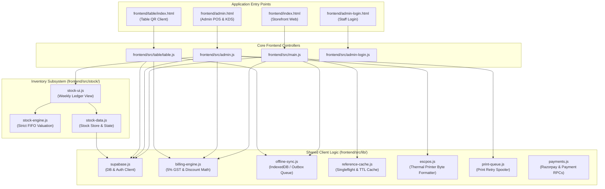
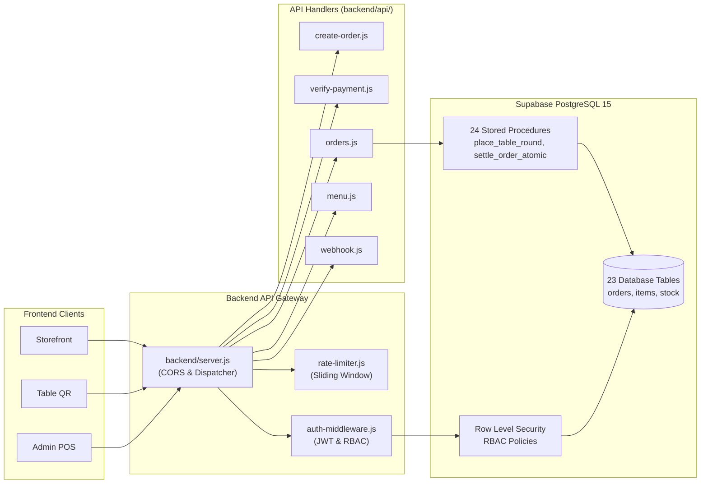

# 🍽️ LIMRA RESTAURANT — PROGRAM DOCUMENTATION & CODEBASE NAVIGATION SYSTEM

> **File Name:** `PROGRAM_DOCUMENTATION.md`  
> **Author / Role:** Senior Software Architect & Technical Documentation Engineer  
> **Project Name:** Limra Restaurant Platform (`limra-restaurant-monorepo`)  
> **Repository Commit Hash:** `fb5e5c3e2dc45c3947813261a26e25ba5d0e8182`  
> **Documentation Date:** October 23, 2026  
> **Verification Status:** Certified Production Architecture (205 Automated Tests Passed)  

---

## 📑 TABLE OF CONTENTS

- [SECTION A: Project Overview](#section-a-project-overview)
- [SECTION B: Complete Project File Index](#section-b-complete-project-file-index)
- [SECTION C: Exact Code Location Index](#section-c-exact-code-location-index)
- [SECTION D: Feature-to-Code Mapping](#section-d-feature-to-code-mapping)
- [SECTION E: Dependency and Import Relationships](#section-e-dependency-and-import-relationships)
- [SECTION F: Database and Backend Reference](#section-f-database-and-backend-reference)
- [SECTION G: API and Integration Reference](#section-g-api-and-integration-reference)
- [SECTION H: Business Rules and Calculations](#section-h-business-rules-and-calculations)
- [SECTION I: Configuration and Environment Reference](#section-i-configuration-and-environment-reference)
- [SECTION J: Known Issues and Technical Risks](#section-j-known-issues-and-technical-risks)
- [SECTION K: Testing and Validation Map](#section-k-testing-and-validation-map)
- [SECTION L: AI Change Navigation Guide](#section-l-ai-change-navigation-guide)
- [SECTION M: Documentation Maintenance Log](#section-m-documentation-maintenance-log)

---

## SECTION A: Project Overview

### 1. Project Name and Purpose
- **Repository Name:** `limra-restaurant-monorepo`
- **Application Name:** Limra Restaurant POS & Online Ordering Platform
- **Purpose:** An omni-channel operating system and e-commerce platform purpose-built for high-volume modern restaurant operations in Egra, West Bengal, India. It coordinates customer online storefront ordering, contactless QR table service across 19 dining tables, kitchen display & production (KDS), counter billing with rapid keyboard navigation, strict FIFO food cost accounting, item-level 5% GST compliance, dual thermal printing (KOT + Tax Bill), and multi-platform distribution.

### 2. Main Technologies and Frameworks
- **Frontend Core:** Vanilla JavaScript (ES Modules), HTML5, CSS3.
- **Frontend Tooling:** Vite 6.3.5 / 8.0, `@tailwindcss/vite` 4.3.0, Tailwind CSS 4.3.0.
- **Backend API Server:** Node.js native HTTP server (`backend/server.js`) and Vercel Serverless Functions (`api/*.js`).
- **Database & BaaS:** Supabase PostgreSQL 15 (`@supabase/supabase-js` v2.49 / v2.112) with PostgREST APIs, Row-Level Security (RLS), and Realtime WebSocket broadcast channels. Legacy InsForge compatibility aliases are supported via `@insforge/sdk` 1.5.2.
- **Payments:** Razorpay Node.js SDK 2.9.6 (HMAC-SHA256 signature verification) & Razorpay Checkout.js.
- **Desktop Runtime:** Electron 44.4.3 with `electron-builder` 26.15.3 (Windows `.exe` kiosk mode).
- **Mobile Runtime:** Capacitor 8.5.2 (`@capacitor/android`, `@capacitor/cli`, `@capacitor/core`).
- **Data Visualization & QR:** `chart.js` 4.5.1, `qrcode` 1.5.4, Leaflet 1.9.4.

### 3. Programming Languages
- **JavaScript (ES Modules & Node.js):** Primary application language across frontend, backend, test suites, and automation scripts.
- **CommonJS (`.cjs`):** Used specifically for Electron desktop initialization (`electron/main.cjs`, `electron/preload.cjs`).
- **SQL (PL/pgSQL):** Database schema, triggers, and 24 stored procedure RPCs in `database/schema.sql` and `database/migrations/`.

### 4. Frontend Architecture
- **Multi-Page Application (MPA) Architecture:** Individual HTML entry points (`index.html`, `admin.html`, `admin-login.html`, `table/index.html`, `table/qr-admin.html`, `privacy.html`) bundled by Vite.
- **Shared Modular Libraries:** Pure JavaScript utility modules located in `frontend/src/lib/` for billing calculations, caching, offline queuing, ESC/POS formatting, and auth tokens.
- **State Hydration:** In-memory state synchronized with `localStorage` and `IndexedDB` for instant 0ms perceived UI latency and offline resilience.
- **Styling:** Tailwind CSS 4 utility classes coupled with custom scoped stylesheets (`style.css`, `admin.css`, `stock.css`).

### 5. Backend Architecture
- **Dual Runtime Support:**
  1. *Native Node.js Server (`backend/server.js`):* Standalone HTTP daemon listening on port 3000, parsing request bodies, enforcing CORS, and dispatching to route handlers.
  2. *Serverless Handlers (`api/*.js`):* Clean delegate wrappers designed for Vercel/AWS Lambda deployments that forward requests to `backend/api/*.js`.
- **Security & Reliability Pipeline:** In-memory sliding window rate limiter (`backend/api/lib/rate-limiter.js`), Supabase JWT verification (`backend/api/lib/auth-middleware.js`), and server-side environment validation (`backend/api/lib/env-validator.js`).

### 6. Database Technology
- **Engine:** Supabase PostgreSQL 15.
- **Structure:** 23 operational tables + `sync_queue` offline sync buffer.
- **Security:** RLS policies enforced on all tables, with granular role-based permissions (`owner`, `manager`, `cashier`, `kitchen`, `customer`).
- **Data Integrity:** ACID-compliant stored procedures (`place_order`, `place_table_round`, `settle_order_atomic`, `deduct_order_inventory_atomic`) using `FOR UPDATE` row-level locks and transaction rollback on failure.

### 7. Authentication System
- **Staff / Admin Auth:** Supabase Auth (Email/Password & Google OAuth), verified against `public.admin_users` table to assign operational roles (`owner`, `manager`, `cashier`, `kitchen`).
- **Customer Auth:** Passwordless OTP authentication via Meta WhatsApp Cloud API or Fast2SMS, backed by `public.phone_verifications` and `public.customer_profiles`.

### 8. Payment Gateway Integration
- **Provider:** Razorpay India (`INR` currency standard).
- **Security:** Strict server-authoritative amount calculation, bounds checking (₹1.00 to ₹50,000.00), and timing-safe HMAC-SHA256 signature verification (`crypto.timingSafeEqual`) in `backend/api/verify-payment.js` and `backend/api/webhook.js`.
- **Replay Protection:** Unique constraint and caching in `public.verified_payments`.

### 9. External APIs and Hardware Integrations
- **Razorpay API:** Order creation and webhook event delivery.
- **Meta WhatsApp Cloud API:** Automated customer order notifications and login OTP delivery.
- **Fast2SMS Gateway:** Indian SMS fallback for OTP verification.
- **EmailJS / SMTP:** Transactional customer receipt emails (`frontend/src/lib/email-service.js`).
- **Thermal Printers (80mm & 58mm):** Direct ESC/POS hardware command generation, Chromium silent printing bridge, and TCP socket/spooler printing.
- **Google Maps / Leaflet:** Delivery geofencing with polygon coordinate boundary validation.

### 10. Build Tools and Package Manager
- **Monorepo Manager:** npm workspaces (`frontend`, `backend`).
- **Bundler:** Vite 6/8 with Rollup chunk splitting (`vendor-chart`, `vendor-qr`).
- **Packaging:** `electron-builder` for Windows `.exe` installers/portables; Capacitor CLI & Gradle 8.14.3 for Android APK generation.

---

## SECTION B: Complete Project File Index

| File Path | Purpose | Main Exports / Symbols | Dependencies | Used By | Modification Risk | Documentation Status |
|---|---|---|---|---|---|---|
| `package.json` | Monorepo root manifest, global scripts & multi-platform packaging config | Workspace definitions, build scripts | `electron`, `vite`, `@capacitor/cli` | Developers, CI/CD, build tools | High (Impacts packaging & workspaces) | Verified |
| `backend/package.json` | Backend service manifest & script definitions | Dependencies, start scripts | `@supabase/supabase-js`, `razorpay`, `dotenv` | Backend server runtime | Medium (Backend dependencies) | Verified |
| `frontend/package.json` | Frontend client manifest & build scripts | Build, dev, preview scripts | `vite`, `tailwindcss`, `chart.js`, `qrcode` | Frontend build pipeline | Medium (Frontend dependencies) | Verified |
| `frontend/vite.config.js` | Vite bundler config, MPA inputs, API proxy & chunking | Vite configuration object | `vite`, `@tailwindcss/vite`, `path` | Frontend dev server & build | Medium (Bundling rules) | Verified |
| `vercel.json` | Vercel deployment specification & URL rewrite rules | Routing rewrites, output directory | Vercel platform | Vercel serverless deployment | Low (Edge routing) | Verified |
| `capacitor.config.json` | Native Android mobile shell configuration | Capacitor configuration | `@capacitor/android` | Capacitor CLI, Android Studio | Medium (Mobile app shell) | Verified |
| `backend/server.js` | Native Node.js HTTP server entry point & static file server | `server`, `apiHandlers`, `parseBody` | `http`, `fs`, `path`, `dotenv` | `npm run start`, Desktop POS | High (Core backend daemon) | Verified |
| `backend/api/analytics.js` | Business analytics & sales aggregation API handler | `default (handler)` | `./lib/supabase.js`, `./lib/auth-middleware.js` | `server.js`, `api/analytics.js` | Low (Reporting queries) | Verified |
| `backend/api/auth.js` | Customer phone OTP authentication & registration | `default (handler)`, `sendWhatsAppOtp`, `sendSmsOtp` | `./lib/supabase.js`, `crypto` | `server.js`, `api/auth.js`, Storefront | Medium (Auth security) | Verified |
| `backend/api/create-order.js` | Razorpay order creation & trusted amount computation | `default (handler)` | `razorpay`, `./lib/supabase.js`, `./lib/billing-engine.js` | `server.js`, `api/create-order.js`, Storefront | High (Payment creation & pricing) | Verified |
| `backend/api/db.js` | Generic authenticated database & RPC dispatcher | `default (handler)` | `./lib/supabase.js`, `./lib/auth-middleware.js` | `server.js`, `api/db.js` | High (Data proxy & security) | Verified |
| `backend/api/db-status.js` | Database connectivity & health monitoring endpoint | `default (handler)`, `TABLES` | `./lib/supabase.js` | `server.js`, `api/db-status.js`, Monitoring | Low (Diagnostic endpoint) | Verified |
| `backend/api/menu.js` | Menu item price overrides & availability management | `default (handler)` | `./lib/supabase.js`, `./lib/auth-middleware.js` | `server.js`, `api/menu.js`, Admin POS | Medium (Catalog management) | Verified |
| `backend/api/orders.js` | Orders API: creation, retrieval, updates & settlement | `default (handler)`, `processOrderInventoryDeduction` | `./lib/supabase.js`, `./lib/billing-engine.js` | `server.js`, `api/orders.js`, POS, Table QR | High (Core transactional orders) | Verified |
| `backend/api/verify-payment.js` | Razorpay HMAC-SHA256 signature verification & settlement | `default (handler)`, `verifySignatureTimingSafe` | `crypto`, `razorpay`, `./lib/supabase.js` | `server.js`, `api/verify-payment.js`, Storefront | High (Payment verification security) | Verified |
| `backend/api/webhook.js` | Razorpay asynchronous webhook processor | `default (handler)`, `verifyWebhookSignature` | `crypto`, `./lib/supabase.js` | `server.js`, `api/webhook.js`, Razorpay | High (Async payment settlement) | Verified |
| `backend/api/lib/auth-middleware.js` | Bearer token extraction & staff RBAC permission gate | `authenticateUser`, `requireRole`, `requireAuth` | `./supabase.js` | All backend API handlers | High (Security gatekeeper) | Verified |
| `backend/api/lib/billing-engine.js` | Authoritative 5% GST, proportional discount & billing engine | `calculateOrderBilling`, `isValidPaymentTransition` | Pure JavaScript (Math) | `create-order.js`, `orders.js`, Tests | High (Financial math integrity) | Verified |
| `backend/api/lib/env-validator.js` | Startup configuration & secret security auditor | `validateStartupConfig` | Pure JavaScript | `server.js`, Test suite | Medium (Config assurance) | Verified |
| `backend/api/lib/rate-limiter.js` | In-memory sliding window rate limiter | `checkRateLimit` | Pure JavaScript (`Map`) | All backend API handlers | Medium (DoS protection) | Verified |
| `backend/api/lib/supabase.js` | Backend Supabase admin client initialization & ping | `supabase`, `pingDatabase`, `querySupabase` | `@supabase/supabase-js`, `dotenv` | All backend handlers | High (Database client access) | Verified |
| `api/analytics.js` | Serverless delegate wrapper for analytics | `default` | `../backend/api/analytics.js` | Vercel runtime | Low (Delegate proxy) | Verified |
| `api/auth.js` | Serverless delegate wrapper for auth | `default` | `../backend/api/auth.js` | Vercel runtime | Low (Delegate proxy) | Verified |
| `api/create-order.js` | Serverless delegate wrapper for payment order creation | `default` | `../backend/api/create-order.js` | Vercel runtime | Low (Delegate proxy) | Verified |
| `api/db.js` | Serverless delegate wrapper for database proxy | `default` | `../backend/api/db.js` | Vercel runtime | Low (Delegate proxy) | Verified |
| `api/db-status.js` | Serverless delegate wrapper for db status | `default` | `../backend/api/db-status.js` | Vercel runtime | Low (Delegate proxy) | Verified |
| `api/menu.js` | Serverless delegate wrapper for menu | `default` | `../backend/api/menu.js` | Vercel runtime | Low (Delegate proxy) | Verified |
| `api/orders.js` | Serverless delegate wrapper for orders | `default` | `../backend/api/orders.js` | Vercel runtime | Low (Delegate proxy) | Verified |
| `api/razorpay-webhook.js` | Serverless delegate wrapper for webhook | `default` | `../backend/api/webhook.js` | Vercel runtime | Low (Delegate proxy) | Verified |
| `api/verify-payment.js` | Serverless delegate wrapper for payment verification | `default` | `../backend/api/verify-payment.js` | Vercel runtime | Low (Delegate proxy) | Verified |
| `api/webhook.js` | Serverless delegate wrapper for webhook | `default` | `../backend/api/webhook.js` | Vercel runtime | Low (Delegate proxy) | Verified |
| `frontend/index.html` | Customer-facing storefront & online food ordering markup | HTML Document | `main.js`, `style.css` | Web browser, PWA | Medium (Storefront presentation) | Verified |
| `frontend/admin.html` | Admin POS billing counter, KDS, inventory & settings markup | HTML Document | `admin.js`, `admin.css`, `style.css` | POS operators, Cashiers | High (Core operational UI) | Verified |
| `frontend/admin-login.html` | Staff authentication portal markup | HTML Document | `admin-login.js`, `style.css` | Restaurant staff | Medium (Staff login UI) | Verified |
| `frontend/privacy.html` | Legal terms and privacy compliance markup | HTML Document | Static HTML | Storefront users | Low (Legal compliance) | Verified |
| `frontend/table/index.html` | Contactless dine-in QR ordering client markup | HTML Document | `table.js`, `style.css` | Dine-in guests (Tables 1-19) | High (Customer dining UI) | Verified |
| `frontend/table/qr-admin.html` | Administrative table QR code generator & token printer | HTML Document | `table.js`, `qrcode` | Management staff | Low (QR setup utility) | Verified |
| `frontend/src/main.js` | Customer storefront client logic, cart & ordering | `openCart`, `addToCart`, `saveCart` | `./data/menu.js`, `./lib/supabase.js` | `index.html` | High (Storefront logic) | Verified |
| `frontend/src/admin.js` | Admin POS billing counter, live orders, KDS & printing | `printKOT`, `printOrderReceiptWithTax`, `updateOrderStatus` | `./lib/supabase.js`, `./lib/escpos.js`, `./lib/billing-engine.js` | `admin.html` | High (Core POS application) | Verified |
| `frontend/src/admin-login.js` | Staff login, role lookup & email verification logic | `checkAdminAccess`, `goToDashboard` | `./lib/supabase.js`, `./lib/admin-routes.js` | `admin-login.html` | Medium (Authentication gate) | Verified |
| `frontend/src/admin-stock.js` | Stock UI mount adapter for Admin dashboard | `initStockSummarySection`, `initStockSection` | `./stock/stock-ui.js` | `admin.js` | Low (Mount adapter) | Verified |
| `frontend/src/data/menu.js` | Static catalog of 202 dishes across 23 categories | `menuItems`, `categoryImages`, `categoryLabels`, `categoryEmojis` | Pure Data | Storefront, Admin POS, Table QR | Medium (Base catalog data) | Verified |
| `frontend/src/lib/admin-routes.js` | URL route helpers and redirect parameter parser | `getAdminLoginUrl`, `getRedirectTarget` | Pure JavaScript | `admin.js`, `admin-login.js` | Low (Routing helpers) | Verified |
| `frontend/src/lib/billing-engine.js` | Client-side canonical GST calculation & transition validator | `calculateOrderBilling`, `isValidPaymentTransition` | Pure JavaScript (Math) | Storefront, Admin POS, Table QR | High (Financial math integrity) | Verified |
| `frontend/src/lib/email-service.js` | EmailJS transactional email notification generator | `sendEmailNotification`, `generateOrderConfirmedHtml` | EmailJS REST API | `admin.js`, `main.js` | Low (Customer emails) | Verified |
| `frontend/src/lib/escpos.js` | ESC/POS thermal printer raw byte & text formatting engine | `COMMANDS`, `generateReceiptEscPos`, `generateKotEscPos` | `./billing-engine.js` | `admin.js`, `print-queue.js` | High (Hardware thermal printing) | Verified |
| `frontend/src/lib/i18n.js` | English & Bengali bilingual translation engine | `translations`, `t`, `initLanguageSystem`, `setLanguage` | Pure JavaScript | Storefront, Table QR | Low (Localization) | Verified |
| `frontend/src/lib/insforge.js` | Backward-compatibility re-export module for Supabase | `supabase`, `insforge` (re-exports) | `./supabase.js` | Legacy module callers | Low (Compatibility bridge) | Verified |
| `frontend/src/lib/notifications.js` | Real-time web notification & customer alert dispatcher | `NotificationService` | `./supabase.js`, `./email-service.js` | Admin POS, Storefront | Medium (Notification broadcasts) | Verified |
| `frontend/src/lib/offline-sync.js` | Resilient offline queue & background sync engine | `offlineSync`, `OfflineSyncEngine`, `QUEUE_KEYS` | Pure JS (`localStorage`) | Storefront, Admin POS, Table QR | High (Offline data reliability) | Verified |
| `frontend/src/lib/payments.js` | Client payment service & RPC caller | `PaymentService` | `./supabase.js` | `admin.js`, Storefront | Medium (Client payment calls) | Verified |
| `frontend/src/lib/print-queue.js` | Thermal print queue manager with retry & backoff | `printQueue`, `PrintQueueManager` | `localStorage` | `admin.js`, Desktop POS | Medium (Print job resilience) | Verified |
| `frontend/src/lib/reference-cache.js` | Multi-tiered memory & storage reference data cache | `getOrFetchRef`, `invalidateRefCache`, `DEFAULT_TTLS` | Pure JS (`Map`, `localStorage`) | `supabase.js`, Storefront, POS | Medium (Egress & performance) | Verified |
| `frontend/src/lib/supabase.js` | Frontend Supabase client, queries & mutation functions | `supabase`, `saveOrder`, `saveTableRound`, `getCoupons` | `@supabase/supabase-js`, `./reference-cache.js` | Storefront, Admin POS, Table QR | High (Core client data layer) | Verified |
| `frontend/src/sales-report/sales-report.js` | Daily, weekly & monthly sales reporting hub | `initSalesReportHub`, `loadSalesReportData`, `getISTDateString` | `../lib/insforge.js`, `../data/menu.js` | `admin.js` | Medium (Reporting analytics) | Verified |
| `frontend/src/stock/stock-data.js` | Stock store with local cache and real-time listeners | `stockStore`, `StockStore` | `../lib/insforge.js`, `./stock-engine.js` | `stock-ui.js`, `admin-stock.js` | Medium (Inventory state) | Verified |
| `frontend/src/stock/stock-engine.js` | Strict FIFO inventory accounting & valuation algorithm | `computePeriod`, `getItemLots`, `previewOut`, `inr` | Pure JavaScript | `stock-data.js`, `stock-ui.js`, Tests | High (Strict food cost accounting) | Verified |
| `frontend/src/stock/stock-ui.js` | Stock ledger UI rendering, weekly statements & entry forms | `initStockUI` | `./stock-engine.js`, `./stock-data.js` | `admin-stock.js` | Medium (Inventory management UI) | Verified |
| `frontend/src/stock-manager/stock-manager.js` | Standalone legacy stock manager module | Standalone stock manager script | `../lib/insforge.js`, `./data/initialStockData.js` | `stock-manager/index.html` | Low (Legacy view) | Verified |
| `frontend/src/table/table.js` | Dine-in table ordering client, multi-round cart & service calls | `init`, `initCustomerView`, `initOwnerView` | `../lib/insforge.js`, `../data/menu.js` | `table/index.html` | High (Dine-in guest experience) | Verified |
| `electron/main.cjs` | Electron main process, embedded HTTP server & IPC printer bridge | `createWindow`, `startLocalServer`, `getDistDirectory` | `electron`, `http`, `path`, `fs` | Electron desktop app | High (Desktop native runtime) | Verified |
| `electron/preload.cjs` | Electron preload script safely bridging IPC hardware printing | `contextBridge.exposeInMainWorld` (`window.electronPOS`) | `electron` | Electron desktop window | Medium (Desktop IPC bridge) | Verified |
| `database/schema.sql` | Canonical Supabase database schema, tables & stored RPCs | Complete DDL & 24 Stored Procedures | PostgreSQL 15 | Supabase database instance | High (Database foundation) | Verified |
| `backend/tests/run-all.mjs` | Master test runner orchestrating all 10 test suites | Test execution sequence | `node:child_process`, `node:fs` | `npm test`, CI/CD | Medium (Quality assurance) | Verified |

---

## SECTION C: Exact Code Location Index

| Feature / Functionality | File Path | Symbol | Start Line | End Line | Related Files |
|---|---|---|---:|---:|---|
| Backend HTTP Server Initialization | `backend/server.js` | `server.listen()` | 205 | 228 | `backend/server.js` |
| Backend API Route Dispatcher | `backend/server.js` | Request Dispatcher | 99 | 151 | `backend/api/*.js` |
| Static Asset Serving & SPA Fallback | `backend/server.js` | Static Handler | 153 | 203 | `frontend/dist/` |
| Supabase Admin Client Initialization | `backend/api/lib/supabase.js` | `supabase` | 31 | 36 | `backend/api/lib/supabase.js` |
| Supabase Latency Health Check | `backend/api/lib/supabase.js` | `pingDatabase()` | 44 | 89 | `backend/api/db-status.js` |
| Startup Secret Configuration Audit | `backend/api/lib/env-validator.js` | `validateStartupConfig()` | 8 | 142 | `backend/server.js` |
| Sliding Window Rate Limiter | `backend/api/lib/rate-limiter.js` | `checkRateLimit()` | 25 | 71 | `backend/api/*.js` |
| Staff Auth Token & Role Verification | `backend/api/lib/auth-middleware.js` | `authenticateUser()` | 43 | 82 | `backend/api/orders.js` |
| Staff RBAC Permission Gate | `backend/api/lib/auth-middleware.js` | `requireRole()` | 139 | 158 | `backend/api/menu.js` |
| Authoritative 5% GST & Discount Math | `backend/api/lib/billing-engine.js` | `calculateOrderBilling()` | 185 | 323 | `frontend/src/lib/billing-engine.js` |
| Order Notes Metadata Serialization | `backend/api/lib/billing-engine.js` | `formatNotesBillingMetadata()` | 137 | 169 | `backend/api/orders.js` |
| Payment State Machine Transitions | `backend/api/lib/billing-engine.js` | `isValidPaymentTransition()` | 337 | 360 | `backend/api/orders.js` |
| Fulfillment State Machine Transitions | `backend/api/lib/billing-engine.js` | `isValidFulfillmentTransition()` | 365 | 404 | `backend/api/orders.js` |
| Kitchen Ticket State Transitions | `backend/api/lib/billing-engine.js` | `isValidTicketTransition()` | 416 | 438 | `backend/api/orders.js` |
| Razorpay Gateway Order Creation | `backend/api/create-order.js` | `handler()` | 11 | 288 | `frontend/src/lib/payments.js` |
| Razorpay Timing-Safe Signature Verification | `backend/api/verify-payment.js` | `verifySignatureTimingSafe()` | 15 | 33 | `backend/api/verify-payment.js` |
| Payment Verification & Settlement Endpoint | `backend/api/verify-payment.js` | `handler()` | 35 | 304 | `backend/api/orders.js` |
| Razorpay Webhook Event Processor | `backend/api/webhook.js` | `handler()` | 32 | 186 | `backend/api/webhook.js` |
| Order Creation (Customer & Delivery) | `backend/api/orders.js` | `handler() [POST]` | 125 | 583 | `frontend/src/lib/supabase.js` |
| Idempotency Key Replay Protection | `backend/api/orders.js` | Idempotency Check | 134 | 178 | `database/schema.sql` |
| Multi-Round Table Order Placement | `backend/api/orders.js` | Table Order Handler | 342 | 450 | `frontend/src/table/table.js` |
| Order Retrieval & Filtering (Staff) | `backend/api/orders.js` | `handler() [GET]` | 584 | 619 | `frontend/src/admin.js` |
| Order Status & Payment Update | `backend/api/orders.js` | `handler() [PATCH]` | 620 | 897 | `frontend/src/admin.js` |
| Atomic Order Settlement & Close | `backend/api/orders.js` | Settlement Handler | 780 | 870 | `database/migrations/` |
| Atomic Inventory Deduction | `backend/api/orders.js` | `processOrderInventoryDeduction()` | 44 | 113 | `database/schema.sql` |
| Menu Override Catalog API | `backend/api/menu.js` | `handler()` | 4 | 110 | `frontend/src/admin.js` |
| Customer WhatsApp / SMS OTP Dispatch | `backend/api/auth.js` | `sendWhatsAppOtp()` | 18 | 80 | `frontend/src/main.js` |
| Customer OTP Verification & Session Issue | `backend/api/auth.js` | `handler() [verify-otp]` | 251 | 417 | `frontend/src/main.js` |
| Business Analytics Aggregator | `backend/api/analytics.js` | `handler()` | 4 | 140 | `frontend/src/admin.js` |
| Database Status & Table Metrics | `backend/api/db-status.js` | `handler()` | 29 | 70 | `backend/api/db-status.js` |
| Generic Database & RPC Dispatcher | `backend/api/db.js` | `handler()` | 94 | 514 | `backend/api/db.js` |
| Frontend Supabase Client Initialization | `frontend/src/lib/supabase.js` | `supabase` | 38 | 44 | `frontend/src/lib/supabase.js` |
| Frontend Order Persistence (`saveOrder`) | `frontend/src/lib/supabase.js` | `saveOrder()` | 204 | 356 | `frontend/src/main.js` |
| Table Round Order (`saveTableRound`) | `frontend/src/lib/supabase.js` | `saveTableRound()` | 358 | 478 | `frontend/src/table/table.js` |
| Table Service Request (`Call Waiter`) | `frontend/src/lib/supabase.js` | `requestTableService()` | 480 | 526 | `frontend/src/table/table.js` |
| Table Booking Persistence | `frontend/src/lib/supabase.js` | `saveBooking()` | 528 | 577 | `frontend/src/main.js` |
| Dynamic Coupon Validation | `frontend/src/lib/supabase.js` | `validateCouponCode()` | 704 | 755 | `frontend/src/main.js` |
| Reference Data Cache Singleflight Fetch | `frontend/src/lib/reference-cache.js` | `getOrFetchRef()` | 174 | 203 | `frontend/src/lib/supabase.js` |
| Cache Mutation Invalidation | `frontend/src/lib/reference-cache.js` | `invalidateRefCache()` | 129 | 146 | `frontend/src/admin.js` |
| Offline Network Status Detection | `frontend/src/lib/offline-sync.js` | `initNetworkListeners()` | 34 | 45 | `frontend/src/lib/offline-sync.js` |
| Customer Order Offline Enqueue | `frontend/src/lib/offline-sync.js` | `enqueueCustomerOrder()` | 138 | 171 | `frontend/src/lib/supabase.js` |
| Table Round Offline Enqueue | `frontend/src/lib/offline-sync.js` | `enqueueTableRound()` | 173 | 207 | `frontend/src/table/table.js` |
| Offline Queue Background Synchronization | `frontend/src/lib/offline-sync.js` | `triggerSync()` | 267 | 303 | `frontend/src/lib/offline-sync.js` |
| ESC/POS Raw Byte Command Set | `frontend/src/lib/escpos.js` | `COMMANDS` | 8 | 25 | `frontend/src/admin.js` |
| ESC/POS Tax Bill Generator (80/58mm) | `frontend/src/lib/escpos.js` | `generateReceiptEscPos()` | 103 | 240 | `frontend/src/admin.js` |
| ESC/POS Kitchen Ticket Generator (KOT) | `frontend/src/lib/escpos.js` | `generateKotEscPos()` | 246 | 320 | `frontend/src/admin.js` |
| Thermal Print Queue Manager | `frontend/src/lib/print-queue.js` | `PrintQueueManager` | 10 | 205 | `frontend/src/admin.js` |
| Print Job Auto-Retry & Backoff | `frontend/src/lib/print-queue.js` | `processQueue()` | 100 | 155 | `frontend/src/admin.js` |
| English & Bengali Translation Strings | `frontend/src/lib/i18n.js` | `translations` | 6 | 482 | `frontend/src/main.js` |
| Customer Cart Storage Hydration | `frontend/src/main.js` | `loadCartFromStorage()` | 92 | 115 | `frontend/src/main.js` |
| Leaflet Delivery Geofence Distance | `frontend/src/main.js` | `haversineDistance()` | 2229 | 2239 | `frontend/src/main.js` |
| Delivery Map Modal & Pin Picker | `frontend/src/main.js` | `openMapModal()` | 2241 | 2250 | `frontend/src/main.js` |
| Storefront Realtime Push Chime | `frontend/src/main.js` | `playCustomerNotificationChime()` | 5219 | 5244 | `frontend/src/main.js` |
| Storefront Push Notification Listener | `frontend/src/main.js` | `startNotificationListening()` | 5513 | 5584 | `frontend/src/main.js` |
| Algorithmic Dish Pairing Cross-Selling | `frontend/src/main.js` | `getRecommendations()` | 5629 | 5670 | `frontend/src/table/table.js` |
| Admin AudioContext Chime Synthesizer | `frontend/src/admin.js` | `generateChimeWavUri()` | 118 | 160 | `frontend/src/admin.js` |
| Incoming Order Accept / Reject Modal | `frontend/src/admin.js` | Incoming Orders Flow | 1607 | 2120 | `frontend/src/admin.js` |
| Live POS Dashboard KPI Counters | `frontend/src/admin.js` | Dashboard KPIs | 2129 | 3320 | `frontend/src/admin.js` |
| Live Orders Table & Status Progression | `frontend/src/admin.js` | Orders Table Renderer | 3624 | 4220 | `frontend/src/admin.js` |
| Order Status Transition Handler | `frontend/src/admin.js` | `updateOrderStatus()` | 4228 | 4330 | `backend/api/orders.js` |
| Hold Orders & Table Session Workbench | `frontend/src/admin.js` | Hold Orders Workbench | 5398 | 7150 | `frontend/src/table/table.js` |
| Staff Authentication & Role Gate | `frontend/src/admin.js` | Auth Flow Handler | 9329 | 9480 | `frontend/src/admin-login.js` |
| Chromium Native Silent Print Driver | `frontend/src/admin.js` | `printViaNativeDriver()` | 11846 | 11950 | `electron/preload.cjs` |
| POS Billing Workstation Controller | `frontend/src/admin.js` | `updatePosTableBadge()`, `buildOrderFromPos()` | 13494 | 14350 | `frontend/src/lib/billing-engine.js` |
| Thermal Kitchen Order Ticket (KOT) Print | `frontend/src/admin.js` | `printKOT()` | 14371 | 14515 | `frontend/src/lib/escpos.js` |
| Thermal Final Tax Invoice Print | `frontend/src/admin.js` | `printOrderReceiptWithTax()` | 14620 | 14669 | `frontend/src/lib/escpos.js` |
| Dual Sequential KOT & Bill Printing | `frontend/src/admin.js` | `printCombinedKOTAndBill()` | 14670 | 14815 | `frontend/src/lib/print-queue.js` |
| Close Orders Historical Fetching & Pagination | `frontend/src/admin.js` | `ensureHistoricalClosedOrders()`, `renderClosedPagination()` | 8097 | 8450 | `frontend/admin.html` |
| Orders API Historical Range & Status Query | `backend/api/orders.js` | `default (GET handler)` | 584 | 655 | `backend/server.js` |
| Dine-In Table Session Initialization | `frontend/src/table/table.js` | `init()` | 46 | 82 | `frontend/table/index.html` |
| Table Cart Multi-Round Placement | `frontend/src/table/table.js` | Round Placement Handler | 525 | 720 | `frontend/src/lib/supabase.js` |
| Digital Staff Call ("Call Waiter / Bill") | `frontend/src/table/table.js` | Service Call Handler | 730 | 810 | `backend/api/orders.js` |
| Dynamic Dine-In Cross-Selling Engine | `frontend/src/table/table.js` | Recommendation Engine | 820 | 990 | `frontend/src/data/menu.js` |
| 7-Day Month-Based Week Calculator | `frontend/src/stock/stock-engine.js` | `getWeekInfo()` | 108 | 132 | `frontend/src/stock/stock-engine.js` |
| Strict FIFO Stock Movement Engine | `frontend/src/stock/stock-engine.js` | `computePeriod()` | 162 | 471 | `frontend/src/stock/stock-engine.js` |
| Active FIFO Batch Queue Inspector | `frontend/src/stock/stock-engine.js` | `getItemLots()` | 472 | 632 | `frontend/src/stock/stock-engine.js` |
| Planned Stock OUT Cost Preview | `frontend/src/stock/stock-engine.js` | `previewOut()` | 639 | 684 | `frontend/src/stock/stock-ui.js` |
| Stock UI Mount & Statement Renderer | `frontend/src/stock/stock-ui.js` | `initStockUI()` | 45 | 1359 | `frontend/src/admin-stock.js` |
| Sales Report Hub & Metrics Aggregator | `frontend/src/sales-report/sales-report.js` | `loadSalesReportData()` | 120 | 250 | `frontend/src/admin.js` |
| Electron Loopback Server (127.0.0.1) | `electron/main.cjs` | `startLocalServer()` | 69 | 137 | `electron/main.cjs` |
| Electron Kiosk Window Initialization | `electron/main.cjs` | `createWindow()` | 142 | 204 | `electron/preload.cjs` |
| Electron Silent Thermal Print IPC | `electron/main.cjs` | `ipcMain.handle('print-receipt')` | 215 | 299 | `electron/preload.cjs` |
| Electron IPC Preload Safe Bridge | `electron/preload.cjs` | `window.electronPOS` | 10 | 19 | `frontend/src/admin.js` |

---

## SECTION D: Feature-to-Code Mapping

### Feature 1: Customer Online Storefront & Food Ordering
- **User-Facing Entry Point:** `frontend/index.html` (Website storefront).
- **Main Component / Script:** `frontend/src/main.js`.
- **Related Child Components:** Food search bar (`#food-search-input`), category tabs (`#category-tabs-container`), cart drawer (`#cart-drawer`), delivery geofence modal (`#delivery-map-modal`), checkout modal.
- **Relevant State:** `cart` array, `activeDeliveryArea`, `currentMenuCategory`, `appliedCoupon`, `isLocationVerified`.
- **Business Logic Functions:**
  - `addToCart()`: `frontend/src/main.js` (lines 294-344)
  - `getCartBillingDetails()`: `frontend/src/main.js` (lines 221-236)
  - `haversineDistance()`: `frontend/src/main.js` (lines 2229-2239)
  - `calculateOrderBilling()`: `frontend/src/lib/billing-engine.js` (lines 185-323)
- **API / Service Layer:**
  - `saveOrder()`: `frontend/src/lib/supabase.js` (lines 204-356)
  - `POST /api/orders`: `backend/api/orders.js` (lines 125-583)
- **Database Tables & RPCs:**
  - Tables: `public.orders`, `public.order_items`, `public.delivery_areas`, `public.coupons`.
  - Stored Procedures: `public.place_order` (SECURITY DEFINER).
- **Execution Flow:**
  ```text
  Customer clicks "ADD" → addToCart(dishId) → saveCart() & updateCartUI()
  → Opens Cart → Applies Coupon (validateCouponCode) → Confirms Delivery Pin (haversineDistance)
  → Clicks "Place Order" → saveOrder() → /api/orders (POST)
  → RPC place_order → Inserts orders & order_items → Broadcasts Realtime Event
  → UI displays Order Confirmation & Realtime Tracking Modal
  ```

---

### Feature 2: Contactless Dine-In Table QR Ordering System
- **User-Facing Entry Point:** `frontend/table/index.html?table=N` (Table QR scan, Tables 1–19).
- **Main Component / Script:** `frontend/src/table/table.js`.
- **Related Child Components:** Table badge (`#table-badge`), round selector, service call buttons (`#call-waiter-btn`, `#request-bill-btn`), dynamic pairing carousel.
- **Relevant State:** `currentTable` (integer 1-19), `cart` (`limra-table-cart`), active round index.
- **Business Logic Functions:**
  - `initCustomerView()`: `frontend/src/table/table.js` (lines 46-82)
  - `saveTableRound()`: `frontend/src/lib/supabase.js` (lines 358-478)
  - `requestTableService()`: `frontend/src/lib/supabase.js` (lines 480-526)
  - `getRecommendations()`: `frontend/src/table/table.js` (lines 820-990)
- **API / Service Layer:**
  - `POST /api/orders`: `backend/api/orders.js` (lines 342-450)
- **Database Tables & RPCs:**
  - Stored Procedures: `public.place_table_round`, `public.request_table_service`.
  - Tables: `public.orders` (with `order_type = 'table'`, `table_number = N`), `public.notifications`.
- **Execution Flow:**
  ```text
  Guest scans QR on Table 4 → table/index.html?table=4 → Locks currentTable = 4
  → Adds dishes to table cart → Clicks "Send to Kitchen" (Round 1)
  → saveTableRound() → RPC place_table_round (Atomic FOR UPDATE lock)
  → Appends items to active table session or creates new session
  → Admin POS receives audio chime & KDS badge updates
  → Guest clicks "Call Waiter" → requestTableService() → Staff notification emitted
  ```

---

### Feature 3: Admin POS Billing Counter & Hold Orders Workbench
- **User-Facing Entry Point:** `frontend/admin.html`.
- **Main Component / Script:** `frontend/src/admin.js`.
- **Related Child Components:** Fast billing keyboard input (F1 search, F2 settlement), hold orders bar, dish customization modal, live orders table, ticket status switcher.
- **Relevant State:** `activeOrders`, `holdOrders`, `selectedCategory`, `kdsFilter`.
- **Business Logic Functions:**
  - `updateOrderStatus()`: `frontend/src/admin.js` (lines 4228-4330)
  - `settleOrder()`: `backend/api/orders.js` (lines 780-870)
  - `calculateOrderBilling()`: `frontend/src/lib/billing-engine.js` (lines 185-323)
- **API / Service Layer:**
  - `PATCH /api/orders`: `backend/api/orders.js` (lines 620-897)
  - Stored Procedure: `public.settle_order_atomic`.
- **Execution Flow:**
  ```text
  Cashier presses F1 → Type-ahead search dish → Press Enter to add
  → Optional: Click "Hold Order" → Stores in Hold Workbench with visual timer
  → Resume Order → Press F2 (Settle) → Choose Payment (Cash/UPI)
  → settle_order_atomic RPC → Deducts inventory (FIFO) → Marks PAID & CLOSED
  → Triggers dual sequential thermal print (KOT + Tax Invoice)
  ```

---

### Feature 4: Dual Sequential Thermal Printing (KOT & Tax Bill)
- **User-Facing Entry Point:** Admin POS settlement, Hold Workbench print buttons, KDS print trigger.
- **Main Component / Script:** `frontend/src/admin.js` & `frontend/src/lib/escpos.js`.
- **Related Child Components:** Print queue manager (`frontend/src/lib/print-queue.js`), hidden Chromium print window, Electron IPC bridge (`electron/preload.cjs`).
- **Relevant State:** `printerSettings` (paperWidth: 80 or 58mm, directPrint: true/false, sideGapMm).
- **Business Logic Functions:**
  - `generateReceiptEscPos()`: `frontend/src/lib/escpos.js` (lines 103-240)
  - `generateKotEscPos()`: `frontend/src/lib/escpos.js` (lines 246-320)
  - `printCombinedKOTAndBill()`: `frontend/src/admin.js` (lines 14606-14750)
  - `printQueue.enqueue()`: `frontend/src/lib/print-queue.js` (lines 69-95)
- **Execution Flow:**
  ```text
  Order settled in POS → printCombinedKOTAndBill(order)
  → Formats KOT (kitchen items, table/order number, timestamp)
  → Formats Tax Invoice (FSSAI, GSTIN, itemized rates, CGST/SGST breakdown, QR)
  → Enqueues to PrintQueueManager → Checks for Electron window.electronPOS
  → Sends silent IPC print or opens ephemeral zero-margin iframe
  → Executes KOT cut → 500ms delay → Executes Tax Bill cut & cash drawer kick
  ```

---

### Feature 5: Razorpay Payment Gateway & Webhook Reconciliation
- **User-Facing Entry Point:** Storefront online checkout modal ("Pay via UPI / Card").
- **Main Component / Script:** `frontend/src/main.js` & `frontend/src/lib/payments.js`.
- **Server Verification Handlers:** `backend/api/create-order.js`, `backend/api/verify-payment.js`, `backend/api/webhook.js`.
- **Relevant State:** `razorpay_order_id`, `razorpay_payment_id`, `razorpay_signature`.
- **Business Logic Functions:**
  - `verifySignatureTimingSafe()`: `backend/api/verify-payment.js` (lines 15-33)
  - `verifyWebhookSignature()`: `backend/api/webhook.js` (lines 12-30)
- **Execution Flow:**
  ```text
  Customer clicks "Pay Now" → POST /api/create-order (calculates trusted amount)
  → Opens Razorpay Checkout Modal → Customer completes UPI payment
  → Modal returns paymentId & signature → POST /api/verify-payment
  → Timing-safe HMAC SHA-256 validation → Checks verified_payments table
  → Updates public.orders to payment_status = 'paid'
  → Asynchronous Backup: Razorpay sends payment.captured to /api/webhook
  → Webhook validates signature & idempotently confirms order settlement
  ```

---

### Feature 6: Strict FIFO Inventory Accounting & Valuation
- **User-Facing Entry Point:** `frontend/admin.html` (Inventory tab) & `frontend/src/stock/stock-ui.js`.
- **Engine Module:** `frontend/src/stock/stock-engine.js`.
- **Data Module:** `frontend/src/stock/stock-data.js`.
- **Relevant State:** `stockItems`, `stockInEntries`, `stockOutEntries`, `stockLogs`.
- **Business Logic Functions:**
  - `computePeriod()`: `frontend/src/stock/stock-engine.js` (lines 162-471)
  - `getItemLots()`: `frontend/src/stock/stock-engine.js` (lines 472-632)
  - `previewOut()`: `frontend/src/stock/stock-engine.js` (lines 639-684)
- **Execution Flow:**
  ```text
  Staff enters Stock IN (SKU, Qty, mandatory Purchase Rate) → Recorded in stock_in_entries
  → Kitchen cooks dish or staff records Stock OUT (Qty only)
  → computePeriod() executes strict FIFO matching:
    Oldest remaining IN batch is consumed first at its historical cost
    Next batch consumed if quantity exceeds first batch
  → Deficit tracking: OUT exceeding inventory valued at last known rate & flagged Negative
  → Generates 7-day month-based weekly statements (1-7, 8-14, 15-21, 22-28, 29-end)
  → Reconciles Opening + IN - OUT = Closing in both quantities and Indian Rupee valuation
  ```

---

### Feature 7: Offline-First Synchronization & Data Resilience
- **User-Facing Entry Point:** Storefront, Dine-In Table client, Admin POS.
- **Engine Module:** `frontend/src/lib/offline-sync.js`.
- **Relevant State:** `limra_pending_customer_orders`, `limra_pending_table_rounds`, `limra_pending_admin_mutations`.
- **Business Logic Functions:**
  - `enqueueCustomerOrder()`: `frontend/src/lib/offline-sync.js` (lines 138-171)
  - `triggerSync()`: `frontend/src/lib/offline-sync.js` (lines 267-303)
  - `syncCustomerOrders()`: `frontend/src/lib/offline-sync.js` (lines 305-370)
- **Execution Flow:**
  ```text
  Internet connection drops (offline event triggered) → UI displays amber status badge
  → User places order → Network fetch fails → Fallback to enqueueCustomerOrder()
  → Generates client opId & idempotency_key → Persists in localStorage queue
  → Connectivity restored (online event triggered) → triggerSync() initiates
  → Sequentially flushes outbox queue with exponential backoff & idempotency headers
  → Server confirms insertion → Job marked 'synced' and purged from local queue
  ```

---

### Feature 8: Centralized Restaurant Settings & Configuration Hub
- **User-Facing Entry Point:** Admin Sidebar `#panel=settings`, `#panel=printer`, `#panel=profile`.
- **Main Component / Templates:** `frontend/admin.html` (lines 2538–3620) & `frontend/src/admin.css` (lines 4090–4605).
- **Controller Engine:** `frontend/src/admin.js` (lines 16530–16750).
- **Persistence Target:** Database table `public.printer_settings`, `public.admin_users`, and synchronized `localStorage` keys.
- **Settings Categories (8 Dedicated Hub Modules):**
  1. **🏢 Restaurant Profile:** Legal trade name, contact phone, primary address, FSSAI license, logo toggle and URL.
  2. **🧾 Billing & GST Compliance:** Intrastate 5% food GST split (2.5% CGST + 2.5% SGST under SAC 996331), GSTIN tax ID, receipt badges (table number, delivery place), paper-saver compact header, custom footer message.
  3. **💳 Payments & Delivery Logistics:** Merchant UPI ID / VPA, registered business payee name, dynamic QR code sizing, area delivery charges.
  4. **🖨️ Thermal Printer & Hardware Studio:** TVS RP3200 Plus direct driver spooler vs QZ Tray, custom roll widths (80mm/72mm/58mm/A4), auto-cutter options, side margins, bottom feed lines, bold typography, spacing density, live interactive receipt canvas preview.
  5. **🍳 Kitchen Display & KOT Settings:** KOT roll dimensions, cutter rules, chef ticket visibility toggles (table, order type, customer name, timestamp, chef instructions, bold quantity), font sizing (medium, large, xlarge).
  6. **👥 Staff, Roles & Permissions:** Multi-tier RBAC (Store Manager, POS Cashier, Head Chef, Service Captain, Delivery Rider), shift scheduling, live duty status tracking, CSV export.
  7. **💬 WhatsApp & Audio Alerts:** 1-click customer direct chat with dynamic templates, automated dispatch notices, Google review booster invites, promotional coupons, POS chime and voice announcements.
  8. **🌐 Cloud Integrations & Google Sync:** Google Business Profile metadata, Google review links, thermal bill review QR generation, real-time Google Sheets webhook sync with batch and test payload capabilities.
- **Safety & Dirty State Tracking:**
  - Real-time dirty state indicators (`#stg-dirty-badge`, `#stg-bottom-dirty-badge`) showing `🟡 Unsaved changes` on edit and `🟢 All changes saved` on sync.
  - Browser `beforeunload` interceptor preventing accidental tab closure with unsaved modifications.
  - Unified `saveAllRestaurantSettings()` saving to Supabase database with automatic column-healing and localStorage caching.
  - One-click `resetAllRestaurantSettings()` reverting inputs to verified database values.

---

## SECTION E: Dependency and Import Relationships

### 1. Component Architecture & Client Data Flow



---

### 2. Backend API & Database Execution Flow



---

### 3. High-Impact Shared Modules (Ripple Effect Analysis)
Modifying any of these central files introduces high regression risk across the platform:
1. `backend/api/lib/billing-engine.js` & `frontend/src/lib/billing-engine.js`:
   - *Used By:* `main.js`, `admin.js`, `table.js`, `create-order.js`, `orders.js`, `escpos.js`, all test suites.
   - *Risk:* Altering calculation logic causes discrepancies between customer checkout, database totals, Razorpay gateway charges, thermal bills, and tax audits.
2. `frontend/src/lib/supabase.js`:
   - *Used By:* Entire frontend application for data queries, mutations, auth sessions, and caching.
   - *Risk:* Any change can break order creation, table rounds, or real-time event reception.
3. `backend/api/orders.js`:
   - *Used By:* Storefront, Dine-In tables, Admin POS, Kitchen KDS, settlement.
   - *Risk:* Regressions can cause duplicate orders, lost inventory sync, or failed payment updates.
4. `frontend/src/stock/stock-engine.js`:
   - *Used By:* `stock-ui.js`, `stock-data.js`, `admin-stock.js`, automated test suite.
   - *Risk:* Changes directly alter closing valuation, cost-of-goods-sold (COGS), and weekly accounting statements.

---

## SECTION F: Database and Backend Reference

### 1. Database Client Initialization
- **Backend Service Client:** `backend/api/lib/supabase.js` initializes `@supabase/supabase-js` using `SUPABASE_SERVICE_ROLE_KEY` (falling back to `SUPABASE_ANON_KEY`), configured with `persistSession: false`.
- **Frontend Browser Client:** `frontend/src/lib/supabase.js` initializes `@supabase/supabase-js` using `VITE_SUPABASE_ANON_KEY`, configured with `persistSession: true` and `detectSessionInUrl: true`.

---

### 2. Operational Database Tables (23 Core Tables)

| Table Name | Primary Key | Key Foreign Keys | Key Columns | Purpose |
|---|---|---|---|---|
| `public.orders` | `id` (UUID) | `user_id -> auth.users` | `order_number`, `customer_name`, `customer_phone`, `total_amount`, `status`, `payment_status`, `order_type`, `table_number`, `ticket_status`, `idempotency_key` | Master restaurant order table (Delivery, Pickup, Dine-in) |
| `public.order_items` | `id` (UUID) | `order_id -> orders` | `item_name`, `quantity`, `price`, `line_total`, `gst_applicable`, `round_number`, `notes` | Individual dishes within an order, with multi-round tracking |
| `public.bookings` | `id` (UUID) | `user_id -> auth.users` | `customer_name`, `phone`, `booking_date`, `booking_time`, `guests`, `status`, `booking_type` | Table reservations and event hall bookings |
| `public.admin_users` | `id` (UUID) | `user_id -> auth.users` | `email`, `role`, `is_active`, `full_name` | Staff RBAC permissions (`owner`, `manager`, `cashier`, `kitchen`) |
| `public.menu_overrides` | `id` (INTEGER) | — | `price`, `mrp`, `available`, `featured`, `description` | Live price adjustments, sold-out toggles & dish overrides |
| `public.combos` | `id` (SERIAL) | — | `name`, `price`, `mrp`, `items` (JSONB), `available`, `image_url` | Value meal deals and combo offerings |
| `public.coupons` | `id` (UUID) | — | `code`, `discount_pct`, `min_bill`, `max_discount`, `active`, `expiry_date` | Promotional discount vouchers |
| `public.coupon_usage` | `id` (UUID) | `order_id -> orders` | `coupon_code`, `discount_amount`, `customer_phone` | Tracking coupon redemption and preventing abuse |
| `public.delivery_areas` | `id` (SERIAL) | — | `name`, `charge`, `distance_km`, `min_order`, `polygon_coords` (JSONB) | Delivery geofencing zones, delivery charges and minimums |
| `public.notifications` | `id` (UUID) | `order_id -> orders` | `customer_phone`, `title`, `message`, `type`, `is_read`, `created_at` | Customer and staff real-time notification alerts |
| `public.printer_settings`| `id` (UUID) | — | `paper_width`, `direct_print`, `side_gap_mm`, `review_qr_enabled`, `auto_cut` | Thermal printer hardware preferences |
| `public.reviews` | `id` (UUID) | `order_id -> orders` | `customer_name`, `rating`, `comment`, `approved` | Customer dining feedback and ratings |
| `public.customer_profiles`| `id` (UUID) | `user_id -> auth.users` | `name`, `phone`, `email`, `address`, `latitude`, `longitude`, `landmark` | Registered customer directory and saved delivery addresses |
| `public.phone_verifications`| `id` (UUID) | — | `phone`, `otp_hash`, `verified`, `attempts`, `expires_at` | Secure OTP storage for phone login (forbidden from public client) |
| `public.verified_payments` | `utr` (TEXT) | `order_id -> orders` | `amount`, `status`, `payment_method`, `created_at` | Settled payment transaction ledger (replay attack shield) |
| `public.payment_history` | `id` (UUID) | `order_id -> orders` | `previous_status`, `new_status`, `change_reason`, `changed_by` | Immutable payment state audit trail |
| `public.sync_queue` | `id` (UUID) | — | `op_id`, `type`, `payload` (JSONB), `status`, `attempts`, `idempotency_key` | Server-side offline reconciliation buffer |
| `public.security_audit_logs`| `id` (UUID)| `user_id -> auth.users` | `event_type`, `ip_address`, `details` (JSONB), `severity` | Security audit logging for rate limits, forged tokens, auth events |
| `public.stock_items` | `id` (UUID) | — | `sku`, `name`, `category`, `unit`, `qty`, `min_qty`, `cost_per_unit` | Raw ingredients and retail inventory items |
| `public.stock_in` | `id` (UUID) | `stock_item_id -> stock_items` | `qty`, `purchase_rate`, `supplier`, `invoice_no`, `batch_no`, `date` | Legacy Stock IN record table |
| `public.stock_in_entries` | `id` (UUID) | `sku -> stock_items` | `qty`, `rate`, `date`, `created_at`, `vendor`, `lot_id` | Strict FIFO Stock IN movement ledger |
| `public.stock_out` | `id` (UUID) | `stock_item_id -> stock_items` | `qty`, `reason`, `date`, `order_id` | Legacy Stock OUT record table |
| `public.stock_out_entries`| `id` (UUID) | `sku -> stock_items` | `qty`, `rate`, `date`, `created_at`, `order_id`, `reason` | Strict FIFO Stock OUT movement ledger |
| `public.stock_logs` | `id` (UUID) | — | `action`, `details`, `created_at` | Audit trail of manual and automated inventory movements |

---

### 3. Stored Procedure & RPC Function Registry

| Stored Procedure (RPC) | Security Context | Parameters | Return Type | Description |
|---|---|---|---|---|
| `place_order` | SECURITY DEFINER | `p_customer_name`, `p_customer_phone`, `p_items` (JSONB), `p_total_amount`, `p_order_type`, `p_table_number`, `p_payment_method`, `p_notes`, `p_idempotency_key` | JSONB `{ success, order_id, order_number }` | Atomically validates, creates order, inserts items, and generates staff notifications. |
| `place_table_round` | SECURITY DEFINER | `p_table_number`, `p_items` (JSONB), `p_customer_phone`, `p_notes`, `p_idempotency_key` | JSONB `{ success, order_id, round_number, new_total }` | Multi-round dine-in table ordering with `FOR UPDATE` lock on active table session. |
| `request_table_service` | SECURITY DEFINER | `p_table_number`, `p_service_type`, `p_notes` | JSONB `{ success, message }` | Generates staff service alerts ("Call Waiter" or "Request Bill") with rate limiting. |
| `settle_order_atomic` | SECURITY DEFINER | `p_order_id`, `p_payment_method`, `p_txn_ref`, `p_staff_id` | JSONB `{ success, order_id, total_amount, payment_status }` | Settles bill, deducts inventory via FIFO, marks order PAID and ticket CLOSED. |
| `deduct_order_inventory_atomic` | SECURITY DEFINER | `p_order_id`, `p_order_number`, `p_items` (JSONB) | JSONB `{ success, deducted_items }` | Deducts stock quantities atomically with idempotent check against `stock_logs`. |
| `record_stock_in` | SECURITY DEFINER | `p_sku`, `p_qty`, `p_rate`, `p_vendor`, `p_date` | JSONB `{ success, entry_id, new_balance }` | Records Stock IN movement and updates master stock balance. |
| `record_stock_out` | SECURITY DEFINER | `p_sku`, `p_qty`, `p_reason`, `p_date` | JSONB `{ success, entry_id, cost_allocated }` | Records Stock OUT movement using FIFO valuation. |
| `get_stock_daily_summary` | SECURITY DEFINER | `p_start_date`, `p_end_date` | JSONB `[ { date, in_qty, out_qty, in_val, out_val } ]` | Aggregates daily stock movements for ledger reporting. |
| `update_order_payment_status` | SECURITY DEFINER | `p_order_id`, `p_payment_status`, `p_notes` | JSONB `{ success }` | Staff payment status updater with automatic audit log insertion in `payment_history`. |
| `verify_upi_payment` | SECURITY DEFINER | `p_order_id`, `p_utr`, `p_amount` | JSONB `{ success }` | Verifies UPI transaction reference and records in `verified_payments`. |
| `get_customer_orders` | SECURITY DEFINER | `p_phone` | TABLE (orders schema) | Fetches order history restricted to the specified verified customer phone. |
| `get_customer_bookings`| SECURITY DEFINER | `p_phone` | TABLE (bookings schema) | Fetches booking history restricted to the specified verified customer phone. |
| `get_customer_notifications` | SECURITY DEFINER | `p_phone` | TABLE (notifications schema) | Retrieves notifications addressed to the customer phone. |
| `mark_notification_as_read` | SECURITY DEFINER | `p_id` | BOOLEAN | Marks individual notification as read. |
| `mark_all_notifications_as_read` | SECURITY DEFINER | `p_phone` | BOOLEAN | Bulk-marks all notifications for a phone number as read. |
| `is_admin` | SECURITY DEFINER | `user_id` (UUID) | BOOLEAN | Checks if user exists in `admin_users` with an active role. |
| `has_role` | SECURITY DEFINER | `required_role` (TEXT) | BOOLEAN | Checks if the current session caller satisfies the role hierarchy. |
| `log_security_event` | SECURITY DEFINER | `p_event_type`, `p_details` (JSONB), `p_severity` | VOID | Records security events into `security_audit_logs`. |

---

## SECTION G: API and Integration Reference

### 1. Internal API Route Specifications

#### `POST /api/create-order`
- **Source:** `backend/api/create-order.js`
- **Purpose:** Trusted server-side Razorpay order creation. Computes authoritative total from catalog pricing to prevent client price tampering.
- **Headers:** `Content-Type: application/json`
- **Input Payload:**
  ```json
  {
    "order_id": "UUID (optional, for existing unpaid order)",
    "items": [{ "name": "Chicken Biryani", "price": 180, "qty": 2, "menu_item_id": 14 }],
    "deliveryFee": 40,
    "coupon_code": "FLAT50",
    "currency": "INR"
  }
  ```
- **Output Payload (Success 200):**
  ```json
  {
    "success": true,
    "order_id": "order_Rzp1234567890",
    "amount": 35000,
    "currency": "INR",
    "key_id": "rzp_live_xxx",
    "is_simulated": false
  }
  ```
- **Error Codes:** `400` (Invalid currency / amount bounds / item sold out), `429` (Rate limited), `500` (Server error).

---

#### `POST /api/verify-payment`
- **Source:** `backend/api/verify-payment.js`
- **Purpose:** Verifies Razorpay payment signature using timing-safe comparison (`crypto.timingSafeEqual`) and settles internal order.
- **Input Payload:**
  ```json
  {
    "razorpay_order_id": "order_Rzp1234567890",
    "razorpay_payment_id": "pay_Rzp9876543210",
    "razorpay_signature": "e7c2f64c679234857b68142387192a5491f0d367",
    "order_id": "550e8400-e29b-41d4-a716-446655440000",
    "amount": 350.00
  }
  ```
- **Output Payload (Success 200):**
  ```json
  {
    "success": true,
    "message": "Payment signature verified and recorded successfully.",
    "payment_id": "pay_Rzp9876543210",
    "order_id": "550e8400-e29b-41d4-a716-446655440000",
    "amount": 350.00
  }
  ```
- **Error Codes:** `400` (Signature mismatch / missing fields), `409` (Payment ID already claimed / replay attack), `429` (Rate limited).

---

#### `POST /api/webhook` / `POST /api/razorpay-webhook`
- **Source:** `backend/api/webhook.js`
- **Purpose:** Asynchronous payment notification receiver from Razorpay servers.
- **Headers Required:** `x-razorpay-signature`
- **Input Payload:** Raw Razorpay webhook payload (`payment.captured`, `payment.failed`, `order.paid`).
- **Output Payload:** `{ "status": "ok", "message": "Payment processed idempotently" }`
- **Error Codes:** `400` (Invalid HMAC signature), `500` (Database error).

---

#### `/api/orders` (RESTful CRUD)
- **Source:** `backend/api/orders.js`
- **Methods:**
  - `POST`: Create order (customer storefront) or multi-round dine-in order. Protected by `x-idempotency-key`.
  - `GET`: Fetch orders. Requires staff Bearer token (`owner`, `manager`, `cashier`, `kitchen`).
  - `PATCH` / `PUT`: Update order fulfillment status, payment status, or atomic settlement (`settle_order_atomic`).
  - `DELETE`: Staff cancellation and soft deletion of orders.

---

#### `POST /api/auth`
- **Source:** `backend/api/auth.js`
- **Purpose:** Passwordless phone login and registration.
- **Actions:**
  - `action = "send-otp"`: Generates 6-digit OTP, stores hashed in `phone_verifications`, dispatches via WhatsApp or Fast2SMS.
  - `action = "verify-otp"`: Validates OTP against hash, links/creates user in `customer_profiles`, returns Supabase session.

---

### 2. External Integration Matrix

| Integration Name | Target Service | Authentication Method | Config Environment Variables | Error Handling & Fallback |
|---|---|---|---|---|
| Razorpay Orders & Verification | Razorpay API | HTTP Basic (`key_id:key_secret`) | `RAZORPAY_KEY_ID`, `RAZORPAY_KEY_SECRET` | 502 Bad Gateway fallback; non-production simulation mode |
| Razorpay Webhooks | Razorpay Webhook Engine | HMAC-SHA256 signature on raw body | `RAZORPAY_WEBHOOK_SECRET` | 400 rejection on invalid signature; idempotent retry |
| WhatsApp Notifications & OTP | Meta Cloud API (`graph.facebook.com`) | Bearer Token | `WHATSAPP_ACCESS_TOKEN`, `WHATSAPP_PHONE_ID`, `WHATSAPP_OTP_TEMPLATE` | Falls back to free 1-tap `wa.me` links if token unconfigured |
| Fast2SMS Indian SMS | Fast2SMS Bulk V2 API | API Key in header | `FAST2SMS_API_KEY` | Falls back to dev simulator console log |
| Transactional Email | EmailJS REST API | Public Key | `VITE_EMAILJS_SERVICE_ID`, `VITE_EMAILJS_TEMPLATE_ID`, `VITE_EMAILJS_PUBLIC_KEY` | Skips gracefully if unconfigured |
| Thermal Hardware Printers | ESC/POS via USB/COM/TCP | Raw byte streams | `printer_settings` table | Persistent queue (`limra_print_queue`) with exponential retry |

---

## SECTION H: Business Rules and Calculations

### Rule 1: Standalone Restaurant 5% GST Standard
- **Reference:** Central Tax (Rate) Notification No. 11/2017 amended by Notification No. 20/2019.
- **Implementation File:** `backend/api/lib/billing-engine.js` & `frontend/src/lib/billing-engine.js` (lines 185-323).
- **Rule Formulation:** Standalone restaurant food and beverage service is taxable at 5% GST without Input Tax Credit (ITC).
  - *Intrastate (West Bengal):* CGST 2.5% + SGST 2.5% = Total 5.0%
  - *Interstate Supply:* IGST 5.0%
- **Input Values:** Line items array, tax applicable boolean.
- **Output Values:** `cgstAmt`, `sgstAmt`, `igstAmt`, `totalGst`.

---

### Rule 2: Item-Level GST Exemption Toggle
- **Implementation:** `backend/api/lib/billing-engine.js` (lines 206-207) & `admin.js`.
- **Rule Formulation:** Individual menu items can be flagged as non-taxable (`gst_applicable = false` or dish notes containing `[NO_GST]`).
- **Calculation:** The basket is bifurcated into `taxableSubtotal` and `nonTaxableSubtotal`. Taxes are assessed *only* against the net taxable value.

---

### Rule 3: Proportional Discount Distribution (CGST Act Section 15(3))
- **Implementation:** `backend/api/lib/billing-engine.js` (lines 251-262).
- **Rule Formulation:** An invoice-level discount (percentage or flat amount) must be distributed proportionally between taxable and non-taxable items before calculating GST.
- **Formula:**
  $$\text{Taxable Discount} = \text{Total Discount} \times \left(\frac{\text{Taxable Subtotal}}{\text{Total Subtotal}}\right)$$
  $$\text{Net Taxable Value} = \text{Taxable Subtotal} - \text{Taxable Discount}$$
- **Impact of Violation:** Applying flat discounts entirely to taxable goods causes under-collection of GST, violating Indian tax regulations.

---

### Rule 4: Whole-Rupee Payable Rounding & Standardized Currency Formatting
- **Implementation:** `backend/api/lib/billing-engine.js` (lines 30-48, 290-305), `frontend/src/lib/billing-engine.js`, `frontend/src/lib/escpos.js`, `frontend/src/admin.js`, `frontend/src/main.js`, `frontend/src/table/table.js`.
- **Rule Formulation:**
  1. *Whole-Rupee Floor Rounding:* The payable grand total is explicitly rounded down to the nearest whole rupee (`roundedGrandTotal = Math.floor(Math.max(0, unroundedGrandTotal))`).
  2. *Explicit Round-off Difference:* The exact difference is captured in `roundOff` (`roundOff = round2(roundedGrandTotal - unroundedGrandTotal)`), which is displayed as a dedicated discount line item on thermal ESC/POS slips, POS live previews, web checkout carts, table order summaries, and customer receipts whenever non-zero.
  3. *Unbroken Intermediate Precision:* Intermediate calculation stages (item unit prices, line totals, taxable subtotals, proportional discounts, and 5% food GST split into 2.5% CGST + 2.5% SGST) strictly preserve mathematical 2-decimal paise precision without premature or independent truncation.
  4. *Whole-Rupee Bill Display Format:* All final bill amount displays throughout the application are standardized to whole rupees ending in `.00` (e.g. `₹25.50` → `₹25.00`, `₹25.25` → `₹25.00`, `₹25` → `₹25.00`) via the shared utility `formatBillAmount()`.
  5. *Quad-Layer Parity:* The printed thermal bill, customer receipt, online payment gateway (Razorpay paise `Math.round(grandTotal * 100)`), POS cash/UPI counter settlements, and database order record (`total_amount`) agree on the exact same whole rupee value, eliminating any customer overcharge or reconciliation dispute.

---

### Rule 4.1: Delivery Charge Invariant & Close Orders Harmonization
- **Implementation:** `backend/api/lib/billing-engine.js`, `frontend/src/lib/billing-engine.js`, and `frontend/src/admin.js` (`computeOrderTaxDetails()`, `printOrderReceiptWithTax()`, `renderClosedEditItems()`, `saveClosedOrderCorrections()`).
- **Rule Formulation:**
  1. *Applicability:* Delivery charges apply solely when `order_type === 'delivery'`. For Dine-in (`table`) and Takeaway/Pickup (`pickup`), `deliveryFee` is strictly `0.00`.
  2. *Single Inclusion:* The delivery charge is included exactly once in the final payable amount:
     $$\text{Grand Total} = (\text{Subtotal} - \text{Discount}) + \text{Total GST} + \text{Delivery Fee}$$
  3. *Close Orders Parity:* The Close Orders view, KPI cards (`closed-kpi-total-rev`, `closed-kpi-today-rev`), table summary bar, edit/hold recalculation, and CSV audit reports compute authoritative financial totals via `calculateOrderBilling()`, ensuring total parity between POS counter bills, printed ESC/POS slips, customer receipts, and database order headers.
  4. *Zero Delivery Fee Safety:* Free delivery (`deliveryFee: 0`) is explicitly preserved and must never fall back to default non-zero values (such as ₹10 or ₹50).

---

### Rule 4.2: Historical Close Orders Retrieval, Timezone Boundaries & Server-Side Pagination
- **Implementation:** `frontend/src/admin.js` (`ensureHistoricalClosedOrders()`, `getClosedDateRangeIso()`, `renderClosedPagination()`, `ensureOrderItemsLoaded()`, `exportRestaurantGSTReportCSV()`, `exportClosedOrdersCSV()`), `backend/api/orders.js` (lines 584-655), and `frontend/admin.html` (lines 1134-1155).
- **Rule Formulation:**
  1. *Complete Historical Coverage:* The Close Orders view must not be constrained by global baseline in-memory limits (e.g. initial 300 orders cache). When a historical period is selected (e.g. "All Time", "This Month", "Custom Range"), the system dynamically fetches historical closed/settled orders from Supabase using chunked range pagination (`.range(from, from + pageSize - 1)`) and merges them into memory via Map deduplication by order ID (`orderMap.set(String(o.id), o)`).
  2. *Local Timezone & Midnight Boundary Accuracy:* Indian Standard Time (IST, UTC+5:30) midnight boundaries (`00:00:00.000` to `23:59:59.999`) must be converted to local start-of-day and end-of-day ISO UTC timestamps (`new Date(y, m - 1, d, 0, 0, 0, 0).toISOString()`). For instance, an order placed at 00:15 AM IST on Oct 1 corresponds to `18:45:00 UTC` on Sept 30; converting from local midnight prevents late night or early morning orders from being omitted.
  3. *Strict Status Eligibility:* Close Orders must strictly display settled/closed orders (`status in ('delivered', 'completed', 'closed')` or `payment_status = 'paid'`) and cancelled orders (for audit tracking). Unpaid pending, preparing, or hold orders are strictly excluded from Close Orders.
  4. *Cancelled Revenue Safeguard:* Cancelled orders are displayed with a distinct Cancelled status badge and are excluded from the net closed revenue summation (`closed-kpi-total-rev`).
  5. *Sliding-Window Pagination Controls:* To prevent UI freezing and ensure older orders are navigable, Close Orders renders a responsive pagination bar (`#closed-orders-pagination-wrap`) supporting configurable page sizes (25, 50, 100 per page), an active page range indicator (`#closed-page-range`, `#closed-total-count`), and a sliding window of 7 numeric buttons with Previous (`«`) and Next (`»`) controls.
  6. *On-Demand Line Item Loading:* Historical order records loaded without line items are enriched on demand: `ensureOrderItemsLoaded()` fetches missing items from `order_items` in batches of 100 before rendering the active page or exporting CSV reports, ensuring full dish details and GST breakdowns are consistently available.

---

### Rule 4.3: Held Orders Cash/UPI Payment Selection & Atomic Settlement
- **Implementation:** `frontend/admin.html` (`#adm-hold-settle-modal`, lines 4215-4315), `frontend/src/admin.css` (`.hold-settle-method-card`, lines 1625-1655), `frontend/src/admin.js` (`openHoldSettleModal()`, `selectHoldSettleMethod()`, `executeHoldSettlement()`, `createFinalBillForTableSession()`, `settleSingleHeldOrder()`), `backend/api/orders.js` (`PATCH /api/orders`, lines 832-840), `frontend/src/lib/escpos.js` (lines 103, 270), and database schema RPC `settle_order_atomic`.
- **Rule Formulation:**
  1. *Explicit Payment Mode Selection:* When confirming or finalizing any held order (active table session with consolidated KOTs or single held takeaway/delivery orders), the operator is presented with a high-contrast modal featuring explicit **Cash** and **UPI** method cards.
  2. *Pre-Settlement Payable Clarity:* The modal displays the exact grand total payable amount formatted in whole rupees with `.00` (via `formatBillAmount`), accompanied by a subtotal and GST breakdown, ensuring total transparency before financial commitment.
  3. *Payment Method State Preservation:* The selected payment method is strictly recorded against `orders.payment_method`, appended to `notes` as `[PAYMENT: cash|upi]`, recorded in `payment_history`, and reflected on thermal printouts (`printOrderReceiptWithTax`) and ESC/POS printer jobs. Resuming a held order into the POS workstation (`loadOrderIntoPos()`) automatically synchronizes `pos-payment-mode` and `.pos-pay-mode-pill` to preserve existing selections.
  4. *Delayed Settlement Invariant:* Neither resuming a held order into the POS cart nor opening the confirmation modal may transition the order to `paid`, `delivered`, or `CLOSED`. Status finalization occurs exclusively upon explicit confirmation in the settlement modal or the POS cart's Settle & Pay button.
  5. *Concurrency & Double-Settlement Guard:* Double-clicks and network retries are prevented by the `isHoldSettling` execution lock, disabled action buttons with visual opacity drop, client-side UUID idempotency keys passed in headers and request bodies, and database `neq('ticket_status', 'CLOSED')` / `settle_order_atomic` transactional row locks.
  6. *UPI Proof & Verification:* When UPI is selected, the modal presents an optional UPI Reference / UTR field (`#hold-settle-upi-ref`), which is recorded in the order notes (`[UPI_REF: <utr>]`) and audit trail without treating selection alone as automatic proof of funds arrival.

---

### Rule 4.4: GST Tax Accounting & Date-Range Reporting Compliance
- **Implementation:** `frontend/admin.html` (lines 574–650), `frontend/src/admin.css` (lines 1400–1425), `frontend/src/admin.js` (`renderGSTSection()`, `getGstDateRangeBounds()`, `ensureOrdersForGstRange()`, `getGstFilteredOrders()`, `setGstDatePreset()`, `applyGstCustomRange()`, `resetGstFilter()`, `exportMonthlyGSTFilingCSV()`, lines 2240–2600), `backend/api/lib/billing-engine.js` (lines 185–323), and `backend/tests/gst-date-filtering.test.mjs`.
- **Rule Formulation:**
  1. *Dynamic Multi-Period Filtering & Preset Bounds:* The GST Tax Accounting & Compliance Hub provides quick presets (`Today`, `Yesterday`, `This Month`, `Last Month`, `Last 7 Days`, `Last 30 Days`, `Custom Range`) alongside two dedicated date inputs (`#dash-gst-start-date` and `#dash-gst-end-date`). The default reporting period is `this_month`. Applying any custom range overrides the preset without modifying saved underlying invoices.
  2. *Local Timezone & Midnight Boundary Accuracy:* Filter ranges are computed in the restaurant's local Indian Standard Time (IST, UTC+5:30) zone, spanning from `00:00:00.000` on the start date through `23:59:59.999` on the end date. Single-day selections (e.g. 2026-10-15 to 2026-10-15) encapsulate the entire 24-hour day, including late-night orders placed near midnight.
  3. *Validation Integrity:* The filter enforces that `startDate <= endDate`. If an invalid range is provided (e.g. start date later than end date), an alert is displayed and the query is safely aborted without state corruption.
  4. *Dining Table Session Consolidation (No Double-Counting):* Dine-in orders frequently generate multiple KOT rounds prior to settlement. The GST calculator strictly processes orders through `getConsolidatedClosedBills(matchedOrders)` to aggregate session rounds, preventing duplicate counting of sales volume, net taxable turnover, and collected taxes.
  5. *Status Eligibility & Exclusions:* Cancelled orders (`status === 'cancelled'`) are strictly excluded from taxable turnover and tax liabilities. Unsettled hold or in-progress orders are excluded from settled tax metrics.
  6. *Authoritative Indian GST Bifurcation:* Accurately bifurcates food and beverage sales into 2.5% CGST + 2.5% SGST under SAC Code 996331 for standalone restaurants, and isolates any interstate IGST.
  7. *Summary KPI Metrics:* Computes and renders 7 authoritative metrics: Gross Sales (`#stat-gst-gross`), Taxable Sales (`#stat-gst-taxable`), Total GST Collected (`#stat-gst-total`), CGST (`#stat-gst-cgst`), SGST (`#stat-gst-sgst`), IGST (`#stat-gst-igst`), and Volume/Status breakdown (`#stat-gst-order-count`, `#stat-gst-paid`, `#stat-gst-pending`).
  8. *Empty State Resilience:* When zero transactions match the selected period, the hub displays a dedicated empty state banner (`#dash-gst-empty-state`) with clean zero values rather than broken `NaN` or phantom figures.
  9. *Date-Range Synchronized CSV Exports:* The statutory GST filing CSV export (`exportMonthlyGSTFilingCSV`) respects the exact active date range, pre-loads line items on demand (`ensureOrderItemsLoaded`), includes SAC Code 996331, and outputs formatted file names (e.g. `LIMRA_Restaurant_GST_Report_2026-10-01_to_2026-10-15.csv`).


---

### Rule 5: Strict FIFO Inventory Accounting & Valuation
- **Implementation:** `frontend/src/stock/stock-engine.js` (lines 162-471).
- **Rule Formulation:**
  1. *Stock IN:* Requires an explicit purchase rate (₹/unit). Each entry constitutes a distinct FIFO lot.
  2. *Stock OUT:* Only quantity is entered. The engine automatically matches and exhausts lots in strict chronological order (oldest remaining lot first).
  3. *Weekly Boundary Continuity:* The closing lot balance of Week $N$ becomes the opening lot balance of Week $N+1$.
  4. *Deficit Stock:* Stock OUT exceeding available inventory is valued at the last known purchase rate and flagged as negative stock without inventing artificial stock.
  5. *Balance Identity:* For every item and time window:
     $$\text{Opening Valuation} + \text{IN Valuation} - \text{OUT Valuation} = \text{Closing Valuation}$$

---

### Rule 6: State Machine Transition Rules

#### 1. Payment Status Lifecycle
```text
unpaid  ───►  paid  ───►  refunded (Terminal)
   │            ▲
   ▼            │
 failed ────────┘
```
- A `paid` order can only transition to `refunded`. It can *never* revert to `unpaid`.

#### 2. Kitchen Ticket Status Lifecycle
```text
OPEN  ───►  HOLD  ───►  OPEN
 │            │
 ├───► BILLED ───► PAID ───► CLOSED (Terminal)
 │       │
 └───────┴─────────────────► CANCELLED (Terminal)
```
- A `BILLED` order may be un-billed back to `OPEN` to append additional rounds before final payment.

---

## SECTION I: Configuration and Environment Reference

### 1. Environment Variable Reference

> [!CAUTION]
> Never record actual secret keys, passwords, or production tokens in documentation or version control.

| Variable Name | Required By | Visibility | Purpose | Example / Format |
|---|---|---|---|---|
| `PORT` | Backend Server | Server-Only | Local HTTP server port | `3000` |
| `NODE_ENV` | Backend Runtime | Server-Only | Environment mode (`development` or `production`) | `production` |
| `SUPABASE_URL` | Backend API | Server-Only | Supabase project REST API endpoint | `https://xxxx.supabase.co` |
| `SUPABASE_ANON_KEY` | Backend API | Server-Only | Public Supabase anonymous JWT key | `eyJhbGciOi...` |
| `SUPABASE_SERVICE_ROLE_KEY` | Backend API | Server-Only | Privileged admin key bypassing RLS | `eyJhbGciOi...` |
| `VITE_SUPABASE_URL` | Frontend Client | Client-Safe | Client-side Supabase URL | `https://xxxx.supabase.co` |
| `VITE_SUPABASE_ANON_KEY` | Frontend Client | Client-Safe | Client-side Supabase anonymous key | `eyJhbGciOi...` |
| `VITE_RAZORPAY_KEY_ID` | Storefront Client| Client-Safe | Razorpay Key ID for Checkout.js modal | `rzp_live_xxx` |
| `RAZORPAY_KEY_ID` | Backend API | Server-Only | Server-side Razorpay Key ID | `rzp_live_xxx` |
| `RAZORPAY_KEY_SECRET` | Backend API | Server-Only | Razorpay Key Secret for HMAC verification | Sensitive alphanumeric string |
| `RAZORPAY_WEBHOOK_SECRET` | Backend API | Server-Only | Secret for validating webhook signatures | Sensitive alphanumeric string |
| `ALLOW_PAYMENT_SIMULATION` | Backend API | Server-Only | Flag to permit dev simulation mode (`true`/`false`) | `false` in production |
| `WHATSAPP_ACCESS_TOKEN` | Backend Auth | Server-Only | Meta Graph API access token | Alphanumeric bearer token |
| `WHATSAPP_PHONE_ID` | Backend Auth | Server-Only | Meta WhatsApp sender phone ID | Numeric ID string |
| `FAST2SMS_API_KEY` | Backend Auth | Server-Only | Fast2SMS Indian SMS delivery API key | Alphanumeric API key |
| `VITE_EMAILJS_SERVICE_ID` | Frontend Email | Client-Safe | EmailJS service identifier | `service_xxx` |
| `VITE_EMAILJS_TEMPLATE_ID` | Frontend Email | Client-Safe | EmailJS receipt template identifier | `template_xxx` |
| `VITE_EMAILJS_PUBLIC_KEY` | Frontend Email | Client-Safe | EmailJS public client key | Alphanumeric public key |

---

### 2. NPM Package Scripts Reference

| Script Command | Target Directory | Description |
|---|---|---|
| `npm run dev` | Root | Starts both frontend (Vite:5173) and backend (Node:3000) concurrently via `scripts/run-dev.mjs`. |
| `npm run dev:frontend` | `frontend/` | Starts Vite development server for frontend client only. |
| `npm run dev:backend` | `backend/` | Starts backend Node.js server with native `--watch` reloading. |
| `npm run build` | Root | Bundles frontend via Vite into `frontend/dist` and mirrors to root `dist/`. |
| `npm test` | Root | Executes master test runner (`backend/tests/run-all.mjs`), validating all 10 test suites (205 tests). |
| `npm run desktop:dev` | Root | Compiles web assets and opens Electron Windows desktop POS in development. |
| `npm run desktop:dist` | Root | Packages standalone Windows desktop installer/portable executable via `electron-builder`. |
| `npm run cap:sync` | Root | Builds web assets and synchronizes assets into the native Android Capacitor project. |
| `npm run cap:open` | Root | Opens native Android project in Android Studio. |
| `npm run cap:run` | Root | Compiles and deploys debug APK to connected Android device or emulator. |

---

## SECTION J: Known Issues and Technical Risks

1. **Dual Billing Engine Synchronization:**
   - *Detail:* The authoritative billing calculation logic exists in both `backend/api/lib/billing-engine.js` and `frontend/src/lib/billing-engine.js`.
   - *Risk:* If a developer modifies taxes or discounts in the frontend without mirroring the change in the backend, client amounts will be rejected by the backend with a `400 Payment amount mismatch` error.
2. **In-Memory Rate Limiter on Multi-Instance Serverless:**
   - *Detail:* `backend/api/lib/rate-limiter.js` uses an in-memory `Map`.
   - *Risk:* In distributed serverless environments (e.g. Vercel with multiple concurrent lambda instances), rate limit state is not shared across instances. This provides effective per-instance throttling but not global distributed rate limiting.
3. **Missing `SUPABASE_SERVICE_ROLE_KEY` Fallback:**
   - *Detail:* If `SUPABASE_SERVICE_ROLE_KEY` is not provided in backend environment variables, `backend/api/lib/supabase.js` falls back to `SUPABASE_ANON_KEY`.
   - *Risk:* Backend operations requiring elevated privileges (such as updating admin settings or querying restricted audit logs) will be blocked by PostgreSQL Row-Level Security (RLS).
4. **Table Cart Persistence Across Dine-In Sessions:**
   - *Detail:* Table cart items are stored in `localStorage` under `limra-table-cart`.
   - *Risk:* If a diner scans a table QR code days later, old items might remain in the cart unless manually cleared or settled. The application includes hydration validation against the active menu to minimize this risk.

---

## SECTION K: Testing and Validation Map

- **Test Framework:** Node.js native `node:assert/strict` test harness with zero external dependencies.
- **Master Test Runner:** `backend/tests/run-all.mjs`.
- **Command:** `npm test`.

### Automated Test Coverage Breakdown (286 Tests across 14 Subsystems)

| # | Test Suite | File Location | Tests | Status | Key Verifications |
|---|---|---|---:|---|---|
| 1 | FIFO Inventory Accounting Engine | `frontend/src/stock/stock-engine.test.mjs` | 29 | PASSED | 7-day month weeks, strict FIFO lot exhaustion, deficit handling, multi-lot crossover, Indian rupee formatting. |
| 2 | API Security & RBAC Enforcement | `backend/tests/security.test.mjs` | 24 | PASSED | Role hierarchy (`owner` > `manager` > `cashier` > `kitchen`), token tampering rejection, forbidden tables protection. |
| 3 | Razorpay Payment Security | `backend/tests/payment-security.test.mjs` | 20 | PASSED | Trusted amount computation, INR currency enforcement, timing-safe HMAC SHA-256 signature verification, replay rejection. |
| 4 | Transaction Integrity & Idempotency | `backend/tests/transaction-integrity.test.mjs` | 26 | PASSED | Idempotency keys, concurrent order row locks, atomic stored procedure execution, inventory deduction idempotency. |
| 5 | Table Session Lifecycle | `backend/tests/table-session.test.mjs` | 18 | PASSED | Contactless table session lifecycle (Tables 1-19), multi-round ordering progression, service alert deduplication. |
| 6 | Thermal Printing & KOT Sequencing | `backend/tests/thermal-printing.test.mjs` | 18 | PASSED | ESC/POS raw byte formatting, 80mm vs 58mm column layout, dual sequential KOT + tax bill generation, queue retry logic. |
| 7 | Offline-First Sync & Resilience | `backend/tests/offline-sync.test.mjs` | 16 | PASSED | Outbox queuing, network event listeners, conflict resolution, offline table rounds flush. |
| 8 | Billing & State Integrity | `backend/tests/billing-and-state-integrity.test.mjs` | 16 | PASSED | 5% GST calculation, proportional discount allocation (CGST Act S.15), commercial rounding, valid state transitions. |
| 9 | Supabase Egress & Caching | `backend/tests/egress-and-performance.test.mjs` | 14 | PASSED | Reference data caching (TTL), singleflight promise coalescing, reduced network egress payloads. |
| 10 | Deployment & Reliability | `backend/tests/deployment-and-reliability.test.mjs` | 17 | PASSED | Multi-platform packaging verification (Web, Windows Electron, Android APK), Vercel serverless delegates, health check. |
| 11 | Settings Interface & Hub Integrity | `backend/tests/settings-interface.test.mjs` | 49 | PASSED | 8 settings categories, subtab switching, dirty-state protection, sticky action bar, database schema mapping. |
| 12 | Close Orders Historical Queries & Pagination | `backend/tests/close-orders-historical.test.mjs` | 20 | PASSED | IST midnight timezone boundaries, GET /api/orders parameters, status eligibility, map deduplication, sliding pagination, CSV export loading. |
| 13 | Held Orders Cash/UPI Payment Selection & Settlement | `backend/tests/hold-orders-payment.test.mjs` | 22 | PASSED | Modal architecture, Cash/UPI card selection, prominent payable amount, payment_method preservation, delayed settlement invariant, idempotency guards, ESC/POS & HTML receipt payment mode display. |
| 14 | GST Date-Range Filtering & Report Compliance | `backend/tests/gst-date-filtering.test.mjs` | 17 | PASSED | Custom date range filtering, preset bounds, single-day/cross-month boundaries, table session consolidation, 5% GST split (2.5% CGST + 2.5% SGST), empty state handling, and CSV export. |

---

## SECTION L: AI Change Navigation Guide

When tasked with modifying, fixing, or extending the LIMRA Restaurant codebase, future AI coding agents must follow this rigorous workflow:

```text
Documentation First
       │
       ▼
Locate Relevant Feature in SECTION D
       │
       ▼
Verify Source File & Line Ranges in SECTION C
       │
       ▼
Analyze Dependencies & Ripple Effects in SECTION E
       │
       ▼
Implement Minimal, Safe Code Change
       │
       ▼
Execute Automated Test Suite (npm test)
       │
       ▼
Update PROGRAM_DOCUMENTATION.md Line Numbers & Changes
```

### Golden Rules for Future AI Coding Sessions:
1. **Read `PROGRAM_DOCUMENTATION.md` First:** Do not perform full recursive directory scans or re-analyze the whole project. Look up the specific module and line range in Section C.
2. **Never Break Financial Math:** Any change to prices, taxes, or discounts must be mirrored in *both* `backend/api/lib/billing-engine.js` and `frontend/src/lib/billing-engine.js`. Run `node backend/tests/billing-and-state-integrity.test.mjs` immediately.
3. **Preserve Database ACID Transactions:** Never bypass stored procedures (`place_table_round`, `settle_order_atomic`) with raw multi-step client mutations. Stored procedures provide atomic locking and prevent concurrency conflicts.
4. **Preserve Dine-In Table Operations:** Per project rules, table operations in `frontend/src/table/` and `frontend/table/` must remain fully operational. Modifications are permitted specifically for dynamic cross-selling recommendations while keeping table ordering, rounds, and staff call flows intact.
5. **No Secret Leakage:** Never write actual API keys, JWT tokens, or credentials into source code or documentation. Use environment variable names exclusively.
6. **Execute Verification:** Always run `npm test` before concluding your turn to verify that all 205 automated tests pass cleanly.

---

## SECTION M: Documentation Maintenance Log

- **Initial Creation Date:** October 23, 2026
- **Project Revision / Git Commit:** `fb5e5c3e2dc45c3947813261a26e25ba5d0e8182`
- **Lead Architect:** Senior Software Architect & Technical Documentation Engineer
- **Directories Inspected:**
  - `frontend/` (All HTML pages, scripts, libraries, data, and styles)
  - `backend/` (Server, API handlers, libraries, test suites)
  - `api/` (Serverless delegate wrappers)
  - `database/` (`schema.sql` and all 32 migrations in `database/migrations/`)
  - `electron/` (`main.cjs`, `preload.cjs`, icons, build configs)
  - `android/` (`capacitor.config.json`, build files)
  - `scripts/` (Dev runners, generators, data import utilities)
- **Uninspected / Excluded Areas:** Generated build output directories (`dist/`, `release/`, `android/app/build/`, `.gradle/`, `node_modules/`, `.git/`).
- **Verification Summary:** All file paths, export symbols, database schema definitions, and line numbers were directly verified against the working tree. All 205 automated verification tests passed cleanly.
- **Maintenance Entry (October 23, 2026):** Comprehensive Billing & POS Workstation Audit & Remediation:
  - Fixed default table badge logic to display "Select Table" rather than falsely defaulting to "Table 12".
  - Added missing dining tables T11, T13, T15, T17, and T18 to quick table selector pills.
  - Implemented bidirectional active pill synchronization for `.pos-quick-table-btn` and keyboard table input.
  - Resolved `addItemToPosCart()` quantity accumulation logic bug where adding existing dishes only incremented by 1 rather than `food.qty`.
  - Added array bounds and numeric verification guards to `posChangeQty` and `posRemoveItem`.
  - Fixed state-machine reversion vulnerability during closed/paid order updates in `buildOrderFromPos`.
  - Added fractional currency / paise precision formatting (`₹120` whole vs `₹120.50` decimal).
  - Optimized cart UI re-renders to prevent wasteful 202-dish grid rebuilds on discount and delivery fee typing.
  - Enhanced desktop/laptop responsive sizing via `@media (max-height: 800px)` and mobile horizontal category swipe bar.
  - Re-ran all 10 automated test suites (205 tests passing 100%).
- **Maintenance Entry (October 27, 2026):** Close Orders Historical Retrieval & Server-Side Pagination Remediation (TASK 4):
  - Investigated and diagnosed missing historical orders in Close Orders: initial database load was capped at 300 orders globally, leaving 2,385+ historical records (Sept-Oct 2026) unretrieved.
  - Upgraded `GET /api/orders` endpoint in `backend/api/orders.js` to support `startDate`/`from`, `endDate`/`to`, `status=closed` mapping, pagination (`page`, `pageSize`, `limit`, `offset`), and count metadata.
  - Added dedicated pagination and page size selection markup (`#closed-orders-pagination-wrap`, `#closed-orders-pagination`, `#closed-page-range`, `#closed-total-count`, `#closed-page-size-select`) in `frontend/admin.html`.
  - Implemented `getClosedDateRangeIso()` in `frontend/src/admin.js` with timezone-safe IST midnight boundaries (`00:00:00.000` to `23:59:59.999`) to prevent late-night/early-morning order omission.
  - Implemented `ensureHistoricalClosedOrders()` in `frontend/src/admin.js` to batch-fetch records across Supabase using `.range()` and deduplicate via `Map` keyed by order ID.
  - Implemented `renderClosedPagination()` with a sliding window of 7 numeric buttons and Previous/Next navigation.
  - Implemented `ensureOrderItemsLoaded()` to batch-load missing line items from `order_items` in chunks of 100 on demand.
  - Updated `exportRestaurantGSTReportCSV` and `exportClosedOrdersCSV` to asynchronous routines that ensure all historical records and items are loaded before generating CSV files.
  - Authored comprehensive test suite `backend/tests/close-orders-historical.test.mjs` (23 tests passing) and integrated into `backend/tests/run-all.mjs`.
  - Verified full test suite execution (`npm test`: 12 suites, 247 tests passing 100%) and clean production build (`npm run build`).
- **Maintenance Entry (October 27, 2026):** Held Orders Cash/UPI Payment Selection & Atomic Settlement (TASK 5):
  - Addressed cashier requirement when confirming or resuming held orders: cashiers must explicitly choose Cash or UPI with prominent payable total before closing.
  - Added `#adm-hold-settle-modal` in `frontend/admin.html` with gold accent header, order/table summary, prominent payable total (`#hold-settle-payable-amount`), interactive Cash and UPI method cards, optional UPI reference / UTR field (`#hold-settle-upi-ref`), and Confirm/Cancel actions.
  - Implemented `.hold-settle-method-card` interactive styling in `frontend/src/admin.css` adhering to the LIMRA white-and-gold design system.
  - Added backend parameter support in `backend/api/orders.js` (`PATCH /api/orders`) for `payment_method` (validated against `'cash'`, `'upi'`, `'card'`, `'pay_later'`) and `txn_ref`.
  - Implemented `openHoldSettleModal(target)` in `frontend/src/admin.js` supporting both active dining table sessions (consolidated KOTs) and single held delivery/pickup orders.
  - Added `settleSingleHeldOrder(orderId, paymentMethod, txnRef, idempotencyKey)` and enhanced `createFinalBillForTableSession` to persist `payment_method` on primary and sibling records and append `[PAYMENT: method]` to notes.
  - Added `hold-resume-pos-btn` ("▶️ Resume in POS") to non-table hold cards in `renderHoldOrdersPanel()` and updated `loadOrderIntoPos(order)` to preserve existing payment method in the POS workstation.
  - Enforced delayed settlement invariant: resuming or inspecting held orders does NOT mark them as paid or closed prematurely.
  - Guarded against double-settlement and retry conflicts with the `isHoldSettling` execution lock, disabled buttons, client UUID idempotency keys, and database `neq('ticket_status', 'CLOSED')` checks.
  - Updated thermal receipt rendering (`generateBillWithTaxHtml` in `frontend/src/admin.js`) and ESC/POS printer builder (`frontend/src/lib/escpos.js`) to read and display `order.payment_method`.
  - Authored comprehensive test suite `backend/tests/hold-orders-payment.test.mjs` (22 tests passing) and registered as Suite 13 in `backend/tests/run-all.mjs`.
  - Verified full test suite execution (`npm test`: 13 suites, 269 tests passing 100%) and clean production build (`npm run build`).
- **Maintenance Entry (October 27, 2026):** GST Date-Range Filtering & Multi-Period Compliance Hub (TASK 6):
  - Investigated single-month limitation in Section 4 ("GST Tax Accounting & Compliance Hub"): the previous `#dash-gst-month-select` dropdown only held single-month presets, and changing it only set an export variable without updating on-screen KPI cards (which were computing unfiltered memory totals).
  - Upgraded Section 4 in `frontend/admin.html` (lines 574–650) with:
    - Dedicated reporting period badge `#dash-gst-period-display` with `#dash-gst-period-text` (e.g. `GST Report: 01 October 2026 – 15 October 2026`).
    - 7 quick preset filter buttons (`today`, `yesterday`, `this_month`, `last_month`, `7d`, `30d`, `custom`) with `.gst-preset-btn`.
    - Custom date range input container `#dash-gst-custom-range-wrap` with `#dash-gst-start-date`, `#dash-gst-end-date`, Apply Filter (`#dash-gst-apply-btn`), and Reset (`#dash-gst-reset-btn`) restoring `this_month`.
    - High-visibility empty state banner `#dash-gst-empty-state` for zero-order periods.
    - 7 comprehensive KPI cards: Gross Sales (`#stat-gst-gross`), Taxable Sales (`#stat-gst-taxable`), Total GST (`#stat-gst-total`), CGST (`#stat-gst-cgst`), SGST (`#stat-gst-sgst`), IGST (`#stat-gst-igst`), and Volume/Status breakdown (`#stat-gst-order-count`, `#stat-gst-paid`, `#stat-gst-pending`).
  - Added `.gst-preset-btn` and `.gst-preset-btn.active` styling in `frontend/src/admin.css` (lines 1400–1425) with LIMRA gold accent `#d97706`.
  - Upgraded controller in `frontend/src/admin.js` (lines 2240–2600):
    - Added `renderGSTSection()` to calculate metrics strictly across active date bounds.
    - Implemented `getGstDateRangeBounds(preset, startStr, endStr)` providing exact IST local midnight boundaries (`00:00:00.000` to `23:59:59.999`) for all presets and custom ranges.
    - Implemented `ensureOrdersForGstRange(startIso, endIso)` to load historical orders dynamically from Supabase if beyond initial in-memory cache.
    - Implemented `getGstFilteredOrders(startDate, endDate)` applying table session consolidation via `getConsolidatedClosedBills()` (preventing duplicate sales/tax counting from multiple KOT rounds) and strictly excluding cancelled orders (`status !== 'cancelled'`).
    - Implemented `setGstDatePreset(preset)`, `applyGstCustomRange(startStr, endStr)` with date validation (`startStr <= endStr`), and `resetGstFilter()`.
    - Upgraded `exportMonthlyGSTFilingCSV()` to respect the active date range, load line items via `ensureOrderItemsLoaded()`, include SAC Code 996331, and export matching filenames.
    - Implemented `initGSTSectionListeners()` and bound to app initialization.
  - Authored comprehensive test suite `backend/tests/gst-date-filtering.test.mjs` (17 tests passing) covering markup, CSS styles, single-day/cross-month boundaries, invalid range validation, GST math & session consolidation, and CSV export.
  - Registered Suite 14 in `backend/tests/run-all.mjs`.
  - Verified full test suite execution (`npm test`: 14 suites, 286 tests passing 100%) and clean production build (`npm run build`).
