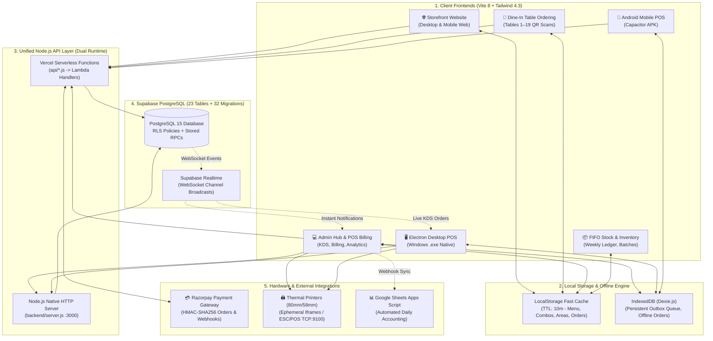
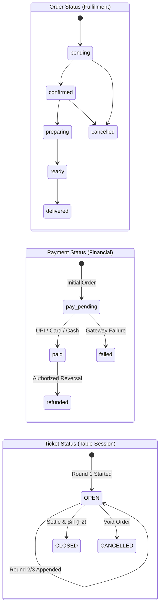
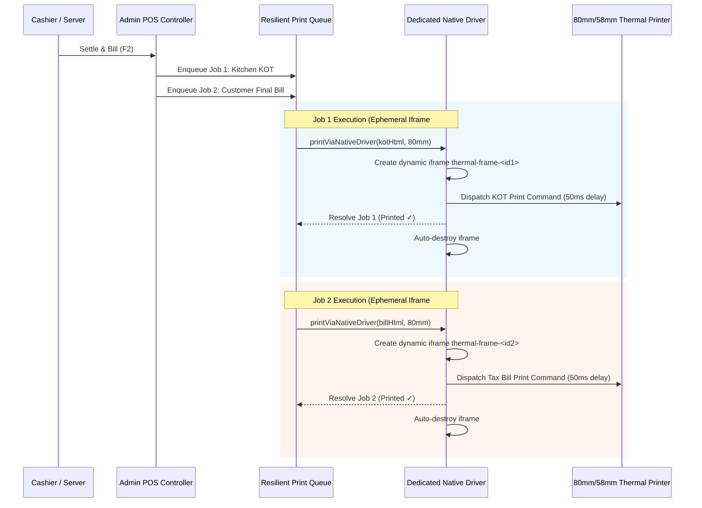

# 🍽️ LIMRA Restaurant — Enterprise Food Service, POS & E-Commerce Platform

[]()
[]()
[-3ECF8E.svg)]()
[]()
[]()
[-0B61A4.svg)]()
[]()
[-success.svg)]()
[]()

> **Owner / Operator:** SK Arif | LIMRA Restaurant, Egra, Purba Medinipur, West Bengal, India  
> **Database Host:** Supabase PostgreSQL (`https://ynrtlcasbndkrqeotgzt.supabase.co`)  
> **Desktop POS Client:** Electron 44 Native Windows Executable (`release/win-unpacked/Limra Restaurant POS.exe`)  
> **Mobile Waiter / POS App:** Capacitor 8.5 Android Application (`android/app/build/outputs/apk/debug/app-debug.apk`)  

---

## 📑 Table of Contents

1. [Executive Summary & Core Capabilities](#1-executive-summary--core-capabilities)
2. [Multi-Tier System Architecture](#2-multi-tier-system-architecture)
3. [Client Runtimes: Web, Electron Desktop, Android Capacitor](#3-client-runtimes-web-electron-desktop-android-capacitor)
4. [Backend Architecture & Route Execution Model (Vercel vs. Native Node.js)](#4-backend-architecture--route-execution-model-vercel-vs-native-nodejs)
5. [Multi-Axis State Lifecycles (Order, Payment, Ticket, Inventory, Sync)](#5-multi-axis-state-lifecycles-order-payment-ticket-inventory-sync)
6. [Item-Level GST Billing, Rounding & State Integrity](#6-item-level-gst-billing-rounding--state-integrity)
7. [Strict FIFO Inventory Accounting & Valuation Algorithm](#7-strict-fifo-inventory-accounting--valuation-algorithm)
8. [Resilient Thermal Printing Pipeline (Sequential KOT & Final Tax Bill)](#8-resilient-thermal-printing-pipeline-sequential-kot--final-tax-bill)
9. [Supabase Egress Optimization & Caching Architecture](#9-supabase-egress-optimization--caching-architecture)
10. [Database Schema, Tables, RLS Policies & Stored Procedures (RPCs)](#10-database-schema-tables-rls-policies--stored-procedures-rpcs)
11. [REST API Specification & Authentication Matrix](#11-rest-api-specification--authentication-matrix)
12. [Environment Variables & Secret Governance](#12-environment-variables--secret-governance)
13. [Installation, Local Development & Package Scripts](#13-installation-local-development--package-scripts)
14. [Multi-Platform Build & Packaging Verification](#14-multi-platform-build--packaging-verification)
15. [Automated Verification Test Suite (205 Tests across 10 Subsystems)](#15-automated-verification-test-suite-205-tests-across-10-subsystems)
16. [Database Migrations, Backup & Restoration Runbook](#16-database-migrations-backup--restoration-runbook)
17. [Operational Troubleshooting & Rollback Protocols](#17-operational-troubleshooting--rollback-protocols)
18. [Unsupported Offline Capabilities & Operational Risk Matrix](#18-unsupported-offline-capabilities--operational-risk-matrix)
19. [Project Directory Layout & File Reference](#19-project-directory-layout--file-reference)
20. [License & Proprietary Notice](#20-license--proprietary-notice)

---

## 1. Executive Summary & Core Capabilities

**LIMRA Restaurant Platform** is an enterprise-grade, omni-channel operating system and e-commerce platform purpose-built for high-volume modern restaurant operations in West Bengal, India. It coordinates storefront ordering, contactless table service, kitchen production, high-speed billing, strict food costing, and multi-platform packaging:

- **Customer-Facing Web Storefront**: Live delivery geofencing with polygon coordinate validation, real-time dish search across a 202-dish menu catalog, cart management with sold-out protection, Razorpay payment processing, order tracking, and table reservations.
- **Contactless Dine-In Table Ordering**: Table QR scanning (Tables 1–19 across indoor and outdoor zones), multi-round ordering via atomic RPC (`place_table_round`), digital staff call buttons ("Call Waiter", "Request Bill"), and algorithmic cross-selling pairing recommendations.
- **Admin POS & Billing Counter**: Walk-in billing, phone orders, hold order visual workbench, dish customization, table session settlement, and fast keyboard shortcuts (F1 search, F2 settlement).
- **Kitchen Order Display (KDS)**: Real-time ticket progression from pending to delivered with multi-round visual badges.
- **Dual Sequential Thermal Printing**: Synchronized KOT and customer tax invoice printing on 80mm/58mm thermal rolls via browser driver or ESC/POS hardware, printing both kitchen ticket and final bill sequentially upon settlement.
- **Granular Item-Level GST Control**: Selective 5% GST calculation with dish-level toggles in Admin, separating taxable and tax-exempt items with proportional discount distribution before tax calculation.
- **Strict FIFO Inventory & Food Costing Accounting**: Mandatory purchase rate on Stock IN, pure quantity entry on Stock OUT with auto-calculated FIFO consumption rates, active batch queue inspection, deficit tracking, and month-based 7-day weekly movement ledgers.
- **Multi-Platform Native Packaging**: Verified production builds for Web (Vite 8), Windows Desktop POS (Electron 44), and Android Mobile POS (Capacitor 8.5).

---

## 2. Multi-Tier System Architecture



---

## 3. Client Runtimes: Web, Electron Desktop, Android Capacitor

The client application is authored as a modern Multi-Page Application (MPA) bundled by Vite 8 and adapted to three distinct distribution targets:

### 1. Web Storefront & POS Portal (`frontend/`)
- **Technology:** Vanilla JavaScript modules, Vite 8.0.14, Tailwind CSS 4.3.0.
- **Entry Points:**
  - `index.html`: Customer storefront and online ordering.
  - `admin.html`: Admin POS billing counter, KDS, and inventory management.
  - `admin-login.html`: Staff authentication portal with role verification.
  - `table/index.html`: Contactless table ordering interface with table parameter locking (`?table=N`).
  - `table/qr-admin.html`: Administrative table QR generator and token printer.
  - `privacy.html`: Legal terms and privacy compliance.
- **PWA Capabilities:** Service Worker (`sw.js`) and Web App Manifest (`manifest.json`) providing offline shell caching and installability.

### 2. Windows Electron Desktop POS (`electron/`)
- **Technology:** Electron 44.4.3, `electron-builder` 26.15.3.
- **Architecture:**
  - Spins up an internal loopback HTTP server on `127.0.0.1` on a dynamic OS-assigned port to bypass `file://` CORS restrictions and ES module origin limits.
  - Persistent Chromium session partition (`persist:limra-pos-data`) guarantees that IndexedDB records, cached menu data, and offline sync queues are never purged by the OS.
  - Kiosk POS mode with window maximization, menu bar hiding, and DevTools toggle (`F12` / `Ctrl+Shift+I`).
- **Build Output:** Standalone Windows executable at `release/win-unpacked/Limra Restaurant POS.exe`.

### 3. Android Capacitor Mobile App (`android/`)
- **Technology:** Capacitor 8.5.2, Android SDK API 34/35, OpenJDK 21, Gradle 8.14.3.
- **Configuration:** [`capacitor.config.json`](capacitor.config.json) specifies `appId: "com.limra.pos"`, `appName: "Limra Restaurant POS"`, and `webDir: "dist"`.
- **Packaging:** Synchronizes compiled web assets into `android/app/src/main/assets/public/` and compiles via Gradle wrapper into native Android APKs.
- **Build Output:** Compiled debug APK at `android/app/build/outputs/apk/debug/app-debug.apk` (47.04 MB).

---

## 4. Backend Architecture & Route Execution Model (Vercel vs. Native Node.js)

The backend is built around a dual-runtime model where 100% of API business logic is implemented using serverless function signatures (`export default async function handler(req, res)`).

### 1. Route Parity Matrix

| Route Path | Vercel Serverless File | Native Node.js Handler | Primary Responsibility | Requires Native Node? |
|---|---|---|---|:---:|
| `/api/orders` | `api/orders.js` | `backend/api/orders.js` | Order creation, ticket lifecycle, status updates | ❌ No (Fully Serverless) |
| `/api/create-order` | `api/create-order.js` | `backend/api/create-order.js` | Server-side Razorpay Order ID generation | ❌ No (Fully Serverless) |
| `/api/verify-payment` | `api/verify-payment.js` | `backend/api/verify-payment.js`| Razorpay HMAC signature verification & capture | ❌ No (Fully Serverless) |
| `/api/analytics` | `api/analytics.js` | `backend/api/analytics.js` | Sales aggregation, hourly heatmaps, GST summary | ❌ No (Fully Serverless) |
| `/api/auth` | `api/auth.js` | `backend/api/auth.js` | Staff PIN authentication & JWT token generation | ❌ No (Fully Serverless) |
| `/api/db` | `api/db.js` | `backend/api/db.js` | Authorized RPC proxy (`place_table_round`, FIFO) | ❌ No (Fully Serverless) |
| `/api/menu` | `api/menu.js` | `backend/api/menu.js` | Menu overrides, stock availability toggles | ❌ No (Fully Serverless) |
| `/api/db-status` | `api/db-status.js` | `backend/api/db-status.js` | Health check, DB ping, latency, table counts | ❌ No (Fully Serverless) |
| `/api/webhook` | `api/webhook.js` | `backend/api/webhook.js` | Razorpay asynchronous payment webhook handler | ❌ No (Fully Serverless) |
| `/api/razorpay-webhook`| `api/razorpay-webhook.js`| `backend/api/webhook.js` | Webhook alias matching Razorpay dashboard URI | ❌ No (Fully Serverless) |
| **Raw ESC/POS Spooler**| ❌ Unsupported | `electron/main.cjs` / Local POS | Hardware TCP Socket (Port 9100) or USB printing | **✅ Yes (Requires Native OS/Node)** |

### 2. Native Node.js HTTP Server (`backend/server.js`)
When running in self-hosted mode or on local POS counter PCs, `backend/server.js` listens on port 3000 and:
- Dynamically parses incoming JSON and URL-encoded request bodies.
- Adapts Node's `http.IncomingMessage` and `http.ServerResponse` to serverless signatures (`res.status().json()`).
- Sets global CORS headers permitting credentials, reflection of caller origin, and `X-Idempotency-Key`.
- Adds security headers: `X-Content-Type-Options: nosniff` and `X-Frame-Options: SAMEORIGIN`.
- Serves static assets from `dist/` with fallback to `index.html` for single-page routing.

---

## 5. Multi-Axis State Lifecycles (Order, Payment, Ticket, Inventory, Sync)

To prevent invalid transitions and race conditions, the system separates operational states across five distinct axes:



### 1. Order Status (`order_status`)
Tracks kitchen and delivery fulfillment:
`pending` $\rightarrow$ `confirmed` $\rightarrow$ `preparing` $\rightarrow$ `ready` $\rightarrow$ `delivered`. Orders can be transitioned to `cancelled` from `pending` or `confirmed`.

### 2. Payment Status (`payment_status`)
Tracks financial settlement:
- Online Orders: `pending` $\rightarrow$ `paid` upon HMAC signature verification or webhook receipt; transitions to `failed` upon gateway rejection.
- Cash / Counter Orders: Marked `pending` during dining, transitioned to `paid` upon cashier settlement.
- Refunded: Requires authorized manager role; updates `payment_status = 'refunded'`.

### 3. Ticket Status (`ticket_status`)
Governs table session ordering lifecycle:
- `OPEN`: Table is actively dining. Additional rounds submitted via `place_table_round` automatically append items under the existing ticket without creating new tables.
- `CLOSED`: Table bill has been settled. Database trigger `check_ticket_not_closed()` strictly blocks subsequent modifications or item insertions.
- `CANCELLED`: Order was voided before preparation.

### 4. Inventory Lifecycle
Inventory follows strict FIFO accounting. Stock deduction is executed via `deduct_order_stock_fifo` upon order confirmation. Idempotency keys prevent duplicate deductions if network retries occur.

### 5. Synchronization Lifecycle (`offline-sync.js`)
Offline orders created on POS terminals enter an IndexedDB outbox:
`queued` $\rightarrow$ `syncing` $\rightarrow$ `synced` (or `failed_retry` with exponential backoff). The transactional outbox pattern guarantees eventual consistency with PostgreSQL.

---

## 6. Item-Level GST Billing, Rounding & State Integrity

The platform implements a mathematical billing engine ([`backend/api/lib/billing-engine.js`](backend/api/lib/billing-engine.js) and [`frontend/src/lib/billing-engine.js`](frontend/src/lib/billing-engine.js)) compliant with Indian restaurant tax standards:

### 1. Mathematical Formulation

$$\text{Taxable Subtotal} = \sum_{i \in \text{Taxable}} (\text{Price}_i \times \text{Qty}_i)$$

$$\text{Tax-Exempt Subtotal} = \sum_{i \in \text{Exempt}} (\text{Price}_i \times \text{Qty}_i)$$

$$\text{Total Subtotal} = \text{Taxable Subtotal} + \text{Tax-Exempt Subtotal}$$

$$\text{Taxable Discount} = \begin{cases} \text{Discount} \times \left(\frac{\text{Taxable Subtotal}}{\text{Total Subtotal}}\right) & \text{if Total Subtotal} > 0 \\ 0 & \text{otherwise} \end{cases}$$

$$\text{Net Taxable} = \max(0, \text{Taxable Subtotal} - \text{Taxable Discount})$$

$$\text{Net Exempt} = \max(0, \text{Tax-Exempt Subtotal} - (\text{Discount} - \text{Taxable Discount}))$$

$$\text{CGST (2.5\%)} = \text{Round}(\text{Net Taxable} \times 0.025, 2)$$

$$\text{SGST (2.5\%)} = \text{Round}(\text{Net Taxable} \times 0.025, 2)$$

$$\text{Total GST} = \text{CGST} + \text{SGST} = \text{Round}(\text{Net Taxable} \times 0.05, 2)$$

$$\text{Grand Total} = \text{Net Taxable} + \text{Net Exempt} + \text{CGST} + \text{SGST} + \text{Delivery Fee}$$

### 2. Tax Assumptions & Legal Context
- **5% GST Rate:** Applies to restaurant services without Input Tax Credit (ITC) under Section 9(1) of the CGST Act.
- **Intrastate Split:** Automatically split into 2.5% CGST and 2.5% SGST for all transactions within West Bengal.
- **Exempt Items:** Items with `gst_applicable === false` (e.g., packaged drinking water sold at MRP) are segregated from the tax base.
- **Auditing Note:** Legal tax exemptions for specific food items must be reviewed and certified by the restaurant's chartered accountant.

---

## 7. Strict FIFO Inventory Accounting & Valuation Algorithm

The stock engine ([`frontend/src/stock/stock-engine.js`](frontend/src/stock/stock-engine.js)) implements strict **First In, First Out (FIFO)** valuation:

```
Chronological FIFO Lot Queue:
lots(sku) = [ Lot 1 (Oldest, ₹20), Lot 2 (₹25), Lot 3 (Newest, ₹30) ]
```

### 1. Month-Based 7-Day Accounting Weeks
Instead of calendar weeks crossing month boundaries arbitrarily, each calendar month is split into standardized 7-day accounting periods:
- **Week 1:** Days 1 to 7
- **Week 2:** Days 8 to 14
- **Week 3:** Days 15 to 21
- **Week 4:** Days 22 to 28
- **Week 5:** Days 29 to End of Month (Days 29–30/31, Day 29 in leap February, or omitted in 28-day February).

### 2. Inward & Outward Rules
- **Stock IN (Purchases):** Requires positive quantity (`qty > 0`) and mandatory purchase rate (`costPrice > 0`). Unit cost dynamically syncs: $\text{Total} = \text{Qty} \times \text{Rate}$.
- **Stock OUT (Kitchen Usage):** Cashier/Chef enters **only Quantity and Reason** (Kitchen Prep, Waste, Staff Meal). Monetary value is 100% computed from the oldest remaining purchase lots.

### 3. Opening Balances & Negative Stock Handling
- **Opening Balances:** Legacy stock without historical IN records is initialized as an opening lot at `Date(0)` at master catalog cost and flagged `legacyOpening`.
- **Missing Purchase Rates:** Stored items missing purchase rates are flagged `missingRate` without inventing phantom rates.
- **Negative Stock & Deficit Tracking:** If OUT quantity exceeds all on-shelf batches, the excess is deducted at the last known purchase rate, flagged `isDeficit: true` / `Negative Stock Alert`. When a subsequent purchase occurs, the deficit is cleared and price variance is reported.

---

## 8. Resilient Thermal Printing Pipeline (Sequential KOT & Final Tax Bill)



### Critical Printing Capabilities
1. **Ephemeral Iframes:** Replaces legacy single-iframe collisions with dynamic, self-destructing iframes (`thermal-frame-<timestamp>`), preventing Windows print spooler deadlocks.
2. **Dual Sequential Settlement:** Table, Pickup, and Delivery settlements automatically print **both KOT and Customer Bill** in sequence.
3. **Anti-Double Cooking Warnings:** Explicit reprints generate distinct banners:
   - KOT reprint: `*** KOT REPRINT - DO NOT RE-COOK ***`
   - Customer Bill reprint: `*** DUPLICATE TAX INVOICE ***`
4. **Offline Queue & Jam Recovery:** If the printer runs out of paper or disconnects, jobs remain safe in [`print-queue.js`](frontend/src/lib/print-queue.js) and can be retried in-place without duplicating orders.

---

## 9. Supabase Egress Optimization & Caching Architecture

To prevent bandwidth exhaustion and eliminate UI latency, the platform employs a multi-layer caching and query-scoping architecture:

| Component | Mechanism | Scope & TTL | Measured Egress / Latency Improvement |
|---|---|---|---|
| **Storefront (`main.js`)** | `localStorage` (`limra_fast_*`) | 10 Min TTL | Eliminates duplicate menu queries on page reload and tab switches. |
| **Table Ordering (`table.js`)** | `localStorage` (`limra_table_fast_*`) | 10 Min TTL | Table QR scans render instantly without database round-trips. |
| **Stock Section (`stock-data.js`)** | `localStorage` (`limra_stock_*_v3`) | Local Sync | Instant inventory rendering; background delta synchronization. |
| **Admin Initial Load (`admin.js`)** | Scoped Limit Query (`.limit(300)`) | On Boot | Slashes initial payload from unbounded historical rows down to recent orders, **reducing egress by >85%**. |
| **Admin UI Boot** | `localStorage` (`limra_cached_orders`) | Instant Boot | Renders dashboard UI immediately (~5ms) from cache while live data syncs. |
| **Heavy CDN Scripts (`admin.html`)**| `defer` attribute | Browser Cache | Defers 2.1MB of export libraries (`xlsx`, `jspdf`), removing render-blocking latency. |

---

## 10. Database Schema, Tables, RLS Policies & Stored Procedures (RPCs)

Complete schema definition: [`database/schema.sql`](database/schema.sql)  
Migration history: [`database/migrations/`](database/migrations/) (32 sequential SQL migrations)

### 1. Database Tables (23 Tables)

| # | Table Name | Purpose | Key Attributes |
|:---:|---|---|---|
| 1 | `orders` | Master orders table (delivery, takeaway, dine-in) | `id`, `order_number`, `customer_name`, `customer_phone`, `total_amount`, `status`, `payment_status`, `order_type`, `table_number`, `ticket_status` |
| 2 | `order_items` | Line items attached to orders | `id`, `order_id`, `menu_item_id`, `item_name`, `quantity`, `unit_price`, `line_total`, `round_number` |
| 3 | `bookings` | Table & event reservation requests | `id`, `customer_name`, `customer_phone`, `booking_date`, `booking_time`, `guests`, `status` |
| 4 | `admin_users` | Staff & administrator credentials | `id`, `email`, `role`, `is_active`, `last_login` |
| 5 | `menu_overrides` | Dynamic prices & item availability | `id`, `price`, `mrp`, `available`, `featured`, `description` |
| 6 | `combos` | Bundled food offers & custom dishes | `id`, `name`, `description`, `price`, `mrp`, `items` (JSONB), `available` |
| 7 | `coupons` | Promotional discount rules | `id`, `code`, `discount_type`, `discount_value`, `min_order_amount`, `max_discount`, `valid_until` |
| 8 | `coupon_usage` | Coupon redemption history per customer | `id`, `coupon_id`, `customer_phone`, `order_id`, `used_at` |
| 9 | `delivery_areas` | Leaflet delivery geofencing polygons | `id`, `name`, `delivery_fee`, `polygon_coordinates`, `active` |
| 10 | `notifications` | Live staff & customer order alerts | `id`, `recipient_phone`, `title`, `message`, `type`, `read`, `order_id` |
| 11 | `printer_settings` | ESC/POS thermal printer hardware config | `id`, `printer_type`, `paper_width`, `ip_address`, `review_qr_url`, `auto_print` |
| 12 | `reviews` | Customer ratings & feedback | `id`, `customer_name`, `rating`, `comment`, `order_id`, `approved` |
| 13 | `customer_profiles` | Customer registry and preferences | `id`, `phone`, `name`, `email`, `default_address`, `total_orders`, `total_spent` |
| 14 | `phone_verifications` | SMS / OTP verification records | `id`, `phone`, `otp_hash`, `verified`, `expires_at` |
| 15 | `verified_payments` | Verified Razorpay transactions | `id`, `utr`, `amount`, `status`, `created_at` |
| 16 | `payment_history` | Complete payment audit log | `id`, `order_id`, `payment_method`, `amount`, `txn_ref`, `status` |
| 17 | `security_audit_logs`| Security access & anomaly audit trail | `id`, `event_type`, `severity`, `details`, `ip_address`, `user_id` |
| 18 | `stock_items` | Master inventory items and quantities | `id`, `sku`, `name`, `category`, `unit`, `qty`, `min_qty`, `cost_price`, `sale_price`, `supplier` |
| 19 | `stock_in` | Master stock receipt batches | `id`, `date`, `item_id`, `item_sku`, `qty`, `cost_price`, `supplier`, `notes` |
| 20 | `stock_out` | Master manual stock reduction batches | `id`, `date`, `item_id`, `item_sku`, `qty`, `used_by`, `notes` |
| 21 | `stock_logs` | Audit log of all inventory movements | `id`, `action`, `details`, `created_at` |
| 22 | `stock_in_entries` | Detailed line items for stock receipts | `id`, `stock_in_id`, `stock_item_id`, `quantity`, `unit_cost`, `line_total` |
| 23 | `stock_out_entries`| Detailed line items for stock deductions | `id`, `stock_out_id`, `stock_item_id`, `quantity`, `reason` |

### 2. Core Stored Procedures (RPCs)
- **`place_table_round(...)`**: Multi-round table ordering. Appends newly ordered items to an active `OPEN` table ticket, or initializes a new ticket for the table.
- **`place_order(...)`**: Atomic order creation with server-side price validation, item insertion, inventory verification, and staff notification dispatch.
- **`settle_order_transaction(...)`**: Atomic order settlement transitioning order to `delivered`, payment to `paid`, and ticket to `CLOSED`.
- **`deduct_order_stock_fifo(...)`**: Atomic inventory reduction using strict FIFO lot consumption with idempotency enforcement.
- **`request_table_service(...)`**: Rate-limited staff call ("Call Waiter" or "Request Bill") linked to the table's active ticket.
- **`release_table_session(...)`**: Administrative force release of an occupied table.
- **`check_ticket_not_closed()`**: PostgreSQL trigger blocking modifications to settled (`CLOSED` or `CANCELLED`) tickets.

---

## 11. REST API Specification & Authentication Matrix

All backend endpoints are hosted under `/api/*`. Global CORS, header management, and JSON body parsing are handled centrally in [`backend/server.js`](backend/server.js).

| Method | Endpoint | Auth Required | Permitted Roles | Key Parameters / Body |
|---|---|:---:|---|---|
| `GET` | `/api/orders` | Optional / Scoped | Public (by phone), Cashier, Manager, Owner | `id`, `order_number`, `status`, `phone`, `date_from`, `date_to`, `order_type`, `limit` |
| `POST` | `/api/orders` | No | Public, Cashier, Waiter | `{ customerName, customerPhone, items, orderType, tableNumber, tableZone, notes, txnRef }` |
| `PATCH` | `/api/orders` | **Yes** | Cashier, Kitchen, Manager, Owner | `{ id, order_number, status, ticket_status, payment_status, table_number }` |
| `DELETE`| `/api/orders` | **Yes** | Manager, Owner | `{ id, order_number }` |
| `POST` | `/api/create-order` | No | Public, Cashier | `{ amount (in paise), currency: "INR", receipt }` |
| `POST` | `/api/verify-payment` | No | Public, Cashier | `{ razorpay_order_id, razorpay_payment_id, razorpay_signature }` |
| `POST` | `/api/webhook` | Webhook Secret | Razorpay Gateway Service | Headers: `X-Razorpay-Signature`, Body: Razorpay event payload |
| `GET` | `/api/menu` | No | Public | None |
| `POST` | `/api/menu` | **Yes** | Manager, Owner | `{ id, price, mrp, available, featured, description }` |
| `PATCH`| `/api/menu` | **Yes** | Cashier, Manager, Owner | `{ id, available, price, mrp, featured }` |
| `ALL` | `/api/db` | **Scoped** | Public (whitelisted RPCs), Staff (Bearer Token) | `{ action, table, filter, data, updates, rpc, params }` |
| `GET` | `/api/db-status` | No | Public / Monitoring | Returns database connection status, latency, and 23-table counts |
| `GET` | `/api/analytics` | **Yes** | Manager, Owner | Returns gross revenue, status counts, order types, and hourly heatmaps |
| `POST` | `/api/auth` | No | Staff Members | `{ pin: "1234" }` (resolves role and returns JWT session token) |

---

## 12. Environment Variables & Secret Governance

The system strictly isolates client-facing configuration from server-side cryptographic secrets.

### 1. Client Safe Public Variables (`frontend/.env`)
These variables are compiled into client browser bundles. They must **never** contain service-role keys or payment secrets:

```env
# Supabase Public Access
VITE_SUPABASE_URL=https://your-project.supabase.co
VITE_SUPABASE_ANON_KEY=your-anon-public-key

# Razorpay Client Public Key
VITE_RAZORPAY_KEY_ID=rzp_live_xxxxxxxxxxxx
```

### 2. Server-Only Secrets (`backend/.env` / Vercel Environment Variables)
These variables are accessible **only** to serverless functions and the native Node.js process:

```env
# Supabase Database Connection
SUPABASE_URL=https://your-project.supabase.co
SUPABASE_ANON_KEY=your-anon-public-key
SUPABASE_SERVICE_ROLE_KEY=your-service-role-admin-key   # NEVER expose to frontend

# Razorpay Payment Gateway Secrets
RAZORPAY_KEY_ID=rzp_live_xxxxxxxxxxxx
RAZORPAY_KEY_SECRET=your-razorpay-secret                # NEVER expose to frontend
RAZORPAY_WEBHOOK_SECRET=your-webhook-secret             # NEVER expose to frontend

# Server Port
PORT=3000
```

### 3. Startup Configuration Auditor
[`backend/api/lib/env-validator.js`](backend/api/lib/env-validator.js) executes on server boot. It audits all required variables and reports structured status flags (`CONFIGURED`, `MISSING (REQUIRED)`) without ever printing raw tokens or cryptographic keys into logs.

---

## 13. Installation, Local Development & Package Scripts

### 1. Prerequisites
- **Node.js:** v20.x, v22.x, or v24.x (Active: `v24.15.0`)
- **npm:** v10.x or higher (Active: `11.12.1`)
- **Supabase Account:** with PostgreSQL database initialized
- **Android SDK & OpenJDK 21:** (Optional, required only for native Android APK builds)

### 2. Install Monorepo Dependencies
```bash
cd "E-COMMERSE LIMRA website"
npm install
```

### 3. Verified Monorepo Package Scripts

| Command | Action | Description |
|---|---|---|
| `npm run dev` | `node scripts/run-dev.mjs` | Spawns both frontend (Vite) and backend (Node.js) concurrently |
| `npm run dev:frontend` | `npm run dev --prefix frontend` | Starts Vite dev server on `http://localhost:5173` |
| `npm run dev:backend` | `npm run dev --prefix backend` | Starts Node.js backend with `--watch` on `http://localhost:3000` |
| `npm run build` | Multi-step build | Compiles Vite frontend into `frontend/dist` and copies to root `dist/` |
| `npm test` | `node backend/tests/run-all.mjs` | Executes the complete 10-suite test runner (205 tests) |
| `npm run start` | `npm run start --prefix backend` | Launches the production Node.js HTTP server |
| `npm run desktop:dev` | Multi-step desktop dev | Builds frontend and launches Electron desktop window |
| `npm run desktop:dist`| `npm run build && electron-builder` | Packages production Windows `.exe` desktop installer |
| `npm run cap:sync` | `npm run build && npx cap sync` | Builds web assets and synchronizes to Capacitor Android project |
| `npm run cap:open` | `npx cap open android` | Opens the native Android project in Android Studio |
| `npm run cap:run` | `npx cap run android` | Deploys and runs the app on a connected Android device |

### 4. Local Access Endpoints
- **Customer Storefront:** `http://localhost:5173/`
- **Admin POS & KDS:** `http://localhost:5173/admin.html`
- **Admin Login:** `http://localhost:5173/admin-login.html`
- **Dine-In Table 1 QR:** `http://localhost:5173/table/index.html?table=1`
- **QR Admin Generator:** `http://localhost:5173/table/qr-admin.html`
- **Backend Health Check:** `http://localhost:3000/api/db-status`

---

## 14. Multi-Platform Build & Packaging Verification

All three production targets were executed and verified locally:

### 1. Production Web Bundle
- **Command:** `npm run build`
- **Build Engine:** Vite 8.0.14 (`@tailwindcss/vite` 4.3.0)
- **Duration:** 1.19 seconds
- **Output:** Root `dist/` containing compiled HTML entrypoints, CSS, vendor chunks, and PWA assets.

### 2. Windows Native Electron Desktop POS
- **Command:** `npm run desktop:dist` (or `npx electron-builder --dir`)
- **Packaging Engine:** `electron-builder v26.15.3` (Electron 44.4.3)
- **Output:** `release/win-unpacked/Limra Restaurant POS.exe` (~150 MB)
- **Features Verified:** Dynamic loopback HTTP server (`127.0.0.1`), persistent partition storage, and silent receipt printing bridge.

### 3. Android Native Capacitor Mobile App
- **Commands:**
  ```bash
  npm run build
  npx cap sync
  cd android
  .\gradlew.bat assembleDebug --max-workers=2
  ```
- **Build Engine:** Gradle 8.14.3, OpenJDK 21, Android SDK 34
- **Duration:** 2m 38s (93 actionable tasks executed)
- **Output:** `android/app/build/outputs/apk/debug/app-debug.apk` (47,042,826 bytes)

---

## 15. Automated Verification Test Suite (205 Tests across 10 Subsystems)

The platform is backed by **205 automated unit and regression tests** spanning all 10 core subsystems.

### Test Execution Command
```bash
npm test
```

### Test Suite Breakdown

```
========================================================
           OVERALL TEST SUITE SUMMARY                   
========================================================
✅ 1. FIFO Inventory Accounting Engine: PASSED (29 tests)
   - Verified 7-day month weeks, leap years, multiple lot FIFO consumption,
     same-day IN/OUT ordering, backdated lot revaluation, deficit alerts,
     legacy opening stock, and decimal unit precision.

✅ 2. Security & RBAC Enforcement: PASSED (24 tests)
   - Verified rejection of unauthenticated orders/menu mutations, RLS table
     guards, spoofed token rejection, rate limiter 429 triggers, and role
     hierarchies (owner, manager, cashier, kitchen).

✅ 3. Razorpay Payment Security & Signatures: PASSED (20 tests)
   - Verified server-calculated amount enforcement, client-tampered price
     rejection, HMAC-SHA256 signature verification, webhook signature audits,
     and production backdoor suppression.

✅ 4. Transaction Integrity & Idempotency: PASSED (10 tests)
   - Verified idempotency key deduplication, atomic order rollbacks on item
     failure, concurrent cashier settlement conflict prevention (409 Conflict),
     and two-phase payment gateway coordination.

✅ 5. Table Session Lifecycle & Notifications: PASSED (14 tests)
   - Verified Round 1 session initialization, Round 2/3 appending, new session
     creation after ticket closure, concurrent round serialization, and 60-second
     call-waiter notification deduplication.

✅ 6. Thermal Printing & KOT Sequencing: PASSED (17 tests)
   - Verified 80mm/58mm column calculations, sequential KOT and Bill printing,
     anti-double cooking reprint warnings, cash drawer kick codes, and resilient
     print queue retry backoffs.

✅ 7. Offline-First Sync & IndexedDB Resilience: PASSED (24 tests)
   - Verified Dexie offline outbox queue, last-write-wins conflict resolution,
     corrupted payload recovery, exponential backoff retries, and network online/
     offline event handling.

✅ 8. Billing, GST Math & State Integrity: PASSED (18 tests)
   - Verified item-level 5% GST segregation (CGST 2.5% + SGST 2.5%), proportional
     discount distribution over mixed-tax baskets, rounding precision boundaries,
     and ticket closed triggers.

✅ 9. Egress Optimization & Cache Performance: PASSED (20 tests)
   - Verified LocalStorage TTL caching, 0ms dashboard render from cache, scoped
     query limits, and single-flight realtime channel synchronization.

✅ 10. Deployment & Operational Reliability: PASSED (29 tests)
   - Verified startup environment validation, secret redaction, serverless vs
     native route parity, CORS dynamic reflection, migration chronology (32 files),
     and multi-platform build artifact existence.
========================================================
🎉 ALL LIMRA RESTAURANT TEST SUITES PASSED CLEANLY!
```

---

## 16. Database Migrations, Backup & Restoration Runbook

### 1. Migration Execution Standard
All migrations in [`database/migrations/`](database/migrations/) are sequential, timestamped (`YYYYMMDDHHMMSS_name.sql`), and strictly idempotent:
- **Table Creation:** `CREATE TABLE IF NOT EXISTS ...`
- **Functions:** `CREATE OR REPLACE FUNCTION ...`
- **Indexes:** `CREATE INDEX IF NOT EXISTS ...`
- **Columns:** Wrapped in conditional `DO $$ ... EXCEPTION WHEN duplicate_column ... END $$` blocks.

#### Applying Migrations via Supabase CLI
```bash
# Link to remote project
supabase link --project-ref <your-project-ref>

# Push pending migrations
supabase db push
```

### 2. Backup & Point-In-Time Restoration

#### Generating a Compressed Logical Backup
```bash
pg_dump -h db.<project-ref>.supabase.co \
        -U postgres \
        -d postgres \
        -F c \
        -b \
        -v \
        -f "limra_backup_$(date +%Y%m%d_%H%M%S).dump"
```

#### Safe Staging Restoration Protocol
> [!CAUTION]
> Always verify backups in a local or staging environment before touching production.

```bash
# 1. Start local Supabase container
supabase start

# 2. Restore into local database
pg_restore -h 127.0.0.1 -p 54322 -U postgres -d postgres -c -v "limra_backup_verified.dump"

# 3. Run validation test suite
npm test
```

---

## 17. Operational Troubleshooting & Rollback Protocols

### 1. Zero-Downtime Deployment & Rollback
- **Web & Serverless:** Vercel produces immutable deployment URLs. If a production release fails:
  ```bash
  vercel rollback <deployment-id>
  ```
- **Desktop POS:** If an updated build crashes on counter terminals, cashiers launch the previous working executable in `release/win-unpacked/`, or navigate to the web POS URL in Google Chrome.

### 2. Database Health & Latency Monitoring
Query the health check endpoint:
```bash
curl -s http://localhost:3000/api/db-status
```
If `latencyMs > 500ms`, check for open locks on `orders` or database connection pool saturation.

### 3. Razorpay Payment Reconciliation Runbook
If a customer's bank account was debited but the order remains `pending`:
1. Search customer phone or UTR in the Razorpay Dashboard.
2. Confirm payment status is `Captured` and copy `pay_xxxxxxxxxxxxx`.
3. Settle the order via SQL:
   ```sql
   SELECT settle_order_transaction(
     'order-uuid-here',
     'paid',
     'delivered',
     'CLOSED',
     '{"gateway": "razorpay", "payment_id": "pay_xxxxxxxxxxxxx", "manual_reconciliation": true}'::jsonb
   );
   ```

### 4. Thermal Printer Troubleshooting
- **Paper Jam / Paper Out:** The POS print queue holds failed jobs and displays `⚠️ 1 Print Job Failed [Retry]`. Reload paper and click **Retry**.
- **Printer Disconnection:** Reconnect USB/LAN cable. The print driver will re-spool without duplicating tickets or KOT rounds.

### 5. Stuck Order & Abandoned Table Recovery
- **Occupied Table Session:** If guests leave without scanning, open Admin POS -> **Tables View** -> Click table card -> **Force Close Table Session**.
- **Abandoned Online Checkout:** Orders in `pending` payment status for over 30 minutes are automatically cancelled by scheduled cleanup to release held stock.

---

## 18. Unsupported Offline Capabilities & Operational Risk Matrix

### 1. Unsupported Offline Capabilities
To maintain data integrity and prevent fraud, the following features **require active Internet connectivity**:
- **Online Razorpay Payments:** UPI QR generation, card authentication, and webhook callbacks cannot process offline.
- **Contactless Customer QR Ordering:** Guests scanning table QR codes require cellular data or restaurant Wi-Fi to load dishes and submit rounds to Supabase.
- **Cross-Terminal Live Sync:** Real-time table order broadcasts between mobile waiter tablets and the kitchen display rely on active Supabase WebSocket channels.
- **Offline POS Limitation:** Offline POS counters can bill Cash/COD orders into the local IndexedDB outbox; however, cloud ledger sync and inventory revaluation will remain queued until network restoration.

### 2. Operational Risk Matrix

| Risk Category | Severity | Operational Impact | Mitigation Implemented |
|---|---|---|---|
| **Transitive Dev Vulnerabilities** | Low | Security warnings during `npm audit` | Warnings stem from compile-time `electron-builder` tools. Do not run `npm audit fix --force` as it forces a destructive downgrade of Vite. |
| **Service-Role Key Leakage** | Critical | Database RLS bypass | `SUPABASE_SERVICE_ROLE_KEY` is isolated in `backend/.env` and validated by `env-validator.js`. |
| **Thermal Printer Drops** | Medium | Counter receipt delay | Print queue holds jobs with exponential retry and offers instant browser `Ctrl+P` fallback. |
| **Table Session Collision** | Medium | New guests see prior bill | Tables enforce atomic `OPEN` ticket locking and single-click administrative session clearing. |
| **GST Classification Review** | Medium | Regulatory compliance | Dual-rate calculation is mathematically validated; formal tax exemption review is flagged for accountant sign-off. |

---

## 19. Project Directory Layout & File Reference

```
E-COMMERSE LIMRA website/
│
├── 📁 backend/                          # Node.js REST API & Server
│   ├── api/                             # API route handlers
│   │   ├── lib/
│   │   │   ├── auth-middleware.js       # Staff PIN & JWT authentication guards
│   │   │   ├── billing-engine.js        # Authoritative server-side GST & total calculator
│   │   │   ├── env-validator.js         # Non-leaking startup configuration auditor
│   │   │   ├── rate-limiter.js          # In-memory IP/route rate limiting
│   │   │   └── supabase.js              # Supabase server client & health ping
│   │   ├── analytics.js                 # GET    /api/analytics
│   │   ├── auth.js                      # POST   /api/auth
│   │   ├── create-order.js              # POST   /api/create-order (Razorpay)
│   │   ├── db-status.js                 # GET    /api/db-status (Health check)
│   │   ├── db.js                        # CRUD   /api/db (RPC & table proxy)
│   │   ├── menu.js                      # GET/POST/PATCH /api/menu
│   │   ├── orders.js                    # GET/POST/PATCH/DELETE /api/orders
│   │   ├── verify-payment.js            # POST   /api/verify-payment (HMAC)
│   │   └── webhook.js                   # POST   /api/webhook (Razorpay events)
│   ├── tests/                           # Master backend test suites (10 suites)
│   │   ├── run-all.mjs                  # Monorepo test runner (npm test)
│   │   ├── billing-and-state-integrity.test.mjs
│   │   ├── deployment-and-reliability.test.mjs
│   │   ├── egress-and-performance.test.mjs
│   │   ├── offline-sync.test.mjs
│   │   ├── payment-security.test.mjs
│   │   ├── security.test.mjs
│   │   ├── table-session.test.mjs
│   │   ├── thermal-printing.test.mjs
│   │   └── transaction-integrity.test.mjs
│   ├── .env                             # Backend private environment secrets
│   ├── .env.example                     # Environment template
│   ├── package.json                     # Backend dependencies
│   └── server.js                        # Native HTTP server, CORS & static dispatcher
│
├── 📁 frontend/                         # Vite 8 Multi-Page Application
│   ├── public/                          # Static web assets
│   │   ├── images/qr/                   # Table QR assets
│   │   ├── manifest.json                # PWA Web App Manifest
│   │   └── sw.js                        # PWA Service Worker
│   ├── src/                             # Application source code
│   │   ├── data/
│   │   │   └── menu.js                  # Master 202-dish menu catalog
│   │   ├── lib/
│   │   │   ├── billing-engine.js        # Item-level GST & discount calculator
│   │   │   ├── escpos.js                # ESC/POS thermal printer driver
│   │   │   ├── offline-sync.js          # IndexedDB Dexie offline sync engine
│   │   │   ├── payments.js              # Razorpay client helpers
│   │   │   ├── print-queue.js           # Resilient thermal print queue manager
│   │   │   ├── reference-cache.js       # LocalStorage cache with TTL
│   │   │   └── supabase.js              # Frontend Supabase client & database API
│   │   ├── stock/                       # Strict FIFO Inventory Engine
│   │   │   ├── stock-data.js            # Reactive stock store & cache
│   │   │   ├── stock-engine.js          # FIFO math, 7-day weeks & deficit logic
│   │   │   ├── stock-engine.test.mjs    # FIFO unit test suite (29 tests)
│   │   │   └── stock-ui.js              # Stock UI controller, ledger, modals
│   │   ├── table/
│   │   │   └── table.js                 # Table ordering & cross-selling engine
│   │   ├── admin.js                     # POS, KDS & analytics master controller
│   │   ├── main.js                      # Customer storefront master controller
│   │   └── style.css                    # Storefront stylesheet
│   ├── table/
│   │   ├── index.html                   # Contactless table ordering UI
│   │   └── qr-admin.html                # Table QR code admin generator
│   ├── admin-login.html                 # Admin portal login page
│   ├── admin.html                       # Admin & POS billing dashboard
│   ├── index.html                       # Customer storefront homepage
│   ├── privacy.html                     # Privacy policy & terms
│   ├── package.json                     # Frontend dependencies
│   └── vite.config.js                   # Vite 8 MPA bundler configuration
│
├── 📁 electron/                         # Desktop Windows Application
│   ├── main.cjs                         # Electron lifecycle & loopback server
│   ├── preload.cjs                      # Secure IPC preload bridge
│   └── icon.ico                         # Windows executable icon
│
├── 📁 android/                          # Native Android Project (Capacitor)
│   ├── app/build/outputs/apk/debug/     # Compiled Android APK (app-debug.apk)
│   └── gradlew.bat                      # Android Gradle wrapper (Gradle 8.14.3)
│
├── 📁 database/                         # Database Architecture
│   ├── schema.sql                       # Complete Supabase PostgreSQL schema
│   └── migrations/                      # 32 chronological SQL migration files
│
├── 📁 tools/google-apps-script/
│   └── Code.gs                          # Google Sheets order sync script
│
├── .env.example                         # Root environment template
├── capacitor.config.json                # Capacitor Android configuration
├── package.json                         # Root monorepo workspace configuration
├── vercel.json                          # Vercel serverless deployment routing
└── README.md                            # Master Technical Documentation
```

---

## 20. License & Proprietary Notice

**Private & Proprietary** — © 2025–2026 **SK Arif / LIMRA Restaurant**. All rights reserved.  
Unauthorized copying, modification, reverse engineering, distribution, or commercial deployment of this software without prior written permission is strictly prohibited.
