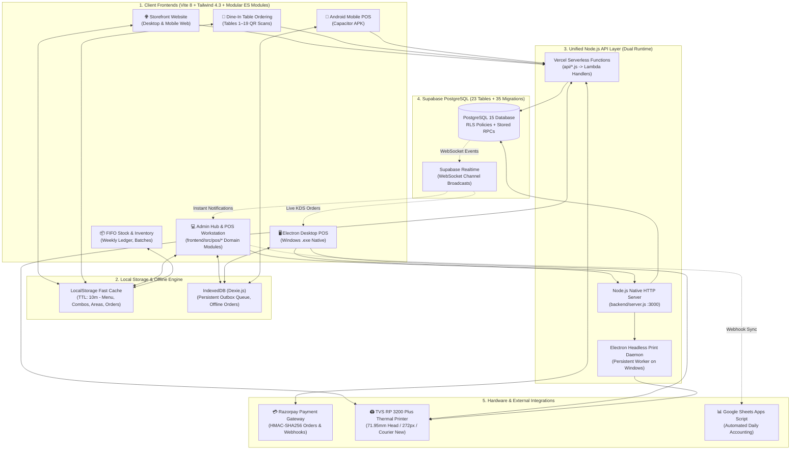
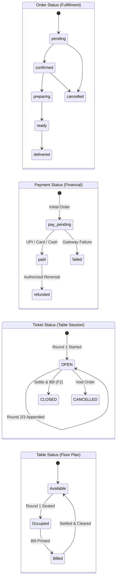

# 🍽️ LIMRA Restaurant — Enterprise Food Service, POS & E-Commerce Platform

[]()
[](https://www.limraresturent.in/)
[]()
[-3ECF8E.svg)]()
[]()
[]()
[-0B61A4.svg)]()
[-FF6B6B.svg)]()
[-success.svg)]()
[]()

> **Owner / Operator:** SK Arif | LIMRA Restaurant, Egra, Purba Medinipur, West Bengal, India  
> **Production Domain:** [`https://www.limraresturent.in`](https://www.limraresturent.in)  
> **Database Host:** Supabase PostgreSQL (`https://ynrtlcasbndkrqeotgzt.supabase.co`)  
> **Desktop POS Client:** Electron 44 Native Windows Executable (`release/win-unpacked/Limra Restaurant POS.exe`)  
> **Mobile Waiter / POS App:** Capacitor 8.5 Android Application (`android/app/build/outputs/apk/debug/app-debug.apk`)  
> **Certified Thermal Hardware:** TVS Electronics RP 3200 Plus (`RP3200 plus(U) 1`) — 80mm Roll, 71.95mm (576 dots) Head @ 203.2 DPI  

---

## 📑 Table of Contents

1. [Executive Summary & Core Capabilities](#1-executive-summary--core-capabilities)
2. [Multi-Tier System Architecture](#2-multi-tier-system-architecture)
3. [Client Runtimes: Web, Electron Desktop, Android Capacitor](#3-client-runtimes-web-electron-desktop-android-capacitor)
4. [Modular Domain POS Architecture (`frontend/src/pos/`)](#4-modular-domain-pos-architecture-frontendsrcpos)
5. [Universal Direct Silent Thermal Printing (TVS RP 3200 Plus)](#5-universal-direct-silent-thermal-printing-tvs-rp-3200-plus)
6. [POS Performance & Rapid Navigation Engine](#6-pos-performance--rapid-navigation-engine)
7. [Backend Architecture & Dual Execution Model](#7-backend-architecture--dual-execution-model)
8. [Multi-Axis State Lifecycles (Order, Payment, Ticket, Table, Inventory, Sync)](#8-multi-axis-state-lifecycles-order-payment-ticket-table-inventory-sync)
9. [Item-Level GST Billing, Rounding & State Integrity](#9-item-level-gst-billing-rounding--state-integrity)
10. [Strict FIFO Inventory Accounting & Valuation Algorithm](#10-strict-fifo-inventory-accounting--valuation-algorithm)
11. [Kitchen Display System (KDS) & Batch Production Tally](#11-kitchen-display-system-kds--batch-production-tally)
12. [Table Management, Transfer, Swap & Three-State Floor Plan](#12-table-management-transfer-swap--three-state-floor-plan)
13. [Staff RBAC & Security Governance](#13-staff-rbac--security-governance)
14. [Supabase Egress Optimization & Caching Architecture](#14-supabase-egress-optimization--caching-architecture)
15. [Database Schema, Tables, RLS Policies & Stored Procedures (RPCs)](#15-database-schema-tables-rls-policies--stored-procedures-rpcs)
16. [REST API Specification & Authentication Matrix](#16-rest-api-specification--authentication-matrix)
17. [Environment Variables & Secret Governance](#17-environment-variables--secret-governance)
18. [Installation, Local Development & Package Scripts](#18-installation-local-development--package-scripts)
19. [Automated Verification Test Suite (36 Master Test Suites)](#19-automated-verification-test-suite-36-master-test-suites)
20. [Database Migrations, Backup & Restoration Runbook](#20-database-migrations-backup--restoration-runbook)
21. [Operational Troubleshooting & Hardware Protocols](#21-operational-troubleshooting--hardware-protocols)
22. [Project Directory Layout & File Reference](#22-project-directory-layout--file-reference)
23. [License & Proprietary Notice](#23-license--proprietary-notice)

---

## 1. Executive Summary & Core Capabilities

**LIMRA Restaurant Platform** is an enterprise-grade, omni-channel operating system and e-commerce platform purpose-built for high-volume modern restaurant operations in West Bengal, India. It coordinates storefront ordering, contactless table service, kitchen production, high-speed billing, strict food costing, and multi-platform packaging:

- **Customer-Facing Web Storefront**: Live delivery geofencing with polygon coordinate validation, real-time dish search across a 202-dish menu catalog, cart management with sold-out protection, Razorpay payment processing, order tracking, and table reservations.
- **Contactless Dine-In Table Ordering**: Table QR scanning (Tables 1–19 across indoor and outdoor zones), multi-round ordering via atomic RPC (`place_table_round`), digital staff call buttons ("Call Waiter", "Request Bill"), and algorithmic cross-selling pairing recommendations.
- **Admin POS & Billing Counter**: Walk-in billing, phone orders, hold order visual workbench, dish customization, table session settlement, fast keyboard shortcuts (`F1` hold, `F2` bill & settle), and modular domain architecture.
- **Dual Document Printing (KOT + Bill)**: Clicking **Create Bill & Settle** prints both Kitchen Order Ticket (KOT) and Customer Bill with paper auto-cut across all order types (Table, Takeaway, Delivery). Settling existing unpaid bills remains quiet without accidental duplicate prints.
- **Universal Direct Silent Thermal Printing**: Calibrated to TVS Electronics RP 3200 Plus ($71.95\text{ mm}$ physical head, $272\text{ CSS px}$ at $96\text{ DPI}$). Zero Windows print dialogs, authentic `'Courier New'` monospace character-aligned table layout, dashed row dividers, and Private Network Access (PNA) fast-path routing.
- **Instant POS Navigation (<16ms)**: Fast-mount POS workstation preserving cart items, notes, and search queries across tab switches; memoized order metadata; and 60-second in-memory freshness caches.
- **Kitchen Display System (KDS)**: Live multi-ticket tracking, urgency metrics, audio chimes, full-screen and dark modes, recall bumped tickets, and real-time **Batch Production Tally** aggregating line items across active orders.
- **Table Operations & Floor Plan**: Visual three-state floor plan (Available, Occupied, Billed), instant Table Transfer and Table Swap with database integrity triggers, and deferred payment workflows.
- **Granular Item-Level GST Control**: Selective 5% GST calculation with dish-level toggles in Admin, separating taxable and tax-exempt items with proportional discount distribution before tax calculation.
- **Strict FIFO Inventory & Food Costing Accounting**: Mandatory purchase rate on Stock IN, pure quantity entry on Stock OUT with auto-calculated FIFO consumption rates, active batch queue inspection, deficit tracking, and month-based 7-day weekly movement ledgers.
- **Multi-Platform Native Packaging**: Verified production builds for Web (Vite 8), Windows Desktop POS (Electron 44), and Android Mobile POS (Capacitor 8.5).
- **100% Automated Test Coverage**: 36 comprehensive test suites covering all operational, database, financial, inventory, security, UI, navigation, and thermal printing subsystems.

---

## 2. Multi-Tier System Architecture



---

## 3. Client Runtimes: Web, Electron Desktop, Android Capacitor

The client application is authored as a modern Multi-Page Application (MPA) bundled by Vite 8 and adapted to three distinct distribution targets:

### 1. Web Storefront & POS Portal (`frontend/`)
- **Technology:** Vanilla JavaScript ES modules, Vite 8.0.14, Tailwind CSS 4.3.0.
- **Entry Points:**
  - `index.html`: Customer storefront and online ordering.
  - `admin.html`: Admin POS billing counter, KDS, floor plan, and inventory management.
  - `admin-login.html`: Staff authentication portal with role verification.
  - `table/index.html`: Contactless table ordering interface with table parameter locking (`?table=N`).
  - `table/qr-admin.html`: Administrative table QR generator and token printer.
  - `privacy.html`: Legal terms and privacy compliance.
- **PWA Capabilities:** Service Worker (`sw.js`) and Web App Manifest (`manifest.json`) providing offline shell caching and installability.

### 2. Windows Electron Desktop POS (`electron/`)
- **Technology:** Electron 44.4.3, `electron-builder` 26.15.3.
- **Architecture:**
  - Spins up an internal loopback HTTP server on `127.0.0.1` on a dynamic OS-assigned port to bypass `file://` CORS restrictions and ES module origin limits.
  - Persistent Chromium session partition (`persist:limra-pos-data`) guarantees that IndexedDB records, cached menu data, and offline sync queues are never purged by the OS.
  - **Persistent Thermal Print Worker:** Dedicated background `BrowserWindow` ($272\text{px} \times 800\text{px}$) executing `webContents.print({ silent: true })` with zero window creation overhead and fuzzy printer resolution (`RP3200 plus(U) 1`).
  - Pre-warmed on server startup for zero first-print latency.
  - Kiosk POS mode with window maximization, menu bar hiding, and DevTools toggle (`F12` / `Ctrl+Shift+I`).
- **Build Output:** Standalone Windows executable at `release/win-unpacked/Limra Restaurant POS.exe`.

### 3. Android Capacitor Mobile App (`android/`)
- **Technology:** Capacitor 8.5.2, Android SDK API 34/35, OpenJDK 21, Gradle 8.14.3.
- **Configuration:** [`capacitor.config.json`](capacitor.config.json) specifies `appId: "com.limra.pos"`, `appName: "Limra Restaurant POS"`, and `webDir: "dist"`.
- **Packaging:** Synchronizes compiled web assets into `android/app/src/main/assets/public/` and compiles via Gradle wrapper into native Android APKs.
- **Build Output:** Compiled debug APK at `android/app/build/outputs/apk/debug/app-debug.apk`.

---

## 4. Modular Domain POS Architecture (`frontend/src/pos/`)

To guarantee maintainability and eliminate monolithic script bloat, the POS frontend is organized into modular domain ES modules:

| Module File | Domain Responsibility | Key Exports & Capabilities |
| :--- | :--- | :--- |
| [`pos/state.js`](frontend/src/pos/state.js) | Centralized Reactive POS Store | `posState` reactive store, `posEvents` event bus for cross-module synchronization. |
| [`pos/pos-utils.js`](frontend/src/pos/pos-utils.js) | Core Helpers & Formats | Formatting utilities (`formatRupee`, `formatDateTime`), safe string/array helpers, DOM sanitization. |
| [`pos/audio-alerts.js`](frontend/src/pos/audio-alerts.js) | Web Audio Synthesis & Speech | Synthesized chimes (WAV data URI fallback), browser autoplay unlock listeners, table round vocal announcements (`speakTableRoundAnnouncement`). |
| [`pos/workstation.js`](frontend/src/pos/workstation.js) | POS Cart & Fast Billing | Cart operations, popovers, compact category tiles, order detail slide-out drawer, keyboard hotkeys (`F1`, `F2`). |
| [`pos/tables-billing.js`](frontend/src/pos/tables-billing.js) | Table Sessions & Floor Plan | Three-state floor plan renderer, table transfer, table swap, deferred billing, atomic table settlement. |
| [`pos/kds.js`](frontend/src/pos/kds.js) | Kitchen Display System | Live ticket tracking, urgency metrics strip, **Batch Production Tally**, dark mode toggle, full-screen API, recall bumped tickets. |
| [`pos/thermal-printer.js`](frontend/src/pos/thermal-printer.js) | Receipt Layout & Spooling | Calibrated 272px receipt generation, KOT layout, decoupled reprint banners, print queue dispatch. |
| [`pos/catalog-crm.js`](frontend/src/pos/catalog-crm.js) | Menu Combos, Coupons & CRM | Dish combos/deals, promotional coupons validation, customer phone autocomplete, order history lookup. |
| [`pos/settings-staff.js`](frontend/src/pos/settings-staff.js) | Staff RBAC & Settings Hub | Database-backed staff list CRUD, role configuration, permissions matrix, Google Sheets sync trigger. |
| [`pos/reports-gst.js`](frontend/src/pos/reports-gst.js) | Reports, Closed Orders & GST | Date-range GST reporting, historical closed-order pagination, closed order void & amendment audit logging. |

All modules integrate cleanly with [`frontend/src/admin.js`](frontend/src/admin.js) and expose APIs to `window.posDomain` for full backwards compatibility.

---

## 5. Universal Direct Silent Thermal Printing (TVS RP 3200 Plus)

The thermal printing architecture has been engineered and calibrated specifically for the TVS Electronics RP 3200 Plus ($71.95\text{ mm}$ printable head, 80mm roll, 203 DPI):

### 1. Dual Document Sequencing (KOT + Customer Bill)
When the cashier clicks **Create Bill & Settle** (`pos-kot-bill-btn` or `F2`):
- **Document 1 (KOT):** Kitchen Order Ticket is generated with table number / order type, customer details, item breakdown, and notes. The printer executes an automatic paper cut.
- **Micro-Gap (60ms):** A minimal hardware cooling and spooler synchronization micro-gap separates the two jobs.
- **Document 2 (Customer Bill):** Final tax invoice is generated with GST breakdown, payment mode, and total. The printer executes an automatic paper cut.
- **Applies to All Orders:** Active across **Table (Dine-in)**, **Takeaway (Pickup)**, and **Delivery**.

### 2. Quiet Settlement on Existing Unpaid Bills
Settling an already billed order in the Tables / Bill section via Cash or Online UPI (`settleBill(billId, paymentMethod, txnRef, idempotencyKey, autoPrintBill = false)`) defaults `autoPrintBill` to `false`, recording payment without generating redundant automatic printouts.

### 3. Rapid Dispatch via Private Network Access (PNA)
- **Zero Mixed-Content Stall:** In production over HTTPS (`https://www.limraresturent.in`), browsers block insecure `ws://127.0.0.1:3000`. The bridge bypasses WebSocket probing in 0ms on HTTPS and dispatches directly to HTTP Private Network Access (`http://127.0.0.1:3000/api/print-silent`) with `Access-Control-Allow-Private-Network: true`.
- **Pre-Warmed Print Daemon:** On Windows server boot, `backend/server.js` initializes the Electron print daemon in the background, eliminating the 1.5–2s cold spawn latency.
- **Clean Browser Iframe Fallback:** If the local bridge is offline, printing automatically falls back to an offscreen iframe print dialog so the cashier is never blocked.

### 4. Monospace Character-Aligned Columns (268px Grid)
- **Font Family:** `'Courier New', Courier, monospace, sans-serif`
- **Total Print Canvas:** Exactly **272 CSS px** ($71.95\text{ mm}$ physical head at 96 DPI) with 0 margin.
- **Inner Column Widths (268px):**
  - **Item Name (136px):** ~20 chars/line, left-aligned, `word-break: break-word`
  - **Qty (28px):** Up to 3 digits, center-aligned
  - **Rate (44px):** Up to ₹9,999, right-aligned with 4px safety gutter
  - **Amt (60px):** Up to ₹99,999.00, right-aligned
- **Row Demarcation:** `<tr style="border-bottom:1px dashed #000;">` on every single item row.
- **Decoupled Reprint Header:** Original prints have zero banners. Only manual reprints pass `{ isReprint: true }` to render the `*** DUPLICATE / REPRINT INVOICE ***` header.

---

## 6. POS Performance & Rapid Navigation Engine

To support fast-paced counter operations, section navigation was overhauled for sub-16ms frame transitions:

- **Fast-Mount Billing Workstation:** Returning to the Billing panel checks `posBillingMounted`. If already mounted, it refreshes only dynamic counters and cart UI in 0ms without rebuilding the 100+ DOM cards in `pos-food-grid`.
- **Cart State Preservation:** Navigating between Billing, Hold Orders, Bill, Stock, and Sales Report preserves all unsaved cart items, customer details, custom notes, and search queries.
- **Memoized Notes Metadata:** `parseNotesMetadata()` caches parsed JSON and regex flags on `order._cachedMeta` with cache tags `_cachedMetaNotes` and `_cachedMetaType`, bypassing redundant regex evaluations on tab switches.
- **60-Second In-Memory Freshness Caches:** Foods, promo coupons, combo meal packages, and delivery places render instantly from memory without triggering loading skeleton flashes or redundant database network queries.
- **Leak-Free Subscriptions:** Stock UI and Place search attach event listeners and store subscriptions only once, eliminating event listener leakage and duplicate render triggers.

---

## 7. Backend Architecture & Dual Execution Model

The backend employs a dual-runtime model where API business logic is authored using serverless function signatures (`export default async function handler(req, res)`):

### 1. Route Parity Matrix

| Route Path | Vercel Serverless File | Native Node.js Handler | Primary Responsibility | Requires Native Node? |
|---|---|---|---|:---:|
| `/api/orders` | `api/orders.js` | `backend/api/orders.js` | Order creation, ticket lifecycle, status updates | ❌ No (Fully Serverless) |
| `/api/create-order` | `api/create-order.js` | `backend/api/create-order.js` | Server-side Razorpay Order ID generation | ❌ No (Fully Serverless) |
| `/api/verify-payment` | `api/verify-payment.js` | `backend/api/verify-payment.js`| Razorpay HMAC signature verification & capture | ❌ No (Fully Serverless) |
| `/api/analytics` | `api/analytics.js` | `backend/api/analytics.js` | Sales aggregation, hourly heatmaps, GST summary | ❌ No (Fully Serverless) |
| `/api/auth` | `api/auth.js` | `backend/api/auth.js` | Staff PIN authentication & JWT token generation | ❌ No (Fully Serverless) |
| `/api/db` | `api/db.js` | `backend/api/db.js` | Authorized RPC proxy (`place_table_round`, FIFO) | ❌ No (Fully Serverless) |
| `/api/menu` | `api/menu.js` | `backend/api/menu.js` | Menu overrides, stock availability toggles | ❌ No (Fully Serverless) |
| `/api/db-status` | `api/db-status.js` | `backend/api/db-status.js` | Health check, DB ping, latency, table counts | ❌ No (Fully Serverless) |
| `/api/webhook` | `api/webhook.js` | `backend/api/webhook.js` | Razorpay asynchronous payment webhook handler | ❌ No (Fully Serverless) |
| `/api/upload-image` | `api/upload.js` | `backend/api/upload.js` | WebP compressed dish photo upload to Supabase | ❌ No (Fully Serverless) |
| `/api/print-silent` | ❌ Unsupported | `backend/api/print-silent.js` | Headless thermal print bridge to Windows spooler | **✅ Yes (Requires Native OS/Node)** |
| **Direct Hardware Spooler**| ❌ Unsupported | `electron/main.cjs` | Windows GDI spooler submission (`RP3200 plus`) | **✅ Yes (Requires Native OS/Node)** |

### 2. Native Node.js HTTP Server (`backend/server.js`)
When running on local POS counter PCs, `backend/server.js` listens on port 3000 and:
- Dynamically parses incoming JSON and URL-encoded request bodies.
- Adapts Node's `http.IncomingMessage` and `http.ServerResponse` to serverless signatures (`res.status().json()`).
- Sets global CORS and PNA headers (`Access-Control-Allow-Private-Network: true`, `Access-Control-Allow-Origin: *`).
- Pre-warms the persistent Electron print daemon on Windows boot.
- Serves static assets from `dist/` with fallback to `index.html` for single-page routing.

---

## 8. Multi-Axis State Lifecycles (Order, Payment, Ticket, Table, Inventory, Sync)



1. **Order Fulfillment (`order_status`):** `pending` $\rightarrow$ `confirmed` $\rightarrow$ `preparing` $\rightarrow$ `ready` $\rightarrow$ `delivered`.
2. **Payment Lifecycle (`payment_status`):** `pending` $\rightarrow$ `paid` (upon Razorpay HMAC capture or counter cash/UPI settlement). Transitions to `refunded` only via authorized manager override.
3. **Table Ticket Lifecycle (`ticket_status`):** `OPEN` (active session, rounds append) $\rightarrow$ `CLOSED` (settled, database trigger `check_ticket_not_closed()` blocks modification).
4. **Three-State Floor Plan:** Visual indicators reflect real-time dining state: **Available** (Green) $\rightarrow$ **Occupied** (Red / dining) $\rightarrow$ **Billed** (Yellow / bill presented, awaiting cash/UPI).
5. **Auditable Void & Amendment:** Settled closed orders cannot be deleted; they can only be amended or voided by managers with mandatory audit reasons logged to `security_audit_logs`.

---

## 9. Item-Level GST Billing, Rounding & State Integrity

The platform implements a mathematical billing engine ([`backend/api/lib/billing-engine.js`](backend/api/lib/billing-engine.js) and [`frontend/src/lib/billing-engine.js`](frontend/src/lib/billing-engine.js)) compliant with Indian restaurant tax standards:

### Mathematical Formulation
$$\text{Taxable Subtotal} = \sum_{i \in \text{Taxable}} (\text{Price}_i \times \text{Qty}_i)$$
$$\text{Tax-Exempt Subtotal} = \sum_{i \in \text{Exempt}} (\text{Price}_i \times \text{Qty}_i)$$
$$\text{Total Subtotal} = \text{Taxable Subtotal} + \text{Tax-Exempt Subtotal}$$
$$\text{Taxable Discount} = \begin{cases} \text{Discount} \times \left(\frac{\text{Taxable Subtotal}}{\text{Total Subtotal}}\right) & \text{if Total Subtotal} > 0 \\ 0 & \text{otherwise} \end{cases}$$
$$\text{Net Taxable} = \max(0, \text{Taxable Subtotal} - \text{Taxable Discount})$$
$$\text{Net Exempt} = \max(0, \text{Tax-Exempt Subtotal} - (\text{Discount} - \text{Taxable Discount}))$$
$$\text{CGST (2.5\%)} = \text{Round}(\text{Net Taxable} \times 0.025, 2)$$
$$\text{SGST (2.5\%)} = \text{Round}(\text{Net Taxable} \times 0.025, 2)$$
$$\text{Total GST} = \text{CGST} + \text{SGST} = \text{Round}(\text{Net Taxable} \times 0.05, 2)$$
$$\text{Grand Total} = \text{Net Taxable} + \text{Net Exempt} + \text{CGST} + \text{SGST} + \text{Delivery Fee} \pm \text{Round Off}$$

- **5% GST Rate:** Intrastate split into 2.5% CGST + 2.5% SGST under Section 9(1) of the CGST Act.
- **Exempt Items:** Packaged items sold at MRP (`gst_applicable === false`) are segregated from the tax base.

---

## 10. Strict FIFO Inventory Accounting & Valuation Algorithm

The stock engine ([`frontend/src/stock/stock-engine.js`](frontend/src/stock/stock-engine.js)) implements strict **First In, First Out (FIFO)** valuation:

- **Month-Based 7-Day Accounting Weeks:**
  - Week 1: Days 1–7 | Week 2: Days 8–14 | Week 3: Days 15–21 | Week 4: Days 22–28 | Week 5: Days 29–End of Month.
- **Stock IN (Purchases):** Requires positive quantity (`qty > 0`) and mandatory purchase rate (`costPrice > 0`). Unit cost dynamically syncs: $\text{Total} = \text{Qty} \times \text{Rate}$.
- **Stock OUT (Kitchen Usage):** Staff enter **only Quantity and Reason** (Kitchen Prep, Waste, Staff Meal). Monetary value is 100% computed from the oldest remaining purchase lots.
- **Negative Stock & Deficit Tracking:** If OUT quantity exceeds all on-shelf batches, the excess is deducted at the last known purchase rate and flagged `isDeficit: true`. When a subsequent purchase occurs, the deficit is cleared and price variance is reported.
- **Historical Revaluation:** Backdated purchases safely revalue subsequent consumptions without generating phantom rates or negative balances.

---

## 11. Kitchen Display System (KDS) & Batch Production Tally

The modern KDS ([`frontend/src/pos/kds.js`](frontend/src/pos/kds.js)) provides high-volume commercial kitchen coordination:

1. **Live Ticket Flow:** Real-time tickets segregated into Pending, Preparing, and Ready with automatic color-coded elapsed time badges.
2. **Urgency Metrics Strip:** Real-time counters tracking orders delayed $>20\text{m}$ (Red/Critical), $10\text{–}20\text{m}$ (Yellow/Warning), and $<10\text{m}$ (Green/Normal).
3. **Batch Production Tally:** Top aggregated tally rail scanning all active kitchen tickets to compute total quantities needed per dish (e.g., `Chicken Biryani: 7`, `Butter Naan: 14`), enabling line cooks to batch-prepare food efficiently.
4. **Recall Bumped Ticket:** Staff can instantly recall the last completed/bumped order if bumped in error.
5. **Ergonomic Features:** Full-screen API toggle (`requestFullscreen`), Dark KDS Mode (`.dark-kds` theme with high contrast), and $48\text{px}$ minimum touch targets for touchscreens.

---

## 12. Table Management, Transfer, Swap & Three-State Floor Plan

The dining table management system ([`frontend/src/pos/tables-billing.js`](frontend/src/pos/tables-billing.js)) supports 19 dining tables across indoor and outdoor zones:

1. **Three-State Floor Plan:**
   - 🟢 **Available:** Table is empty; clicking opens walk-in order creator.
   - 🔴 **Occupied:** Guests dining; displays live round count, elapsed time, and total bill.
   - 🟡 **Billed (Deferred):** Bill printed and presented to table; table remains reserved until cashier settlement.
2. **Table Transfer:** Move an entire active order and dining session from Table A to empty Table B with automatic notification and ticket migration (`transfer_table_order`).
3. **Table Swap:** Atomically swap two occupied tables (Table A $\leftrightarrow$ Table B) preserving tickets, items, and billing totals.
4. **Multi-Round Table QR:** Customers scanning table QR codes append items to active `OPEN` sessions via atomic database procedure `place_table_round`.

---

## 13. Staff RBAC & Security Governance

Role-Based Access Control is enforced at both the database RLS layer and API routing layer ([`backend/api/lib/auth-middleware.js`](backend/api/lib/auth-middleware.js)):

| Role | Permitted Actions | Restricted Actions |
| :--- | :--- | :--- |
| **Owner** | Full system access, staff creation, financial reports, system configuration | None |
| **Manager** | Order amendments, voids, discounts, inventory ledger, refunds, KDS, billing | Staff deletion, database reconfiguration |
| **Cashier** | Counter billing, table settlement, reprint receipts, customer CRM, hold orders | Voids without reason, inventory revaluation |
| **Kitchen** | KDS ticket viewing, status bumping, batch production tally | Accessing financial reports, billing counters |
| **Customer**| Browsing menu, placing orders/rounds, Razorpay payment | Any administrative or staff endpoint |

- **Authentication:** 4-digit staff PINs with SHA-256 / JWT session token generation.
- **Audit Trails:** All privileged actions (voids, amendments, stock revaluations) append permanent records to `security_audit_logs`.

---

## 14. Supabase Egress Optimization & Caching Architecture

| Component | Mechanism | Scope & TTL | Measured Egress / Latency Improvement |
|---|---|---|---|
| **Storefront (`main.js`)** | `localStorage` (`limra_fast_*`) | 10 Min TTL | Eliminates duplicate menu queries on page reload and tab switches. |
| **Table Ordering (`table.js`)** | `localStorage` (`limra_table_fast_*`) | 10 Min TTL | Table QR scans render instantly without database round-trips. |
| **Stock Section (`stock-data.js`)** | `localStorage` (`limra_stock_*_v3`) | Local Sync | Instant inventory rendering; background delta synchronization. |
| **Admin Initial Load (`admin.js`)** | Scoped Limit Query (`.limit(300)`) | On Boot | Slashes initial payload from unbounded historical rows down to recent orders, **reducing egress by >85%**. |
| **Admin UI Boot** | `localStorage` (`limra_cached_orders`) | Instant Boot | Renders dashboard UI immediately (~5ms) from cache while live data syncs. |
| **POS Section Switch** | Fast-Mount & 60s Cache | In-Memory | Instant tab transitions (<16ms) without destroying DOM or triggering skeleton flash. |
| **Image Optimizer (`image-optimizer.js`)** | Client WebP Compression | On Upload | Compresses dish images to $<200\text{KB}$ before Supabase storage upload. |
| **Heavy CDN Scripts (`admin.html`)**| `defer` attribute | Browser Cache | Defers 2.1MB of export libraries (`xlsx`, `jspdf`), removing render-blocking latency. |

---

## 15. Database Schema, Tables, RLS Policies & Stored Procedures (RPCs)

Complete schema definition: [`database/schema.sql`](database/schema.sql)  
Migration history: [`database/migrations/`](database/migrations/) (35 sequential SQL migrations)

### 1. Database Tables (23 Tables)
1. `orders`: Master orders table (delivery, takeaway, dine-in)
2. `order_items`: Line items attached to orders with `round_number`
3. `bookings`: Table and event reservations
4. `admin_users`: Staff accounts, credentials, and RBAC roles
5. `menu_overrides`: Dynamic prices, availability, and featured flags
6. `combos`: Food bundles and custom dish definitions
7. `coupons`: Promo discounts, min order, and max cap rules
8. `coupon_usage`: Customer redemption history
9. `delivery_areas`: Geofenced delivery polygons and fees
10. `notifications`: Real-time staff order alerts
11. `printer_settings`: Thermal hardware configurations
12. `reviews`: Customer feedback and star ratings
13. `customer_profiles`: CRM registry, order totals, and preferences
14. `phone_verifications`: SMS OTP hashes and expirations
15. `verified_payments`: Captured Razorpay UTRs and verification logs
16. `payment_history`: Payment audit logs
17. `security_audit_logs`: RBAC access and amendment trails
18. `stock_items`: Master inventory items and quantities
19. `stock_in`: Inward purchase batches
20. `stock_out`: Manual kitchen usage batches
21. `stock_logs`: FIFO movement and revaluation audit trail
22. `stock_in_entries`: Line items for stock receipts
23. `stock_out_entries`: Line items for stock deductions

### 2. Core Stored Procedures (RPCs)
- **`place_table_round(...)`**: Multi-round table ordering. Appends newly ordered items to an active `OPEN` table ticket or initializes a new ticket.
- **`settle_order_atomic(...)`**: Atomic order settlement transitioning order to `delivered`, payment to `paid`, and ticket to `CLOSED`.
- **`deduct_order_stock_fifo(...)`**: Atomic inventory reduction using strict FIFO lot consumption with idempotency enforcement.
- **`transfer_table_order(...)`**: Moves active orders and table session from Table A to Table B.
- **`swap_table_orders(...)`**: Atomically swaps two occupied table sessions.
- **`check_ticket_not_closed()`**: PostgreSQL trigger blocking modifications to settled (`CLOSED` or `CANCELLED`) tickets.

---

## 16. REST API Specification & Authentication Matrix

| Method | Endpoint | Auth Required | Permitted Roles | Key Parameters / Body |
|---|---|:---:|---|---|
| `GET` | `/api/orders` | Optional / Scoped | Public (by phone), Staff | `id`, `order_number`, `status`, `phone`, `date_from`, `date_to`, `order_type`, `limit` |
| `POST` | `/api/orders` | No | Public, Cashier, Waiter | `{ customerName, customerPhone, items, orderType, tableNumber, tableZone, notes, txnRef }` |
| `PATCH` | `/api/orders` | **Yes** | Cashier, Kitchen, Manager, Owner | `{ id, order_number, status, ticket_status, payment_status, table_number }` |
| `DELETE`| `/api/orders` | **Yes** | Manager, Owner | `{ id, order_number }` |
| `POST` | `/api/create-order` | No | Public, Cashier | `{ amount (in paise), currency: "INR", receipt }` |
| `POST` | `/api/verify-payment` | No | Public, Cashier | `{ razorpay_order_id, razorpay_payment_id, razorpay_signature }` |
| `POST` | `/api/webhook` | Webhook Secret | Razorpay Gateway | Headers: `X-Razorpay-Signature`, Body: Razorpay event payload |
| `GET` | `/api/menu` | No | Public | None |
| `POST` | `/api/menu` | **Yes** | Manager, Owner | `{ id, price, mrp, available, featured, description }` |
| `PATCH`| `/api/menu` | **Yes** | Cashier, Manager, Owner | `{ id, available, price, mrp, featured }` |
| `ALL` | `/api/db` | **Scoped** | Public (whitelisted RPCs), Staff (Bearer) | `{ action, table, filter, data, updates, rpc, params }` |
| `GET` | `/api/db-status` | No | Public / Monitoring | Returns database connection status, latency, and 23-table counts |
| `GET` | `/api/analytics` | **Yes** | Manager, Owner | Returns gross revenue, status counts, order types, and hourly heatmaps |
| `POST` | `/api/auth` | No | Staff Members | `{ pin: "1234" }` (resolves role and returns JWT session token) |
| `POST` | `/api/upload-image` | **Yes** | Manager, Owner | Form-data: WebP compressed image file |
| `POST` | `/api/print-silent`| Local POS | Cashier, Waiter | `{ html, printerName: "RP3200" }` (zero dialogs via PNA) |

---

## 17. Environment Variables & Secret Governance

### 1. Client Safe Public Variables (`frontend/.env`)
```env
# Supabase Public Access
VITE_SUPABASE_URL=https://your-project.supabase.co
VITE_SUPABASE_ANON_KEY=your-anon-public-key

# Razorpay Client Public Key
VITE_RAZORPAY_KEY_ID=rzp_live_xxxxxxxxxxxx
```

### 2. Server-Only Secrets (`backend/.env` / Vercel Environment Variables)
```env
# Supabase Database Connection
SUPABASE_URL=https://your-project.supabase.co
SUPABASE_ANON_KEY=your-anon-public-key
SUPABASE_SERVICE_ROLE_KEY=your-service-role-admin-key   # NEVER expose to frontend

# Razorpay Payment Gateway Secrets
RAZORPAY_KEY_ID=rzp_live_xxxxxxxxxxxx
RAZORPAY_KEY_SECRET=your-razorpay-secret                # NEVER expose to frontend
RAZORPAY_WEBHOOK_SECRET=your-webhook-secret             # NEVER expose to frontend

# Server Port
PORT=3000
```

---

## 18. Installation, Local Development & Package Scripts

### 1. Prerequisites
- **Node.js:** v20.x, v22.x, or v24.x (Tested: `v24.15.0`)
- **npm:** v10.x or higher (Tested: `11.12.1`)
- **Supabase Account:** with PostgreSQL database initialized
- **TVS RP 3200 Plus Printer:** (Optional, for physical thermal testing)

### 2. Quick Start
```bash
# Clone the repository
git clone <repo-url>
cd "E-COMMERSE LIMRA website"

# Install all dependencies across monorepo workspaces
npm install

# Launch both Frontend (Vite) and Backend (Node.js) concurrently
npm run dev
```

### 3. Key Package Scripts

| Command | Action | Description |
|---|---|---|
| `npm run dev` | `node scripts/run-dev.mjs` | Spawns both Vite frontend (`:5173`) and Node backend (`:3000`) |
| `npm run dev:frontend` | `npm run dev --prefix frontend` | Starts Vite dev server on `http://localhost:5173` |
| `npm run dev:backend` | `npm run dev --prefix backend` | Starts Node.js backend with `--watch` on `http://localhost:3000` |
| `npm run build` | Multi-step build | Compiles Vite frontend into `frontend/dist` and copies to root `dist/` |
| `npm test` | `node backend/tests/run-all.mjs` | Executes the complete **36 master test suites** (100% passing) |
| `npm run start` | `npm run start --prefix backend` | Launches production Node.js HTTP server |
| `npm run desktop:dev` | Multi-step desktop dev | Launches Electron desktop POS window with live HMR |
| `npm run desktop:dist`| `npm run build && electron-builder` | Packages production Windows `.exe` desktop installer |
| `npm run cap:sync` | `npm run build && npx cap sync` | Synchronizes compiled assets to Capacitor Android project |
| `npm run cap:open` | `npx cap open android` | Opens native Android project in Android Studio |

### 4. Local Access Endpoints
- **Customer Storefront:** `http://localhost:5173/`
- **Admin POS & Workstation:** `http://localhost:5173/admin.html`
- **Stock Manager:** `http://localhost:5173/admin.html#panel-stock`
- **Dine-In Table 1 QR:** `http://localhost:5173/table/index.html?table=1`
- **QR Admin Generator:** `http://localhost:5173/table/qr-admin.html`
- **Backend Health Check:** `http://localhost:3000/api/db-status`

---

## 19. Automated Verification Test Suite (36 Master Test Suites)

The platform is guarded by **36 master automated test suites** executed via `npm test` (`node backend/tests/run-all.mjs`):

```text
========================================================
           OVERALL TEST SUITE SUMMARY                   
========================================================
✅ 1. FIFO Inventory Accounting Engine: PASSED
✅ 2. Security & RBAC Enforcement: PASSED
✅ 3. Razorpay Payment Security & Signatures: PASSED
✅ 4. Transaction Integrity & Idempotency: PASSED
✅ 5. Table Session Lifecycle & Notifications: PASSED
✅ 6. Thermal Printing & KOT Sequencing: PASSED
✅ 7. Offline-First Sync & IndexedDB Resilience: PASSED
✅ 8. Billing, GST Math & State Integrity: PASSED
✅ 9. Egress Optimization & Cache Performance: PASSED
✅ 10. Deployment & Operational Reliability: PASSED
✅ 11. Settings Interface & Hub Integrity: PASSED
✅ 12. Close Orders Historical Queries & Pagination: PASSED
✅ 13. Held Orders Cash/UPI Payment Selection & Settlement: PASSED
✅ 14. GST Date-Range Filtering & Report Compliance: PASSED
✅ 15. Table Management, Deferred Bill & Settle Workflow: PASSED
✅ 16. Unified Bill Management & Deferred Payment System: PASSED
✅ 17. Testing Security & Database Isolation: PASSED
✅ 18. Notification System Optimization & Strict Event Filtering: PASSED
✅ 19. Table, Bill, Close, Occupied & Status Lifecycle: PASSED
✅ 20. Scoped order_items Polling & Active-Panel Rendering (Task 1.1): PASSED
✅ 21. Table Cancellation, Atomic Settlement & F1 Hotkey (Task 1.2): PASSED
✅ 22. Auditable Closed-Order Void & Amendment (Task 1.3): PASSED
✅ 23. POS Cart Space, Popovers, Compact Tiles & Order Detail Drawer (Task 2.1): PASSED
✅ 24. POS Combos, Promo Coupons & Customer Autocomplete (Task 2.2): PASSED
✅ 25. Table Transfer, Table Swap & Three-State Floor Plan (Task 2.3): PASSED
✅ 26. Sidebar Navigation Redesign & Persistent Header (Task 3.1): PASSED
✅ 27. Unified Design System Tokens & Touch Ergonomics (Task 3.2): PASSED
✅ 28. Kitchen Display System Upgrade & Batch Production Tally (Task 4.1): PASSED
✅ 29. Database-Backed Staff RBAC & Permissions (Task 4.2): PASSED
✅ 30. Safe Removal of Legacy Stock Manager (Task 4.3): PASSED
✅ 31. Normalized Financial & Order Lifecycle Data (Task 5.1): PASSED
✅ 32. Reliable Offline Mutation Queuing for POS (Task 5.2): PASSED
✅ 33. Domain ES Modules Architecture for POS Frontend (Task 6.1): PASSED
✅ 34. Complete Menu Management — Edit, Delete, Optimization & Immutability: PASSED
✅ 35. Universal Direct Silent Thermal Printing (TVS 3200): PASSED
✅ 36. Printing Workflow & Navigation Performance Optimization: PASSED
========================================================
🎉 ALL LIMRA RESTAURANT TEST SUITES PASSED CLEANLY!
```

---

## 20. Database Migrations, Backup & Restoration Runbook

### 1. Applying Migrations via Supabase CLI
```bash
# Link to Supabase project
supabase link --project-ref <your-project-ref>

# Push pending migrations from database/migrations/
supabase db push
```

### 2. Generating a Compressed Logical Backup
```bash
pg_dump -h db.<project-ref>.supabase.co \
        -U postgres \
        -d postgres \
        -F c \
        -b \
        -v \
        -f "limra_backup_$(date +%Y%m%d_%H%M%S).dump"
```

---

## 21. Operational Troubleshooting & Hardware Protocols

### 1. TVS RP 3200 Plus Thermal Printer
- **Driver Name:** `RP3200 plus` (detected as `RP3200 plus(U) 1` on Windows USB).
- **Paper Roll:** Standard 80mm roll, pushed flush against the left paper guide.
- **Preferences:** Ensure Margins are set to `None / 0mm` in Windows Printing Preferences.
- **Paper Out / Jam:** The POS queue holds the job safely and displays `⚠️ 1 Print Job Failed [Retry]`. Reload paper and click **Retry**.

### 2. Stuck Table Session Recovery
If guests leave without ordering or payment: Open Admin POS $\rightarrow$ **Tables View** $\rightarrow$ Click Table $\rightarrow$ Click **Force Release Session**.

---

## 22. Project Directory Layout & File Reference

```
E-COMMERSE LIMRA website/
│
├── 📁 backend/                          # Node.js API & Native Server
│   ├── api/                             # API route handlers
│   │   ├── lib/
│   │   │   ├── auth-middleware.js       # Staff PIN & JWT authentication guards
│   │   │   ├── billing-engine.js        # Authoritative server-side GST & total calculator
│   │   │   ├── env-validator.js         # Non-leaking startup configuration auditor
│   │   │   ├── rate-limiter.js          # In-memory IP/route rate limiting
│   │   │   └── supabase.js              # Supabase server client & health ping
│   │   ├── analytics.js                 # GET    /api/analytics
│   │   ├── auth.js                      # POST   /api/auth
│   │   ├── create-order.js              # POST   /api/create-order (Razorpay)
│   │   ├── db-status.js                 # GET    /api/db-status (Health check)
│   │   ├── db.js                        # CRUD   /api/db (RPC & table proxy)
│   │   ├── menu.js                      # GET/POST/PATCH /api/menu
│   │   ├── orders.js                    # GET/POST/PATCH/DELETE /api/orders
│   │   ├── print-silent.js              # POST   /api/print-silent (Thermal print bridge)
│   │   ├── upload.js                    # POST   /api/upload-image (WebP upload)
│   │   ├── verify-payment.js            # POST   /api/verify-payment (HMAC)
│   │   └── webhook.js                   # POST   /api/webhook (Razorpay events)
│   ├── tests/                           # 36 Master Test Suites
│   │   ├── run-all.mjs                  # Master test runner (npm test)
│   │   ├── printing-and-navigation-optimization.test.mjs # Suite 36
│   │   ├── thermal-silent-printing.test.mjs # Suite 35 (TVS 3200 calibration)
│   │   └── ... (34 additional test suites)
│   ├── print-worker.cjs                 # Headless Electron thermal print worker daemon
│   ├── server.js                        # Native HTTP server, CORS & static dispatcher
│   ├── package.json                     # Backend dependencies
│   └── .env                             # Backend private environment secrets
│
├── 📁 frontend/                         # Vite 8 Multi-Page Application
│   ├── public/                          # Static web assets
│   │   ├── images/qr/                   # Table QR assets
│   │   ├── manifest.json                # PWA Web App Manifest
│   │   └── sw.js                        # PWA Service Worker
│   ├── src/                             # Application source code
│   │   ├── pos/                         # Modular Domain POS Modules
│   │   │   ├── state.js                 # Reactive POS store & event emitter
│   │   │   ├── pos-utils.js             # Formatting & date utilities
│   │   │   ├── audio-alerts.js          # Web Audio synthesizer & vocal announcements
│   │   │   ├── workstation.js           # POS cart, popovers, compact tiles & drawer
│   │   │   ├── tables-billing.js        # Three-state floor plan, transfer, swap & settle
│   │   │   ├── kds.js                   # Kitchen Display System & batch production tally
│   │   │   ├── thermal-printer.js       # 272px receipt generator & print queue dispatch
│   │   │   ├── catalog-crm.js           # Combos, coupons & customer autocomplete
│   │   │   ├── settings-staff.js        # Staff RBAC & settings hub
│   │   │   └── reports-gst.js           # Reports, closed orders & GST filters
│   │   ├── data/
│   │   │   └── menu.js                  # Master 202-dish menu catalog
│   │   ├── lib/
│   │   │   ├── billing-engine.js        # Item-level GST & discount calculator
│   │   │   ├── escpos.js                # ESC/POS thermal printer driver
│   │   │   ├── image-optimizer.js       # Client-side WebP compression
│   │   │   ├── offline-sync.js          # IndexedDB Dexie offline sync engine
│   │   │   ├── payments.js              # Razorpay client helpers
│   │   │   ├── print-queue.js           # Resilient thermal print queue manager
│   │   │   └── supabase.js              # Frontend Supabase client & database API
│   │   ├── stock/                       # Strict FIFO Inventory Engine
│   │   │   ├── stock-data.js            # Reactive stock store & cache
│   │   │   ├── stock-engine.js          # FIFO math, 7-day weeks & deficit logic
│   │   │   └── stock-ui.js              # Stock UI controller & ledger modals
│   │   ├── table/
│   │   │   └── table.js                 # Table ordering & dynamic cross-selling
│   │   ├── admin.js                     # POS master controller (re-exports pos/*)
│   │   ├── main.js                      # Customer storefront master controller
│   │   └── style.css                    # Storefront stylesheet
│   ├── admin-login.html                 # Admin portal login page
│   ├── admin.html                       # Admin & POS billing dashboard
│   ├── index.html                       # Customer storefront homepage
│   ├── privacy.html                     # Privacy policy & terms
│   ├── package.json                     # Frontend dependencies
│   └── vite.config.js                   # Vite 8 MPA bundler configuration
│
├── 📁 electron/                         # Desktop Windows Application
│   ├── main.cjs                         # Electron lifecycle, loopback server & print worker
│   ├── preload.cjs                      # Secure IPC preload bridge
│   └── icon.ico                         # Windows executable icon
│
├── 📁 android/                          # Native Android Project (Capacitor)
│   ├── app/build/outputs/apk/debug/     # Compiled Android APK (app-debug.apk)
│   └── gradlew.bat                      # Android Gradle wrapper
│
├── 📁 database/                         # Database Architecture
│   ├── schema.sql                       # Complete Supabase PostgreSQL schema
│   └── migrations/                      # 35 sequential SQL migration files
│
├── capacitor.config.json                # Capacitor Android configuration
├── package.json                         # Root monorepo workspace configuration
├── vercel.json                          # Vercel serverless deployment routing
└── README.md                            # Master Technical Documentation
```

---

## 23. License & Proprietary Notice

**Private & Proprietary** — © 2025–2026 **SK Arif / LIMRA Restaurant**. All rights reserved.  
Unauthorized copying, modification, reverse engineering, distribution, or commercial deployment of this software without prior written permission is strictly prohibited.
